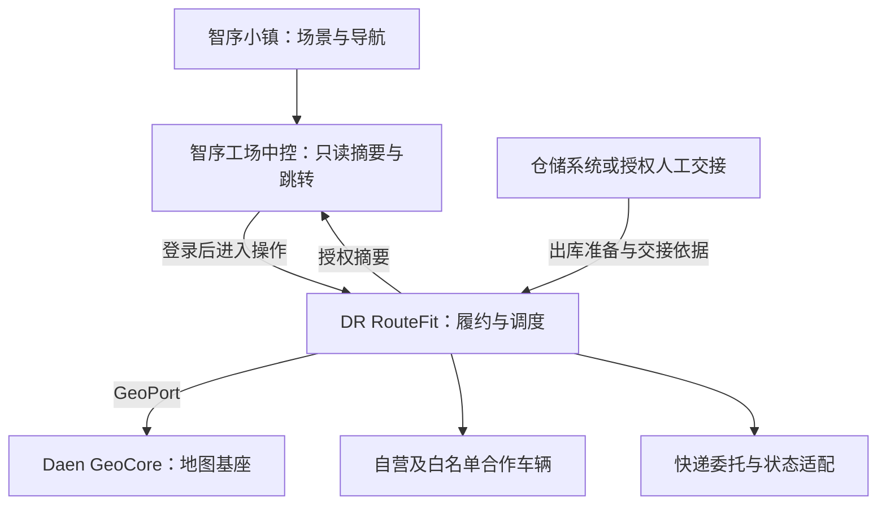

# DR RouteFit — Smart Dispatch & Delivery
## DR 智能调度与顺路配送平台
### 产品需求文档 V1.4｜多运力与智序小镇完整整合评审稿

| 项目 | 内容 |
|---|---|
| 产品名称／项目代号 | DR RouteFit／ROUTEFIT |
| 仓库 | `leishen8806/dr-routefit` |
| 克隆地址 | `git@github.com:leishen8806/dr-routefit.git` |
| 日期／版本 | 2026-10-24／V1.4 评审稿 |
| 状态 | **2026-10-27 按产品需求会 M01 冻结为当前基线，替代 V1.3，见[冻结说明](decisions/2026-10-27-v1.4-freeze.md)；正文、规则与验收编号未改。冻结不是实现、联调或上线证明。** |
| 依据 | 本地 V1.3 原文、2026-10-24 用户选择、智序工场固定 SHA 代码及 GitHub 候选项目；历史来源见附录 E，新核验见附录 G |
| 修订原则 | 一个运营主体统一协调自营、受控合作车辆和快递委托；顺路与返程分阶段；复用智序工场展示，不另建第二套平台 |
| 资料性质 | 本文的本地业务情况仍是待验证假设；外部技术事实另列来源；试运行数值不冒充实测结果 |

> **产品目标：配对车辆，规划路线，准时送达。**
> 安全与实际装载能力不可被时效或成本覆盖；及时送是最高业务优先级，但不得破坏已经接受的其他订单承诺。概率预测不等于保证不会迟到。

## 0. 版本变更与约束

本文件完整继承 V1.3 的正文、规则、案例、参数与工程附录，并整合本轮新增需求。V1.3 原文件及 V1.2 归档不改。本稿是下一版本的完整评审入口；冻结前 README 仍将 V1.3 标为当前基线。用户本轮明确确认的范围已写入本稿，未确认参数保持待定。历史沿革不构成本稿的并列规范。

本次文档整合不自动创建外部开发任务，也不改动 VirtualAiOffice 代码、三维场景或既有运行服务。AI 执行者、模型、文件归属和合并过程集中收录在附录D，与产品行为分开管理。

文中的状态含义：

- **需求确定**：本版提出的行为规范，仍须产品负责人批准后冻结。

- **试运行候选参数**：有明确数值，可用于合成样例与影子实验；批准前不得对客户承诺。

- **待现场验证**：地址质量、实际车队、司机手机、现金/COD 占比、路况覆盖与人力等，不能当作已证实事实。

### 0.1 身份、命名与整合裁决

英文全称：DR RouteFit — Smart Dispatch & Delivery；中文：DR 智能调度与顺路配送平台。Slogan：The right vehicle. The right route. On time. 项目代号 ROUTEFIT，目标仓库 leishen8806/dr-routefit。名称不构成商标或域名核验结论。

当前只推进RouteFit交付。Daen GeoCore定为地图基座，G1在dr-routefit仓库内作为独立模块按需建设；不另开对外平台主线、不要求第二个使用方、不复制既有DAEN地点身份治理或VirtualAiOffice代码。G2/G3仅为未批准未来选项，不安排仓库命名、计费、配额、开发者门户或匿名化产品建设。

整合决策：首期交付包包括 R1 人工配送核心、R1-M 受控合作运力与人工快递委托，以及独立验收的 R1-V 中控台只读展示与跳转。R2 推荐、R3-A 发车前合单、R3-B 途中插单和 R3-C 返程配货分次放行。R1-V 故障不阻塞 R1/M 正常履约；但不能据此宣称首期展示接入已完成。四周观察与足够样本约束统计能力启用，不阻塞合成实验和安全可执行的R1人工路径。司机确认采用软预留，不采用等待确认的长事务锁。

V1.3 已保留原 30 条规则与 60 项案例并增加规则 031–040、案例 61–80。本稿保留这 80 项案例，明确修订规则 001/032/038 的范围，并增加规则 041–052、案例 81–104。父目录另一版相同编号曾表示不同内容，必须携带来源版本；对应关系见附录E，禁止按裸编号直接移植。

### 0.2 写法与品牌关系

DR大写且不加点号。正式产品、界面与材料使用DR RouteFit；不使用Dr. RouteFit、Dr.RouteFit、RouterFit。Daen GeoCore为地图基座，简称GeoCore；两边前缀各自保留，不写成Daen RouteFit或DR GeoCore。历史本地目录E:/Dr.RouteFit保留原样，不因品牌修订执行目录迁移。

| 用途 | 统一写法/规则 |
|---|---|
| 调度配送业务产品 | DR RouteFit |
| 地图基座 | Daen GeoCore；简称GeoCore |
| 业务仓库 | dr-routefit |
| G1模块 | dr-routefit仓库内独立模块；具体目录名R0-B确定 |
| G2独立仓库 | 待定；不属于当前交付任务 |

地图基座面向RouteFit及未来其他平台提供地址、坐标、路网时间和车辆位置。该定位是能力归属与演进方向，不表示全部能力已实现或本期需要对外开放。这里的“路网时间”仅指道路行驶时间；整趟履约P90、装卸等待、承诺和派车由RouteFit负责（3.3、5.1）。

### 0.3 阅读目录

正文：21 是本次多运力、顺路返程和智序小镇整合的集中阅读入口，其条款已同步到相关正文与验收。1范围；2角色；3承诺与ETA；4货物与装载；5地址与GeoCore；6状态与履约；7合单插单；8司机端；9收款；10异常退回；11调度与影子模式；12规范关系；13模型与契约；14验证指标；15阶段；16容量成本；17安全与非功能；18完成标准；19待定事项；20变更记录。

附录A：52条完整规则及验收映射。附录B：104项完整验收。附录C：禁用的候选参数。附录D：工程流程及估算。附录E：来源、冲突与旧编号映射。附录F：历史来源说明和验证边界。附录G：本轮来源、GitHub核验、冲突裁决与实施建议。

## 1. 产品目标与 V1 边界

### 1.1 首期定位

**一家运营企业、一个发货仓、已核验的自营与白名单合作车辆，并可人工委托经批准的快递企业。由调度员统一录单、选履约方式和跟进交接、配送、异常与结算记录。**

社会车辆在本稿中特指审核过、接受约定服务与交接规则的合作车辆；不等于开放司机市场。快递企业接受运输委托，不被当作可由 RouteFit 任意指挥的车辆。

**首个试点业务链仍是仓库发货到客户，执行可选择自营车、受控合作车或人工快递委托。**外部自助下单、开放司机市场、快递 API 自动下单、计划接力转运、返程商业取货、合单与途中插单、自动派单在首期关闭。顺路配送与返程配货均为确定规划方向，按第 21 章阶段启用。

首期以 R1 人工闭环为核心，增加 R1-M 受控多运力与 R1-V 只读展示；后续先影子推荐，再发车前合单，途中插单与返程配货分别放行。后续能力不是首发验收依赖。首期一单选择一种履约方式，不计划拆单或同时派给两方。车辆直送一单一次取送、同一时刻仅一辆车承运；快递委托绑定一个有效承运商运单，其网络内转运不是 RouteFit 可调度的多车任务。授权故障换车和退回属于异常处置；自营送站后再快递接力暂不开放。

**试点验收标准：真实运营人员能够完成这条链，而不是所有角色都有页面。**

### 1.2 范围表

| 按阶段保留的需求（不代表同时首发） | 排除或另行评审 |
|---|---|
| 调度员代客录单、地图选点与地址确认 | 客户完整自助下单 App、开放司机市场 |
| 单运营主体的自营及白名单合作车、司机、班次、资格、装载档案；人工快递委托 | 开放招商抢单、跨企业运力交易、快递 API 自动下单和复杂计费 |
| 已验证货物模板、车型／装载模式兼容表 | 全货类通用三维装箱、装载数字孪生编辑器 |
| 人工派单、司机接拒单、取送货证据 | 未经验证的全自动 S1 或动态插单 |
| 司机 Android 路线的定位技术样机与最小执行端 | 同期建设 Android、iOS、PWA 三套司机端 |
| 运费记录；现金、COD、月结按实际业务启用对应对账路径 | 钱包、自动划转、信贷、自动退款和保险理赔 |
| R1异常与退回；R2影子推荐；R3按条件合单插单 | 全城市实时最优调度或无限规模承诺 |
| R1-V 将真实配送摘要只读接入既有中控台并跳转 RouteFit；未接入模块标未知 | 完整 WMS、设备控制、三维直接调度或把模拟仓储数据当实时 |
| 首期仓库到客户；R3-C 增加受控返程取货与独立履约单 | 首期返程取货、开放商户间撮合、特殊工程运输 |

单企业不等于无权限：每个业务对象仍保留 `companyId`，从已认证主体导出有效作用域；客户输入的公司编号不构成授权。CI 使用第二个合成公司进行跨作用域拒绝测试，但不建设多企业注册、开户、品牌管理后台。

### 1.3 服务等级的启用

S1 及时送、S2 当日送、S3 预约送是产品词表。S4 经济拼单在 R3-A 及后续小范围开放，R1/R2 可以仅用于合成测试。

不得为追求 S1 采纳率，把已接受的 S2/S3/S4 订单单方面挤出承诺窗口。

### 1.4 首批试点范围表（R0-A 填写）

下表在 R0-A 由产品与运营填写并批准（D01、D03、D06、D15）。**未填或未批准的项，对应能力保持关闭**，只能做合成实验；填写结果同步到 PILOT-0（附录 C）的 `serviceAreaRef`、启用开关和责任人字段。

| 项目 | 需要明确的内容 | 填写值 |
|---|---|---|
| 运营企业 | 名称、试点负责人 | 待填 |
| 发货仓 | 名称、地址、装卸作业时间 | 待填 |
| 车辆 | 数量、车型及实测档案引用（规划假设 3–5 辆、1–2 类车型，见 16 章） | 待填 |
| 司机 | 人数、所用手机型号与系统版本、可用班次 | 待填 |
| 货类 | 首批已验证货物模板清单、明确排除的货类 | 待填 |
| 服务区域 | 边界引用（`serviceAreaRef`）、明确不服务的区域 | 待填 |
| 营业时间 | 接单时段、配送时段、节假日安排 | 待填 |
| 预计日单量 | 平均值与峰值；用于容量与人力规划 | 待填 |
| 是否启用 S1 | 是／否；启用时的区域、时段、货类和当日容量 | 待填（默认否） |
| 收款方式 | 现金、COD、KHQR 转账、月结各自是否启用 | 待填（默认全部关闭） |
| 界面语言 | 司机端、调度台、客户通知各用哪种语言（8.1） | 待填 |
| 运营人员 | 当班与备用调度员、装载复核人、财务复核人 | 待填 |
| 合作车辆与快递 | 白名单主体、可用车/司机、服务范围、协议、交接与应付规则；快递揽收或仓库交接安排 | 待填 |
| 中控台 | 只读字段、受众、真实仓库与场景映射、认证方式、刷新与过期阈值 | 待填 |
| 批准 | 批准人、批准日期、本表版本 | 待填 |

## 2. 角色与运营责任

| 角色 | 责任 |
|---|---|
| 运营负责人 | 批准服务区域、货类、SLA、装载模板、报价和异常升级策略 |
| 当班调度员及备用人员 | 录单、地址核实、手工调度、处理无人接单／定位中断／时效风险 |
| 仓库／装载复核人 | 实测包装尺寸、验证载荷及装卸条件、交接留证 |
| 司机 | 接拒单、状态与定位、取货确认、签收或异常、收款申报 |
| 财务复核人 | 核对银行到账与现金交款、处理差额；不能以司机自报代替银行确认 |
| 客户／收货人 | 提供地址、货物信息，确认报价、时间窗、改期与收货 |

在实车试点前必须填入当班与备用联系人、可服务时段和异常响应安排。不能默认“AI 系统会处理所有异常”。记录人工处理时间；重复录入、额外确认和异常处理均计入负担。

### 2.1 试点人员培训与演练（R1 交付物）

试点验收要求真实运营人员完成整条链（1.1），因此培训与演练是 R1 的交付物，不是上线后的补充工作。

- **操作手册：**按角色编写（调度员、仓库／装载复核人、司机、财务复核人），覆盖正常链路、第 6、9、10 章的异常路径和 6.5 的人工降级操作。使用试点人员实际使用的语言（8.1），版本化管理。
- **培训：**上岗前完成，记录参训人、时间、手册版本和考核结果。手册或流程版本变化后，相关人员重新培训。
- **演练：**实车试点前，用合成订单在受控环境中按角色走完整条链及主要异常场景（拒收、收货人不在、部分收货、取货后取消、换车、地图或定位不可用、收款差额、试点暂停），记录完成情况、耗时和卡点。不使用真实客户数据。
- **上岗条件：**未完成培训和演练的人员不分配试点任务。装载复核人和财务复核人另须单独授权（4.7、9.2）。
- **反馈：**演练和试点中的操作问题作为修订手册、界面和流程的输入；培训、演练和返工耗时计入 14.2 的人工负担指标。

## 3. S1 承诺、ETA 与可行性

### 3.1 时钟定义

记录 `requestReceivedAt`（首次需求）、`dataReadyAt`（数据齐备）、`promiseAcceptedAt`（客户及平台确认承诺）、`offerSentAt`、`driverAcceptedAt`、`pickupArrivedAt`、`pickupCompletedAt`、`deliveredAt`。

S1 候选时限以 `promiseAcceptedAt` 为起点；不能在司机接受、重新派车或改路线时重置。需求至承诺的等待另外统计，防止用拖延接受隐藏服务延迟。

取件 30 分钟定义为**司机到达已确认的取件入口**，不是装货完成；装卸、等待、上楼和交接时间必须计入送达总时长。承诺之前告知客户这一口径。

### 3.2 试运行候选值（PILOT-0，不是生产承诺）

| 参数 | 初始候选值 | 限制与变更方式 |
|---|---:|---|
| S1 到取件点 | ≤30 分钟 | 仅批准服务区、运营时段与货物模板 |
| S1 交付完成 | ≤120 分钟 | 从同一承诺时刻起算，包含等待／装卸／签收 |
| 取件额外缓冲 | 5 分钟 | 在已校准的预测之上，不计为可消费收益 |
| 送达额外缓冲 | 10 分钟 | 不允许通过降低缓冲让插单变可行 |
| S1 候选接受有效期 | 60 秒 | 到期撤销建议，不撤销已接受原任务 |
| 其他候选接受有效期 | 120 秒 | 版本变化立即失效 |
| S4 最大等待 | 60 分钟 | 也受最晚可派车时间限制，取较早者 |
| 客户 ETA 变动提示 | 推迟≥10 分钟；每 15 分钟内普通提示最多一次 | 将违反承诺立即升级，不受冷却限制 |
| 定位建议采样／上传 | 行驶 15 秒／30 秒；静止 60 秒 | 技术实验值，依真机、电量与网络验证调整 |
| 定位过期 | >120 秒 | 不据此自动承诺新 S1 或插单 |
| 复杂装载核验候选数 K | 5 | 仅可选装箱实验；超时是未知，不是可行 |
| 顺路额外耗时 | ≤15 分钟且≤原剩余履约时间15% | 额外取送等待／装卸一起计算；原剩余时间≤0不适用 |

服务区边界、营业时段和启用车型不能留空。未批准的参数与区域不能进入生产承诺；可运行合成样例和不写业务的影子实验。

### 3.3 P90 判定的对象

对每个受影响的取件或交付检查点 i：

```text
ETA_P90(i) = 计算时刻 + Q90(至检查点的全部剩余履约时间 | 已知信息)
准入条件：ETA_P90(i) + buffer(i) <= committedLatestAt(i)
```

全部剩余履约时间包含接受等待、道路行驶、排队、装卸、上楼、服务和交接。已纳入预测分布的因素不能再无说明地重复加罚；额外缓冲记录其用途。

**不能把每一段道路的 P90 相加后，直接称为整趟 P90；也不能把商业服务的悲观 ETA 直接改名为 P90。**同一天堵车等影响可能同时作用于多段。各订单边际 P90 合格，也不证明整车所有订单联合准时率为90%。R0/R3 同时评估单站与整条路线结果。

缺少足够校准数据时，输出 `ETA_UNCALIBRATED` 和保守估算，不伪装成 P90，不自动承诺 S1。可由运营按受控人工策略承接，但记录人工承诺依据，不能声称算法保证。

### 3.4 预测与现实的区别

“硬约束”指**规划、确认与重新计算时**必须满足经过验证的预测门槛，不是宣称道路上不存在意外。运行后预测越界时进入风险与干预流程，保留原承诺和新预测，不篡改历史。

### 3.5 SLA 与目标排序

1. 安全、授权、装载、既有承诺全部满足，才进入候选集。
2. 待接新单优先 S1；同级按最晚安全派发时刻最早者优先，再按承诺截止时间、需求时间、稳定订单ID打破平局。
3. 对已可行候选，缓冲达到门槛即可，不把“缓冲最大化”设为无限优化目标。
4. 在合格候选中按批准的总增量成本比较，再优化空驶和利用率。
5. 无可行方案返回明确原因；不得通过降低货物安全约束、隐去等待或挤掉已承诺订单获得推荐。

### 3.6 承诺前核验与三种时间

客户期望窗口、平台已接受承诺窗口、当前预计时间分别保存。报价确认不自动形成服务承诺；调度员确认资源、有效位置/人工位置依据、装载、工作窗口、现有承诺、服务范围、收费及客户同意后才写入ServicePromise。

已接受但尚未分配车辆的承诺也参与资源可行性检查，不能以“未派单”为由忽略。无可行资源返回原因和可选时间；未校准的R1只按批准人工策略承接，记录依据，不生成算法P90保证。

变更承诺须客户确认、授权操作和新版本；原承诺不可覆盖，指标同时披露原始与变更后表现。新S1不能强制挤占已有承诺。RULE-004的“待接新单”仅指尚未接受服务承诺的订单。

### 3.7 报价与费用

报价记录基础运费、距离、加急、等待、搬运、上楼、安装附加项（如获准）、拼单折扣、税费适用口径和币种。具体费率待运营批准，不由示例硬编码。报价有效期与司机提案TTL不同，前者待定；过期或条件变化需重新报价并取得客户确认。报价调整、返仓费用和司机补偿均保留原值、原因、批准人及确认记录。

### 3.8 承诺后的资源保障（R0-A 冻结）

车辆直送中，客户已接受承诺但司机未接单的订单仍占用运力（3.6）。合作车只能预留在协议及已确认可用窗口内可支配的容量，司机口头“有空”不构成长期保证。快递委托不虚构车辆预留，改记录承运商接单/揽收依据与截止时间；未被确认的服务能力不能支撑保证时效。

- **承诺依据运力：**确认承诺时，调度员记录支撑该承诺的车辆、班次和时段，形成承诺级容量预留（`CapacityReservation`，类型为 promise）。后续新承诺的可行性检查扣除这些预留。**原则是同一运力不得被重复或超额占用**，按阶段校验：
  - R1：按独占任务预留，一辆车的一个时段只支撑一个承诺任务（R1 不合单）。
  - R3-A／R3-B：多个承诺可以共用同一车辆和时段，但须按路线、时段和逐段容量联合校验全部承诺（7.2）；任何一个已有承诺会因此失去窗口、缓冲或容量时，不得接受新承诺。
- **待指派队列：**已承诺未指派的订单单独成队，按最晚安全派发时刻排序，在调度台置顶显示。
- **拒绝或超时：**司机拒绝或提案过期时，只释放提案级软预留（7.1），承诺级预留和原承诺保留；订单回到待指派队列，并立即通知当班调度员。
- **升级时限（试运行候选值，待批准）：**
  - S1：拒绝或超时后 2 分钟内必须有调度员处理；距最晚安全派发时刻不足 10 分钟仍无司机接受，升级到运营负责人。
  - S2–S4：拒绝或超时后 15 分钟内处理；距最晚安全派发时刻不足 30 分钟仍无接受，升级到运营负责人。
  - 升级后仍无可行运力，由运营负责人决定调用备用运力或联系客户协商；不能单方面更改承诺。
- **预留的转换、转移与过期：**
  - 司机接受指派后，承诺级预留在同一事务中转换为执行占用，不另行扣减，同一份容量不重复计算。
  - 改派时，原占用与新指派的预留在同一事务中原子转移；任一步失败则整体回滚，不出现资源同时被两方占用、或两方都不占用。
  - 承诺级预留过期不等于客户承诺消失：订单仍作为待履约需求留在待指派队列，并触发第 10 章异常处理和本节的升级；是否重新预留，由调度员按可行性检查决定。
  - 订单取消、交付完成或退回结案时，按事件释放执行占用。所有转换、转移和释放都记录原因和操作人。
- **防止反复承诺：**同一订单再次向已拒绝的司机发出提案，须记录原因。
- **指标：**统计“承诺后到司机接受”的时长、拒绝或超时次数和升级次数，纳入 14.2.1。

## 4. 货物数据、模板与装载

### 4.1 客户录单方式

调度员选择货物模板、数量、上传包装照片，补充未知事项。客户可提供估计值，不强迫其给出伪精确测量。

模板包含：`templateId/version`、适用品牌型号或 SKU、包装版本、尺寸与重量区间、允许方向、堆叠／支撑限制、装卸要求、实测来源、批准人、有效范围。

“双门冰箱”“三人沙发”只能是检索类别。没有具体型号和包装范围的通用模板不能直接授予可装载；“50kg 水泥袋”中的标称重量也不代表包装外形和允许叠放已经测量。

### 4.2 字段级来源

| 数据来源 | 是否可用于自动候选判断 |
|---|---|
| `CUSTOMER_ESTIMATE` | 只能初筛或询价；不得最终自动确认 |
| `GENERIC_TEMPLATE` | 引导录单；需核验，不能自动确认 |
| `VERIFIED_TEMPLATE` | 与实际型号、包装、数量和版本匹配时，用批准上界及余量判断 |
| `WAREHOUSE_MEASURED` | 在有效期与测量范围内，可参与自动判断 |
| `PICKUP_VERIFIED` | 实际交接核实；尺寸不符必须重新评估 |

每项同时记录 `sourceRef`、`measuredAt`、单位、误差或保守区间、复核人。模板值不等于装载安全证明。

### 4.3 R1 即有的兼容表

运营维护“已验证货物模板／组合装载模式 × 实测车型版本”。表中记录可接受的尺寸上限、数量／组合、装货门、轮拱等占用、固定空间、堆叠与卸货顺序条件，而非仅记录“沙发→货车”。

**多个单件分别适配一辆车，不等于组合一起适配。**每段路线仍检查总重量、有效体积及已批准的组合摆放。未覆盖的混装、异形件或未知包装进入 `MANUAL_LOAD_REVIEW`，不能靠单件兼容表绕过。

### 4.4 分层校验

货物模板→车辆资格与门洞尺寸→逐路段重量／体积→已验证组合装载模式→必要的人工复核。

3D Bin Packing 不列为首发依赖。若 R1–R3 中因组合装载不确定而人工复核占比高，再评估只对前 K 个便宜可行候选求解。求解超时或失败返回 `UNKNOWN`，不能等同不可装／可装。

安全核验仍包括实际固定、承托、限高与装卸条件；本产品不提供实物车辆操作或危险货物搬运教学。

### 4.5 取货核验

司机记录包装、数量、已有破损、关键尺寸差异及交接照片。尺寸／数量／包装变动会使原装载与路线方案失效；授权调度员重新核验，无法安全装载则换车或不接载。

照片不能替代精确称重和测量。拍摄不要求包含人脸、证件或无关私人环境。

### 4.6 车辆与司机基础档案

车辆记录ID、企业归属、车型、车牌、核定和有效载重、车厢内长宽高、装货门尺寸、轮拱/固定空间、容积、设备、货类限制、维护状态和可用时段。kg/cm/m³统一；单件m³=长cm×宽cm×高cm÷1,000,000，总体积按件数累加。未知值不得补零或无限容量。

司机记录ID、主体归属、资格、允许车型、班次、可用时间、任务、联系方式、接拒记录与授权状态。失效资格、维护车辆及重叠执行时间均不得派发。车辆容量包含已装载与有效预留，按逐段计算，不能只查出发载荷。

### 4.7 装载放行与失效

| 状态 | 条件 | 能否交接 |
|---|---|---|
| VERIFIED_PATTERN_PASS | 有效实测输入、组合装载模式、门洞与逐段容量全部通过 | 完成现场检查后可以 |
| MANUAL_LOAD_REVIEW | 证据不足、未覆盖组合或算法未知 | 不可以 |
| MANUAL_RELEASED | 授权复核人留下车辆、货物及路线版本、检查结果、时间与证据 | 完成现场检查后可以 |
| REJECTED | 已知超载、不能进门、禁止堆叠等硬违规 | 不可以，人工不得覆盖 |

“初筛通过”仅是计算步骤，不独立授予装载放行。增减货物、更换车辆、改变包装/尺寸/重量、改变影响可取出的站序或模板失效后重新验证；即使减少货物也可能改变支撑条件。

## 5. 地址与路线数据

下单组合为：地图点位＋原始地址文字＋地标＋具体装卸入口＋联系人。电话确认在地址不清或首次服务时执行并留“已确认／待确认”结果；不要求存通话录音。

将客户点位、地图解析点、司机到达点、授权确认后的入口点分别存储，不互相覆盖。司机 GPS 回写先成为候选校正；超过批准偏移范围或定位精度不足时人工确认，不能自动把隔壁建筑改成地址真值。

地址库保存来源、有效时间、入口照片、可通行车型、楼层／装卸条件与作用域。自有采集数据和地图供应商数据分离；后者的缓存、长期保存和展示方式须在 R0 检查授权。具体供应商条件见来源说明 [S5]。

OSRM 可作为固定速度或外部速度更新的候选；默认安装不能被标记为已经拥有实时路况。[S3] 商业服务按区域、时段、车型和实际道路覆盖评估，不能因为平台提供 traffic 参数就推定金边货车 ETA 已可靠。

### 5.1 Daen GeoCore地图基座：一个交付主线

RouteFit业务只依赖内部GeoPort消费契约。G1在RouteFit仓库内建设Daen GeoCore地图基座独立模块，模块目录名由R0-B按实际栈确定；只实现当前配送所需能力，不另建平台。已有E:/Daen_GeoCore的身份治理与API资产先逐项评估复用，不整仓复制、迁移或共用数据库，不要求其全部上线。已有Daen GeoCore满足接入条件时按需消费；不要求新地址必须先取得GeoID。

已有GeoCore的地点身份/来源治理、核心`/v1`接口与CD-3网关有独立契约。RouteFit无权用本PRD改写这些契约。CD-3正反地理编码结果为临时供应商回答，不自动建立Place、GeoID或持久来源断言。既有网关无缓存边界继续有效，新增存储能力另行评审。

道路A到B行驶时间与配送优化分开：道路行驶时间和通用位置事实由地图基座提供；整趟履约P90、装卸等待、报价、承诺、派车和插单由RouteFit负责。地理数据变化不直接修改订单或运单状态。

### 5.2 最小接口与归属

下表为RouteFit需求逻辑，不宣称已有GeoCore提供全部接口，不要求R0-B一次实现全部方法。进程内方法使用类型/Schema和契约测试；仅真实HTTP边界使用OpenAPI。

| 逻辑能力 | 当前归属与阶段 |
|---|---|
| 人工录入和确认订单地址/入口 | RouteFit R1；没有GeoCore引用也可工作 |
| 已知地点/入口读取 | 已有GeoCore接入就绪后适配，可选；不直接访问其表 |
| resolveAddress / reverseGeocode | R0-B合成验证；真实调用按供应商/GeoCore的已批准契约；失败不阻塞有依据的人工位置确认 |
| getTravelTimeMatrix / getRoute | 归属G1地图基座模块，R2按需验证；由模块内的供应商适配器接入经批准的路线服务（OSRM或商业服务），只返回道路行驶时间与路线；不扩建既有E:/Daen_GeoCore平台或改写其`/v1`契约 |
| getCapabilities | 最小本地能力声明即可，未知或不支持如实返回；非必须另建HTTP服务 |
| confirmAddress | RouteFit确认本次位置快照；修改GeoCore公共地点须另走批准治理流程 |
| ingestLocations / getLatestLocation | G1地图基座的位置采集子模块；RouteFit下达授权班次/任务采集范围并判断过期、预警与调度含义；不写入既有GeoCore地点身份数据 |
| checkZones | 当前服务范围由RouteFit策略校验；不为此建设公共围栏平台 |

业务代码不直接耦合供应商SDK。格式兼容变化优先由适配层吸收；单位、误差含义、覆盖范围或能力语义变化必须评估业务影响，不能保证所有变更永不影响业务。

### 5.3 返回值、历史快照与降级

需要来源、观测/计算时间、数据或适配器版本、质量状态与适用范围。不同结果按其语义定义字段；供应商不提供版本时标明不可得，保留请求/适配器依据，不伪造供应商版本。可信度未知时明确UNKNOWN；不能凭空填概率或P90。

订单保存经授权可留存的确认地址、坐标、入口快照和确认人/时间；GeoCore placeRef/accessPointRef及版本可空。后续地点修正仅对未来选址生效，执行中订单须评估、确认、版本化重规划，不能静默改写历史。第三方内容留存规则先核验，不允许以“快照”绕过供应商限制。

未支持、超时、覆盖外、低质量、禁止访问分别返回结构化原因。GeoCore故障不删除已确认订单，不把旧ETA标成实时；停止依赖缺失输入的新自动决策，显示风险，由调度员在安全/权限/装载约束下按批准人工路径处理。不能保证现实配送完全不受故障影响。

缓存默认关闭。只有获准的数据类别才按来源、有效期、策略版本和失效规则缓存；私有数据不得跨作用域命中。不得默认缓存CD-3临时地理编码结果。

### 5.4 数据权限与未来选项

企业地址和车辆位置由G1地图基座按企业作用域管理；订单联系人、门禁业务说明、交付照片和调度决策由RouteFit管理。地图基座提供采集、位置与来源，RouteFit负责采集授权时段和业务使用规则。两者均不向其他平台共享私有数据。平台认证与对象授权分别验证，companyId不能从任意客户端直接信任。

公共地点事实仅在具有使用权和适当授权时复用；公共事实不必然来自匿名聚合。原始司机轨迹不自动转成公共速度产品，聚合处理不自动取得对外分发资格。

原G2内部共享/G3开放设想归档为未来选项，不进入当前Gate、预算、验收或必须完成的待定清单。只有真实第二方需求与独立授权出现后才研究部署、配额、商业模式及相关许可。

## 6. 最小配送与异常闭环

### 6.1 状态分离

订单意向、司机指派、履约、财务是不同状态机，不用一个 `delivered` 同时表示收货、收款和交款。

| 对象 | 主要状态 |
|---|---|
| Order | draft / validating / quoted / awaiting_dispatch / executing / delivered / cancelled / return_open / returned / closed_exception；awaiting_dispatch要求有效服务承诺，quoted仅表示报价已生成 |
| Assignment | offered / accepted / completed / expired / rejected / revoked / superseded |
| RoutePlan | proposed / committed / in_progress / replanning_required / completed / cancelled |
| ReturnTask | requested / authorized / assigned / picked_up / received / inspected / closed |
| Collection | due / reported / verified / mismatch / voided_by_correction |
| Remittance | open / submitted / verified / discrepancy / reconciled |

异常需要原因、负责人和下一动作；不能把途中持货订单直接设为 `failed` 后结束保管责任。

### 6.2 共同规则

取货、装车、签收使用包裹／订单标识与独立凭证。请求有幂等键；重复消息只形成一次业务结果。取消、重复签收、过期接单与改派均受状态和版本校验。

离线可缓存已授权任务和待上传证据，恢复后校验事件顺序与幂等。离线状态不得接受新的自动派单或把未经确认的银行收款标为到账。

### 6.3 状态转换与责任

Order提供订单总览，Fulfillment阶段记录pickup_pending / picked_up / in_transit / delivery_recorded；不是第二套可任意独立改写的订单总状态。有效指派、实物保管与路线执行必须一起校验。异常以DispatchException单独记录，包含阻断动作、负责人、期限和证据。

| 动作 | 角色/前置条件 | 结果与失败处理 |
|---|---|---|
| 提交与核验 | 调度/仓库；字段、地址和货物证据 | draft→validating；失败保留状态并指出缺项 |
| 报价和承诺 | 调度；报价/资源核验、客户确认 | quoted后确认ServicePromise→awaiting_dispatch；报价不得等同承诺 |
| 发提案 | 调度；无互斥有效指派、有效装载计划 | offered与短期预留；订单仍awaiting_dispatch，前端显示待司机确认 |
| 接受 | 指定司机；TTL、所有版本、容量/承诺复验 | accepted；Order→executing，阶段pickup_pending；重复返回首次结果 |
| 拒绝/超时 | 司机/系统；仅未接受提案 | rejected/expired，释放预留；原承诺保留并预警，无旧任务损失 |
| 撤回/改派 | 调度；取货前 | revoked/superseded，释放旧资源；无新接受则awaiting_dispatch |
| 交接/出发 | 司机和仓库；有效装载放行、件数一致 | picked_up→in_transit，保存凭证；不符创建阻断异常 |
| 交付 | 司机；证据及收款放货规则满足 | delivered，Assignment completed；财务另行结算 |
| 取货前取消 | 授权调度；客户依据 | cancelled；撤销提案、处理已有费用，不删除账 |
| 取货后取消/拒收 | 司机上报、调度授权退回 | return_open与ReturnTask；货物仍占车辆容量 |
| 回仓点收 | 司机和仓库；实物匹配 | ReturnTask inspected/closed，整单退回为returned；差异不能闭合 |
| 故障换车 | 调度/新司机/交接人员；新车复核 | 旧Assignment superseded；新指派接受后交接；保管转移完整记录 |
| 异常结案 | 授权运营；每件货去向明确、必要证据齐 | 部分交付等可closed_exception；财务仍独立，不掩盖违约 |

所有写入检查对象权限、状态、版本、幂等键并写审计。同一订单最多一条有效offered/accepted指派；同车不同路线同时提交也需检查时间和资源冲突。已送达订单不能改派，重新配送须新关联订单。

### 6.4 拆单禁用与部分收货例外

首期不支持预先计划的拆单、多车并行承运或多次交付。现场发生部分收货时，如实逐件记录已交付与剩余货物，不将整单记delivered；剩余创建退回任务，未交接前继续计入载荷。只有每件货的接收或退回去向闭合、异常经授权处置，才允许closed_exception。此为异常处置，不开放拆单调度。

### 6.5 人工降级操作表（R1 前冻结）

所有降级期间的动作标记为 `DEGRADED`，记录原因、开始与结束时间和操作人，并计入 14.2 的人工负担与异常指标。降级不放宽安全、对象授权、装载放行和实物保管要求。

| 情况 | 允许动作 | 禁止动作 | 责任人 | 恢复后的补录 |
|---|---|---|---|---|
| 地图或路线服务不可用（GeoPort 返回 `UNAVAILABLE` 或超时） | 按已确认地址和人工判断派单；新承诺只按批准的人工策略；ETA 标为“人工估计”；已确认任务照常执行 | 新 S1 自动承诺；自动推荐；合单或插单建议；把旧 ETA 显示为实时 | 当班调度员；持续超过批准时限，上报运营负责人 | 补算路线和 ETA 仅作记录，不改原承诺；人工判断依据保留，不回填为系统计算结果 |
| 车辆定位过期（超过过期门槛） | 电话联系司机确认位置，记录人工位置依据（时间、来源、记录人）；继续执行已确认任务 | 以该车为依据自动承诺新 S1 或插单；把人工位置或旧位置显示为实时 | 当班调度员 | 延迟上传点保留原观测时间，不成为当前位置；人工位置记录保留 |
| 司机端离线 | 司机按已缓存任务继续交接和配送，证据离线缓存；调度员电话确认关键节点，作为“代录”记录（代录人、时间、来源） | 离线接受新派单；把未核实的转账标为到账；调度员替司机生成签收证据 | 司机与当班调度员 | 恢复后按原事件时间和幂等键上传，服务端校验顺序；与代录冲突时两条都保留，由调度员按证据裁定 |
| 转账无法核验（银行流水或财务暂不可核对） | 记为 `reported`；默认不放货。如事先批准，可改按现金规则收款，或在授权人和额度内例外放货 | 标为 `verified`；仅凭截图放货（授权例外除外）；司机垫付掩盖差额 | 财务复核人；例外放货须运营负责人授权 | 核验后更新为 `verified` 或 `mismatch`，保留时间线；超过批准时限仍未核验，转为差额异常 |

## 7. 顺路插单的封闭规则

### 7.0 分阶段准入

R3-A先做同仓发车前合单，R3-B才做途中新取送点。R1关闭两者；授权退回不等于商业插单。R3-B要求有效实时位置、当前载荷、停靠时长、司机可用窗口、最新in_progress路线、已完成站点锁定和可用确认渠道，任一缺失则关闭自动建议。

司机应看到新增取送点、尺寸重量、装卸要求、额外时间距离、报酬和原任务影响。司机确认前不强制追加任务；R3仍要求调度授权，自动插单不在当前放行范围。


R3 只在本运营主体审核并可核验行程/容量的自营或合作车辆上测试；不开放陌生社会司机市场，不插入快递企业内部线路。

提案绑定路线版本、货物版本、车辆容量版本、SLA策略版本、计算时间、有效期和预留标识。驾驶中不能要求司机即时操作；响应流程应允许安全停车处理，到期即释放。

### 7.1 接受期间不锁死车辆

使用有期限的软预留，不持有跨司机确认时长的数据库事务锁。预留消耗必须对其他调度可见；到期／拒绝释放，其他已经确认的任务照常执行。

司机接受时，在一个短事务中重新核对提案有效期、路线版本、司机、载荷、时间窗和冲突。过期返回 `OFFER_EXPIRED`，版本变化返回 `PLAN_VERSION_CONFLICT`。客户端迟到确认不得复活旧提案。

### 7.2 插入范围

只修改尚未执行的站点，已取货必须保证交付或授权退回。先取后送、每段载荷安全、已承诺订单窗口和缓冲均满足。

等待、找入口、搬运和签收均计入增量耗时。15分钟／15%为待验证试运行规则，不是行业事实。短途不应为凑比例省略这些时间。

### 7.3 S4 截止及兜底

```text
latestDispatchAt = min(
  客户确认的最大等待截止,
  committedDeliveryLatestAt - 剩余履约保守预测 - 批准缓冲
)
```

无可靠预测时不计算伪精确截止，转人工确认。到期未拼成：只执行客户事先选择的兜底——维持原价独立配送（企业自担差额且有授权预算）、提出新报价等待确认、或取消。不能自动加价、无限等待或静默改送达日。

### 7.4 已有客户通知

插单使 ETA 推迟达到10分钟候选门槛时通知；任何预测可能越过承诺窗口时立即风险升级。通知不是授权，不能以“已经发短信”为理由改变客户承诺。

### 7.5 返程配货

R3-C 在 R3-A 稳定后单独评审。车辆完成原任务后的计划返程机会可匹配新取送需求；驾驶中对未完成路线追加任务还必须通过 R3-B。返程商业订单不是 ReturnTask，须独立报价、承诺、交接和结算，详见 21.4。

## 8. 司机端与位置可信性

首期面向**实际试点司机设备验证后的 Android 路线**。默认比较 Android 原生定位服务与 Capacitor＋原生后台定位组件；不把普通 PWA 或内置 Geolocation 包装直接视为可靠后台跟踪。[S1][S2]

R0 必测：锁屏、切后台、接电话、开启导航、低电量／节电、网络断连、权限拒绝／撤销、进程被终止、重新登录和班次结束。不能承诺强制停止后仍无条件持续定位。

位置记录包含 `observedAt`、`receivedAt`、精度、来源、权限与设备状态。延迟补传点保留原观测时间，不变成当前位置。过期或精度差时界面提示，不继续自动承诺新 S1 或拼单。

只在被授权班次／任务期间采集，明确提示、可停止、有限留存；不把离班轨迹用于员工表现打分。司机手机系统占比和最低版本仍待现场调查。

调度台可用 Web；客户初期仅接收通知／只读跟踪，不新增完整客户端工程。

### 8.1 界面语言（待现场确认）

司机端、调度台和客户通知的语言，按试点人员和客户的实际使用确定，候选为高棉语、英语和中文。语言范围是 R0-A 决策（D15），未确定前只做合成实验。

- 首个试点至少支持试点司机和调度员实际使用的语言，不假定司机能读英文或中文。
- 界面文案集中管理、可替换，不写死在代码里。状态、错误原因和异常编码对用户显示本地化文案，系统内部保留稳定的英文编码，审计与契约只使用编码。
- 地址、地标和客户备注保留原文，不自动翻译；如需译文，另存并标注来源。
- 客户通知语言按客户选择；通知模板由运营审定后启用。
- 金额（USD／KHR）、日期时间（`Asia/Phnom_Penh`）按语言区域格式显示，不改变存储值和精度。
- 高棉文字体和长文本在目标机型上的显示，列入 R0-B 真机测试（14.4）。
- 操作手册和培训材料使用与界面一致的语言和术语（2.1）。

## 9. 最小收款、COD 与每日对账

**本期只做收款记录和核对，不做钱包、自动资金划转、授信或自动退款。**现金和 COD 使用比例是待调查假设，不将“大量使用”写成已验证数据。

### 9.1 账目分离

`chargeType = FREIGHT | COD`。运费属于运输服务，COD 属于代商户收取的货款，不能混为同一收入。每笔绑定订单、受益方、收款人、方式、币种、应收、实收、时间和证据。

方式为 CASH / KHQR / MONTHLY_ACCOUNT。月结是应收账款，不是当场已收款；支持 USD/KHR 独立金额，不做隐式汇率转换和跨币种抵销。精度按币种契约处理，禁止浮点金额累计。

### 9.2 到账核验

司机自报／付款截图→`reported`；公司收款银行流水或授权财务核对匹配金额、币种、收款账户和唯一交易标识后→`verified`。同一交易不得多单重复入账。没有银行接口时可人工核对，不能冒充自动验证。

KHQR 是支付标准／渠道，不能以“展示了二维码”认定支付完成。官方产品背景见 [S6]；本系统的财务控制是拟定需求，不是已获银行接口权限。

### 9.2.1 现金放货与转账核验的区别

现金现场点收后，司机可记录reported与收款凭证，按事先批准的现金/COD放货策略交付；财务后续核验现金与交款，不要求虚构银行交易。转账截图仍须核验到账，未核验时不能当作已支付放货。月结仅按批准协议/额度处理。未启用的收款方式不自动开放。

### 9.3 司机交款

按司机、班次／日、币种生成应交现金与已交记录；财务核对后结清，差额形成异常。司机不得自行减免差额或以个人垫款隐去问题。取消／更正保留原记录，通过批准的冲正记录处理，不删除历史。

COD 未收不得按要求收款的交付策略放货；月结客户按已批准额度或协议处理。签收完成、收款验证、司机交款分别显示，未对账订单不能标记为“财务已结清”。

### 9.4 合作方应付

R1-M 增加 PartnerPayable，记录合作司机/快递服务费、等待搬运等批准附加项、币种、结算周期、核验和付款凭证。应收运费、COD、合作方应付三账分离；不能将 COD 抵扣应付或计为运输收入。不新增钱包、自动分账或资金划转，具体规则见 21.5。

## 10. 拒收、送不到、货损与退回

拒收、联系不上、地址不可达和实物不符分别编码。首轮试点按已批准的有限联系／等待策略处理；系统不给司机无限等待指令，也不要求危险停靠。

需要退回时创建关联 ReturnTask，确认回仓或其他授权目的地、费用承担、保管责任与时间窗。退回是新路线与载荷事件，必须重新验证容量和其他订单承诺；不能将货物从车辆账中凭空移除。

取货照片、包装／封签状态、交接人、异常照片与送达记录关联同一货物。货损先保全证据、交授权人员判断责任；照片不自动证明责任方。客户投诉、赔付和保险理赔不由算法自行裁决。

## 11. 调度台和影子模式

### 11.1 最小界面

订单列表（S1／最晚派发时刻优先）、运力列表、地图／地址详情、推荐解释、异常队列、收款对账列表。显示数据来源、时间、未知项与拒绝原因，不使用设计图 KPI 充当经营事实。

### 11.1.1 多运力与中控入口

调度台增加履约方式筛选（自营/合作车辆/快递）、待合作方确认、待揽收、超期未更新及对账异常。受控合作司机只看获授权任务。智序工场中控台只读显示第 21.6 节授权摘要，点击后进入 RouteFit 再认证与授权；调度写操作仍只在 RouteFit 执行。

### 11.2 影子模式

算法只输出建议，不写 Assignment 或 RoutePlan，不发司机通知、不做运力预留。调度员按原流程先作决策，系统保存决策前输入及推荐，防止事后利用结果信息。

统计全量合格请求中的建议覆盖率、拒绝理由、采纳率、重排／校验次数、人工主动操作时间和总耗时。不要求调度员为每个影子建议再做一次确认；只采样记录未采纳原因，减少额外负担。

### 11.3 有限自动派发是后续放行

仅在影子评估、权限与幂等验收、运营批准后，为已验证模板、地址和空闲合格车辆上的简单 S2/S3 开放。司机接受仍保留。S1、新品类、COD 异常、动态拼单和复杂混装继续人工确认。

不能只凭“采纳率高”放行，还应满足原承诺保护、装载正确性、人工耗时、不合理拒绝比例和成本边界。默认关闭，可随时撤销而不丢失已确认任务。

## 12. 业务规则与验收案例

规范规则为本文件附录A，包含 ROUTEFIT-RULE-001 至 ROUTEFIT-RULE-052。

验收为本文件附录B，完整保留 V1.3 的 AT-01 至 AT-80，新增 AT-81 至 AT-104。旧编号映射见附录E。原 80 项首发分类见附录 B.1，新 24 项见 B.2；新范围不能仅凭旧 80 项通过宣布验收完成。

规则与验收是本 PRD 的组成部分，不是可选附录。缺任一必需参数／证据应按规则拒绝或转人工，不能用任意默认值取得通过。

## 13. 契约与数据结构

### 13.1 核心实体

`CompanyScope`、`Customer`、`Vehicle`、`Driver`、`CargoTemplate`、`LoadPattern`、`CargoItem`、`AddressRecord`、`DeliveryOrder`、`ServicePromise`、`ETAEstimate`、`RoutePlan`、`RouteStop`、`DispatchOffer`、`CapacityReservation`、`DeliveryProof`、`ReturnTask`、`CollectionRecord`、`RemittanceRecord`、`AuditEvent`、`VehicleLoad`、`LoadReview`、`DispatchException`、`RecommendationLog`、`TripEconomics`、`DispatchPolicy`、`LocationObservation`；本稿增加 `CarrierPartner`、`PartnerAgreement`、`CapacityAvailability`、`CarrierBooking`、`CarrierTrackingEvent`、`CustodyTransfer`、`PartnerPayable`、`RouteOpportunity`、`IntegrationProjection`、`SceneBinding`（见 21.7）。

产品只规定实体责任和必须语义；字段结构以 R0 批准的机器契约为准。

### 13.1.1 最小订单和计划字段

| 对象 | 必须语义 |
|---|---|
| DeliveryOrder / Customer | ID、服务端企业作用域、客户/联系人、来源、货物清单、服务等级、原始地址/地标/入口、位置来源和确认、客户期望窗口、报价及版本、承诺引用、收款策略、S4预案（启用时）、备注 |
| ServicePromise / ETAEstimate | 原承诺与变更版本、客户同意、取送检查点、点预测或校准分位数类型、计算时刻、来源、缓冲、适用范围与未知原因 |
| RoutePlan / RouteStop | 车辆、司机、站点类型/顺序、位置依据、路线版本、已完成锁定、各站窗口、各段载荷和ETA、计划/执行时间 |
| DispatchOffer / CapacityReservation | 订单/路线/司机/货物/容量/策略版本、TTL、状态、预留范围与释放原因、确认幂等 |
| LoadReview / DispatchException | 复核或异常类型、对象/版本、阻断动作、授权人员、发生/处理时间、结果与证据 |
| Collection / Remittance | 运费或COD、受益方、金额/币种/方式、申报/核验/交款独立状态、唯一交易或现金凭证、冲正关联 |
| RecommendationLog / TripEconomics | 决策前输入、建议版本、采纳原因、实际结果；运输收入及各直接成本、实际/估算标记 |

以上是数据责任与必需语义，不是已实现的表结构。地址事实与位置观测由G1地图基座管理，订单保存获准的确认快照；业务实体与财务数据留在RouteFit。

### 13.2 单一机器契约来源

R0 交付 `contracts/openapi.yaml`、`contracts/schemas/` 与 `contracts/examples/`，OpenAPI 引用 JSON Schema，不在多个文档手工复制不同字段定义。代码生成／校验使用一致版本与哈希，接口变更有变更说明。

至少覆盖缺字段、显式零、重复 ID、公司不符、未知枚举、非有限数值、严格带时区时间、路线冲突、过期提案、重复支付及定位过期的正反样例。只用合成数据。

**本版文档包没有实现或验证这些 API／Schema；它们是 R0 必交产物，不应被文档目录存在替代。**

## 14. R0 验证计划与指标

### 14.1 先有种子参数，再用四周数据冻结

R0前用PILOT-0做设计和合成实验；基线从R0-A起采集，有历史记录则核实可比性，没有则在获准R1人工试点中积累不少于四周记录。四周与样本充分性是R2统计验证前提，不是启动R1人工闭环的日历等待门槛。**四周只是时间覆盖，不保证样本量足够。**按时段、区域、货类、车型记录样本数和缺失比例，稀疏范围不启用自动承诺。

ETA 校准与验收使用按时间／路线分离的样本，不能用同一批拟合数据评估效果；重复更新的同一趟车不能当成大量独立行程。

### 14.2 指标定义与试点候选门槛

下表全部是待批准的候选目标，不是当前项目已达到的结果。R0-A确定指标定义与采样计划；R2统计放行前填写实际基线、样本数、置信区间或误差范围、目标值、适用范围和批准人。R1只要求人工试点适用的质量与安全门禁。

| 指标 | 口径 | 候选目标 |
|---|---|---|
| S1 准时率 | 原始承诺截止内完成／已接受且到期S1；未完成超时不能被删除 | ≥95%；分母与各类排除单独披露 |
| ETA 绝对误差 P90 | 承诺时预测的交付时刻与实际差的绝对值90分位 | ≤15分钟 |
| ETA 低估误差 P90 | max(实际到达−点预测到达,0) 的90分位 | ≤10分钟；用于风险校准而非替代前项 |
| P90 覆盖率 | 实际履约时间≤承诺时P90预测的比例 | 目标≥90%，同时披露样本量与不确定性 |
| 调度人工耗时 | 每单主动录入、核对、异常及返工时间 | 中位数较基线下降≥20%，P90不恶化 |
| 空驶率 | 无货公里／受测总运营公里 | 较同类基线相对下降≥10%，不得牺牲时效 |
| 装载率 | 各路段体积／重量利用率按公里加权分别统计 | 在安全与时效满足时改善，不单独最大化 |
| 推荐覆盖／采纳 | 可推荐订单占合格请求；采纳占实际展示建议 | 分开统计；采纳候选≥80%不能单独放行 |
| 模板自动匹配覆盖 | 批准模板和装载模式可决定的订单／试点订单 | 候选≥80%，不靠排除难单美化 |
| 交付证据／对账完整 | 到期任务的交接、签收、应收、差额处理记录 | 必需证据完整率100%；差额不能隐藏 |

安全、幂等、越权、重复账和虚假收款的验收必须零容忍，不因业务指标良好而放过。

### 14.2.1 经营与异常补充指标

每趟记录运输收入、司机补偿、里程、等待、装卸、通知/地图/图片等可归属直接成本和异常成本；缺失标估算，不把COD货款算运输收入。贡献毛利=运输收入−已列明直接成本，不宣称等于企业净利润。

同时报告异常单比例与关闭耗时、人工装载复核占比/耗时、数据缺失比例及返工。指标按区域、货类、车型、服务等级分层，分母和排除规则在实验前冻结。R0/R1没有数据的指标标无基线，不填虚构收益。

### 14.3 地图对照

在相同取送点、车辆类别和出发时段，对比自建 OSRM 候选与有权使用的商业路况服务。记录预测时刻、供应商版本、实际入口、GPS／人工到达凭证、装卸时间、天气和异常。不把装卸等待混进“道路速度”校准。

比较误差、覆盖、失败、API延迟、每单成本、计费粒度、限额、缓存和展示授权；不因单次路线漂亮直接选型。

### 14.4 真机定位与人力

设备测试记录屏幕状态、电量、应用状态、有效点间隔、精度、丢点比例、恢复延迟和每小时电量变化。候选要求：正常网络下95%有效更新间隔≤60秒、过期能在120秒门槛提示；耗电目标先取≤5个百分点/小时作为实验线，按实际机型记录，不作为通用系统保证。

同时做调度员影子操作计时。若新增录单核验与对账负担超过节省时间，应先减少重复输入、缩小货类／服务区，而不是默认增加人工。

## 15. 开发阶段与放行

| Gate | 必交范围 | 放行条件与非依赖 |
|---|---|---|
| R0-A | 试点范围、人员、状态/装载/异常/指标契约、PILOT-0候选计划 | 单企业单仓、货类区域、责任和手工路径明确；只冻结本阶段必需决策 |
| R0-B | 最小机器契约、GeoPort合成适配、装载/状态/权限实验、司机真机样机 | 核心风险有证据；没有GeoCore上线或四周基线也可验证人工闭环；未验证能力禁用 |
| R1 | 人工配送、装载放行、司机执行、异常退回、已启用收款对账、经营记录；已批准的试点范围表（1.4）、承诺后资源保障（3.8）、人工降级操作表（6.5）、角色操作手册与培训演练记录（2.1）、试点暂停机制（15.1） | 完整端到端及负向/并发验收；附录 B.1 的 R1 必测全部 PASS，已启用功能的条件案例 PASS；生产试点另行批准；合单插单自动派发保持关闭 |
| R1-M | 自营/合作车分层、合作资格与有效可用窗口、人工快递委托、交接链、外部状态核验与应付 | R1 核心通过；新增必测与相关合作方场景通过；只允许批准白名单，未支持 API 如实声明 |
| R1-V | 智序工场中控台只读摘要与跳转 | 展示接口、对象授权、脱敏、过期与 demo 隔离验收；真实数据到两端的联调有证据，未接入模块不伪造 |
| R2-A | 影子推荐与统计评估 | 可提前开展影子采集；统计放行要求四周覆盖及样本充分；校准/验证集分离；不写业务、不通知、不预留 |
| R2-B | 经人确认的推荐 | R2-A达标后单独放行；有限自动S2/S3再独立批准，S1自动承诺仍禁用 |
| R3-A | 发车前同仓合单 | 逐段组合装载、全部承诺、费用和司机确认；经营效果有依据 |
| R3-B | 途中插单 | R3-A稳定及输入质量达标；TTL、软预留、原子复验、S4兜底、通知与并发通过 |
| R3-C | 返程机会与受控配货 | R3-A 通过且独立取货/返程合同及异常流程通过；若影响进行中路线还要求 R3-B；拒绝任务不损害原任务 |
| R4（可选） | 前K复杂装箱 | 人工复核成本证明收益且有可靠输入；UNKNOWN不放行 |
| R5（可选） | 扩展 WMS/W1/W2/W3 真实摘要及更多小镇场景 | R1-V 已包含配送摘要；R5 只扩展新增数据域，实际源和权限单独核验 |

R2、R3在旧文档中的统称分别映射到上述子阶段；验收表标R2/R3时按能力分派到子阶段，不要求R2-A执行真实派单或R3-A提前实现途中插单。历史估算按原工作包保留，重估时再拆分。

R0-B的原型允许人工位置依据与不支持能力声明；R1若真机定位未达标，仅可在获准人工联系模式运行，界面明确非实时，相关自动能力禁用。安全与对象授权、有效实物保管、必要凭证和已启用财务核验不得降级绕过。

所有Gate状态默认NOT_RUN，代码完成、自测、独立审核、集成通过、生产批准分别登记。GeoCore G2/G3、完整全国地址库、对外开放平台不是任何当前Gate出口条件。

### 15.1 试点暂停与退出条件（实车试点前冻结）

出现下表问题时，立即暂停对应能力。**报告门槛低、操作权限明确、恢复门槛高：**

| 权限 | 谁 | 能做什么 |
|---|---|---|
| 报告 | 所有试点内部人员（调度员、仓库与装载复核人、司机、财务复核人等） | 通过紧急上报渠道报告问题；报告本身不改变系统状态，但当班负责人须在批准时限内响应 |
| 暂停对应能力 | 指定当班角色：当班调度负责人；越权和数据类问题另含技术值班人 | 立即暂停下表中与问题对应的能力，并记录原因 |
| 全局停单 | 运营负责人或人类集成负责人 | 停止接收全部新订单 |
| 恢复 | 运营负责人与人类集成负责人共同批准 | 按下方恢复条件恢复 |

客户、收货人和其他外部人员不能操作暂停，他们的投诉或报告经客服进入上报渠道。暂停、全局停单和恢复操作本身都要校验权限并写入审计。

| 触发问题 | 立即停止 | 继续保留 |
|---|---|---|
| 越权访问被放行（跨企业或对象授权失败未被拒绝） | 相关接口、导出和查询链接；必要时停止接收新订单 | 已取货任务的执行、交接与证据记录 |
| 重复派单或同一运力冲突被放行 | 新提案与新派单 | 已接受且无冲突的在途任务 |
| 已知超载、超容积或其他硬违规被放行 | 该车辆的新装载放行；涉及模板的自动判定；当日同类放行逐单复查 | 已在途货物的安全处置（必要时就近停靠、转运或返仓） |
| 货物去向不明（交接链断开、件数对不上） | 涉及司机和车辆的新任务 | 货物追查；相关订单保持异常未结 |
| 重复入账或虚假到账 | 对应收款方式的放货 | 已核验记录；差额异常保持开放 |

**已取货任务的保管：**暂停不中断已取货货物的保管责任。司机继续完成交付或按授权返仓；签收、交接和证据功能保持可用。系统本身不可用时，使用预先准备的纸质或离线应急交接单记录，恢复后按 6.5 补录。

**恢复条件：**完成根因分析和影响清点（受影响订单、货物、款项和客户）；修复后重跑相关验收案例并 PASS；运营负责人与人类集成负责人共同签字恢复，并记录恢复范围。

**退出试点：**同类阻断问题在恢复后再次出现、无法在批准期限内修复，或运营负责人决定终止时，退出试点：停止接收新订单，在途任务完成交付或退回，导出数据与审计记录，按批准话术通知受影响客户。

## 16. 容量、成本与日程的编制要求

R0 必须确定首批车辆数、订单量、货类、有效司机设备、服务时间、调度员与备用人数。没有这些值，不形成确定上线日。

规划基准建议限定为 3–5 辆受控车、1–2 类已验证车型、1 个核心服务区及一组高频模板；这只是需求复杂度假设，不是现有资源事实。人力、工期与成本估算放在附录D，批准后才成为计划。

必须把地图请求、定位流量、短信／通知、图片存储、财务对账和人工核验纳入每单成本。自动调度并不天然减少调度员工作量。

## 17. 安全、异常与数据可信

保留 V1.1 的所有硬约束：对象归属校验、精确幂等、唯一事件ID、版本冲突拒绝、来源与时钟可信、未知不补零、输入异常安全降级、业务写操作审计。

租户身份不能由任意客户端填写；真值模块不能依靠模型自称“已验证”。地图或三维动画不改变真实运单，live / demo / unavailable 明确分离。

生产数据、司机证件、位置轨迹和凭据不进公开 Git 仓库。测试只用合成数据及受控隔离环境；不得复制真实运行配置构造测试副本。

法律、运输资质、保险、代收责任和位置隐私由具备相应能力的人员按试点安排核实。本版不作当地许可或法律合规保证。

### 17.1 性能与恢复验证

按3–5辆规划假设先测单单筛选、10/50/100单样例、已有路线插入搜索、优化器超时、多调度员资源竞争、许可缓存失效、离线重放及证据上传。规模为测试梯度，不承诺实时最优；响应目标、存储容量、恢复时限和数据恢复点由实际基线冻结。

服务重启或前端关闭不能终止已确认业务；超时/失败结果保留结构化原因。发布前验证备份恢复、权限撤销、密钥处理与回滚路径。审计记录包含主体、动作、原/新版本、幂等键关联及时间，不记录生产凭据。图片、轨迹、客户查询链接与导出同样受对象级授权和到期/撤销控制。

### 17.2 W1/W2/W3与三维边界

W1提供已复核尺寸、待出库和交接；W2提供分拣/复核/待配送批次；W3消费车辆、月台、装车和发运摘要。准确数据归属与出库写责任在真实接入前冻结，不从动画推导业务事实。

大屏仅消费授权摘要，区分live/demo/unavailable，并独立标识fresh/stale质量；影子分析即使使用受控实际输入，也不是实际业务结果。RouteFit可独立工作，禁止为集成搬迁VirtualAiOffice。若复用其适配模块，重新核验既有H-01重复计数、H-02测试缺口等问题是否已关闭，旧记录不等于本轮结论。

### 17.3 技术候选

Fleetbase/Fleet-Ops 为整体流程与可配置框架候选；Karrio 为快递适配参考；Traccar 为可选定位源；VROOM 为优先排线候选，OR-Tools 为复杂约束备选；OSRM及商业路网服务为道路输入候选；3D Bin Packing仅属R4。当前不选定整套部署，也不把候选的功能描述当作与本项目已兼容。详见附录 G。未冻结技术栈，不以候选列表要求全部集成。每项在需要时核验当前代码、许可证、依赖、部署成本、安全、真实样例与退出替换成本。

## 18. 完成标准

首个试点以真实运营人员完成“仓库发货到客户”整条链为准，不以所有角色都有页面为准（1.1）。

完成标准按阶段分别判断。**后续阶段的能力不是 R1 完成的条件**，R1 也不能借用后续阶段的结果。

| 阶段 | 完成时必须证明 | 不属于本阶段 |
|---|---|---|
| R1 | 经培训的真实运营人员完成仓库发货到客户整条链；装载条件有可信依据，硬违规不被放行；拒收、不在、部分收货、取货后取消、换车都有明确的货物去向；已启用的收款方式可核对，未启用的方式被拒绝；人工降级与试点暂停可执行；人工负担有记录；附录 B.1 的 R1 必测全部 PASS | P90 推荐、合单、途中插单、自动派单 |
| R1-M | 已核验合作车辆可完成直送；人工快递委托可确认、交接、跟踪、异常处理与应付核对；两类不能双派或越权 | 开放社会司机市场、快递 API 自动下单 |
| R1-V | 同一真实授权摘要在二维中控与小镇展示一致，未知数据不显示为零，跳转后重新鉴权 | 大屏派车、设备控制、完整 WMS |
| R2 | 影子推荐不写业务；ETA 与 P90 在足够样本上完成校准与独立验证；推荐在承诺、装载、人工负担上不劣于人工基线 | S1 自动承诺；合单与插单 |
| R3-A | 发车前同仓合单逐段校验组合装载和全部承诺；每趟贡献毛利可证明合单有价值 | 途中插单 |
| R3-B | 途中插单不破坏既有承诺；准入数据达标；TTL、软预留、原子复验、S4 兜底和通知通过 | 自动插单 |
| R3-C | 新返程订单有独立承诺与交接，当前/后续任务与回场截止被保护，增量收益可解释 | 开放返程货源交易市场 |
| R4、R5（可选） | 按各自 Gate 单独判断 | — |

代码、自测、独立技术审核、集成验收和生产试点批准分别记录。V1.4 文档整合完成不代表上述任何 Gate 已完成。首期整体交付按 R1 + R1-M + R1-V 分别验收，允许先试运行核心链路，不把未完成的展示标为已交付。

## 19. 待确认决策与默认关闭项

| 编号 | 事项 | 责任 | 最晚确认时点 / 未确认行为 |
|---|---|---|---|
| D01 | 试点企业、仓库、服务区/时段、3–5辆假设、货类/车型 | 产品与运营 | R0-A；未确定仅合成实验 |
| D02 | 人类集成负责人、当班/备用调度、复核、财务人员 | 用户或指定负责人 | 实际集成/试点前；不阻塞本次文档交付 |
| D03 | S1是否启用、30/120分钟与缓冲、手工承诺依据 | 产品与运营 | R1生产前；默认S1生产关闭 |
| D04 | 包装模板、组合模式、余量、复核权限 | 运营/装载复核 | R1；缺证据不自动放行 |
| D05 | 司机设备、定位频率/精度/过期、权限及采集留存 | 运营与技术 | R0-B样机/R1；缺可靠定位关闭相应自动能力 |
| D06 | 支付方式、是否COD、放货规则、现金核对、月结责任 | 运营与财务 | R1对应业务启用前；不需要的方式关闭 |
| D07 | 无人收等待、部分收货、退回/货损/换车责任、费用 | 运营 | R1；先有可执行人工路径 |
| D08 | 报价有效期、提案TTL、通知渠道与失败升级 | 运营与技术 | R1/R3按对应能力；候选不是生产默认 |
| D09 | 校准分层样本充分性、指标阈值、独立验证集 | 产品与技术 | R2；数据不足仅影子、不自动承诺 |
| D10 | GeoPort实际能力、超时/重试、数据来源许可及可保存字段 | 技术/数据责任人 | 真实外部接入前；仅合成/合法人工输入 |
| D11 | 数据保留、删除、照片/查询权限、备份恢复指标 | 数据责任人与技术 | R1生产前；不做无限期默认留存 |
| D12 | S4兜底、额外司机补偿、绕行门槛、插单输入质量 | 产品与运营 | R3-A/B；拼单关闭 |
| D13 | 简单S2/S3自动派发范围、开关与回退 | 产品与集成负责人 | R2-B之后独立批准；默认关闭 |
| D14 | 复杂装箱K/超时、扩展 WMS/设备与更多三维场景接入；首期配送摘要另见 D22 | 产品与技术 | R4/R5有收益依据时再决策 |
| D15 | 界面语言范围（司机端、调度台、客户通知）及译文审定人（8.1） | 运营 | R0-A；未确定只做合成实验 |
| D16 | 操作手册与培训负责人、考核方式、演练场景（2.1） | 运营 | R1 实车前；未完成培训演练不上岗 |
| D17 | 承诺级预留规则与升级时限（3.8） | 产品与运营 | R0-A；候选值不是生产默认 |
| D18 | 降级时限与例外放货授权（6.5）；报告渠道、暂停与全局停单的操作权限、恢复批准人与应急交接单（15.1） | 运营与人类集成负责人 | 降级表 R1 前、暂停机制实车试点前；未确定不进入实车试点 |

G2/G3 地图平台化仍不在当前待办。智序工场读取 RouteFit 的授权配送摘要，不等于 GeoCore 已启动对外平台。

| 新决策 | 已知与待定 | 默认行为 |
|---|---|---|
| D19 运力范围 | 用户确认：自营与受控合作车辆；具体名单/数量、可用窗口、合同和资格待填 | 未审核合作方不可派单 |
| D20 快递委托 | 用户确认：首期人工委托；企业名称、揽收点、服务/货类、时效、计费和凭证待定 | 无接单/交接依据不可当已揽收；API 关闭 |
| D21 顺路与返程 | 用户确认两者都要；返程终点、回场/班次截止、收益阈值、货源范围待定 | R3-C 默认关闭 |
| D22 中控台 | 用户确认只读展示并跳转；身份映射、可见字段、部署地址、刷新和过期门槛待定 | 无真实授权源显示 unavailable |
| D23 责任与应付 | 对客责任方、合作方赔损/拒单/超时规则、账期及核验人待定 | 不自动认责、扣款或划款 |
| D24 开源选型 | 本稿是候选评估；固定版本、组件许可、POC 与替换成本待审 | 不整套安装/拼接所有候选 |

## 20. 本版交付记录

2026-10-24 V1.4：依据用户选择，增加受控社会车辆、人工快递委托、顺路与返程规划、智序工场只读接入。完整继承 V1.3；新增 12 条规则和 24 项案例，修订规则 001/032/038 的适用范围，修正 3.8 的异常处理章节引用。只完成文档；未执行新增案例，未实现集成。V1.3 以下记录为历史沿革。

2026-10-24：整合为V1.3单文件，保留来源原件与历史编号；统一单仓首发、阶段依赖、状态机、装载放行、经营指标和GeoCore地图基座边界。整合形成40条规则全集、80项案例全集、候选配置、工程附录与冲突映射。没有进行代码实现、实车/银行/地图联调、独立产品技术验收或Git提交推送。候选数值仍待批准。

2026-10-24 修正：统一“路网时间”归属——道路行驶时间由G1地图基座模块经供应商适配器提供，不扩建既有E:/Daen_GeoCore平台，整趟履约P90仍由RouteFit负责（0.2、5.1、5.2）；补齐试点措辞——首个试点只跑“仓库发货到客户”一条链，返程取货等其他业务链明确关闭，并写入试点验收标准（1.1、1.2、18）。GeoCore G2/G3 维持归档处理。规则与验收编号不变。

2026-10-24 补充：新增首批试点范围表（1.4）、试点人员培训与演练（2.1）、承诺后的资源保障（3.8）、人工降级操作表（6.5）、界面语言（8.1）、试点暂停与退出条件（15.1）和验收案例首发分类（附录 B.1）；第 18 章完成标准按阶段拆分；R1 Gate 增加对应必交项；第 19 章新增 D15–D18；修正附录 B 中 AT-61～80 被空行断开、无法显示为表格的问题；附录 E.6 注明输入原件不在本包内。规则与验收编号不变，未新增 RULE 或 AT。

2026-10-24 调整：3.8 的占用原则由“同车同时段只支撑一个承诺”改为“同一运力不得被重复或超额占用”（R1 独占任务预留，R3 按路线、时段和逐段容量联合校验多个承诺），并补充预留在司机接受后转换为执行占用、改派时原子转移、预留过期不等于承诺消失；15.1 区分报告、暂停对应能力、全局停单和恢复四级权限，外部人员不能操作暂停；D18 同步。


## 21. 多运力、顺路返程与智序小镇整合方案

### 21.1 定位、用户决定与边界

**DR RouteFit 是智序小镇体系内可独立运行的配送履约与调度业务系统：统一管理自营车辆、受控合作车辆和快递委托，在履约与安全约束内提高顺路及返程运力利用率。Daen GeoCore 提供地图基座，智序工场提供展示与业务入口。**

2026-10-24 用户明确选择：

1. 首期采用“受控合作方”：自营车加审核过的合作车辆；快递先人工委托、运单登记和状态跟踪。
2. 顺风车理念同时包括货运顺路合单与返程配货，分阶段落地；不开展客运或人货混载。
3. 智序工场首期“展示并跳转”：读取指标、任务与异常，具体调度进入 RouteFit；不在三维中控直接派车。

上述选择是需求范围决定，不代表具体承运商合同、生产配置、API 接入或上线已批准。继续只推进一个配送交付主线，不因为小镇接入另建开发者平台、钱包、开放运力交易市场或第二套调度系统。

### 21.2 产品关系与数据权威



| 层 | 权威数据与责任 | 明确不负责 |
|---|---|---|
| 智序小镇 | 场景导航、园区标识、可视化入口 | 真实地理坐标、库存、运单状态真值 |
| 智序工场中控 | 读取授权摘要、聚合展示、带业务引用跳转 | 指派车辆、收款核验、真实设备控制；AI 工单完成不等于货物送达 |
| DR RouteFit | 客户需求、报价/承诺、执行方式、车辆指派、快递委托、交接、异常与结算记录 | 路网引擎、WMS 库存真值、承运商内部调度 |
| Daen GeoCore G1 | 地址/入口位置事实、道路时间矩阵、道路路线、位置观测与来源 | 订单承诺、合单、司机报酬、快递运单状态 |
| WMS 或获授权仓库记录 | 库存、包装核实、备货与实物出入库 | 用场景动画替代实物扫描；自动由 RouteFit 删除库存 |
| 快递企业 | 接单/揽收/网络运输及外部凭证 | 自动获得整个企业订单、司机、客户或地图私有数据 |

真实仓库标识与 W1/W2/W3 场景分区通过 SceneBinding 显式映射。首期单仓不因此变成三个真实仓库。游戏坐标不转换成未经核实的经纬度；园区面积、月台数和库存等示意数值不进入生产报表。

### 21.3 三类运力与统一履约入口

| 类型 | 可控程度 | 首期动作 | 承诺依据 | 状态来源 |
|---|---|---|---|---|
| 自营车辆 OWN_FLEET | 可核实司机、车辆、班次、位置、容量 | 人工派单，司机确认，装载交接和签收 | 已批准车辆容量及可用窗口 | 司机/仓库业务事件 |
| 合作车辆 PARTNER_VEHICLE | 仅协议覆盖的车、司机与确认可用窗口 | 白名单准入，核价，提案确认，执行与应付 | 可用时段与已确认任务；不能推定全天独占 | 合作司机授权端；降级时人工代录并留证 |
| 快递委托 PARCEL_CARRIER | 控制委托选择与交接，不能控制内部路线 | 人工联系/下单，登记运单、承运确认、揽收与状态证据 | 承运商服务范围、货类限制、揽收安排与有效服务确认 | 人工核验的承运商信息；后续才接 API |

这些是产品分类，最终机器枚举在 R0-B 契约冻结。一个运营主体可以管理多个合作方，`operatingCompanyId` 与 `carrierPartnerId` 分离，不能把它们合并为同一公司身份。

**合作车辆准入**：登记主体与责任联系人、协议及有效期、车辆/司机资格核验状态、车型/尺寸/载重、可运输货类、服务区、班次窗口、位置采集授权、任务确认方式、费率/附加项、结算周期、异常联系人。法定资质和保险的具体清单由本地负责人员确认，不由本稿推断。敏感材料受控保存，不进公开 GitHub。

合作方状态采用申请/待核验/可用/暂停/到期/退出等明确语义。只有可用且任务条件匹配者进入候选。退出阻断新任务，不删除其已持货、欠款和争议记录。拒单、临时无车与超时触发人工备用方案，不以自动罚款或扣 COD 替代履约。

社会车可能同时在其他渠道接单：本地容量预留只能防止本系统内重复占用，不能证明外部系统无冲突。每次接受任务复核实际可用窗口及持货情况；未能确认则不做自动承诺。首期不接入其他平台的双向资源同步。

**统一下单流程**：需求与货物核实 → 履约方式候选 → 费用/服务范围/承诺核验 → 人工选定 → 车队提案或快递委托 → 交接 → 运输跟进 → 签收/异常 → 客户应收与合作应付分别对账。

快递承运并非所有货类都适用。包裹件数、单件尺寸重量、易损/禁运/特殊品、服务区、收件时间、附加费用、COD 能力均按合作方服务档案核验。未知不自动归入可寄。外包报价、司机应付和客户报价分别版本化；低价不自动优先于安全与已接受承诺。

### 21.3.1 快递委托、取消与交接

新增 CarrierBooking，建议生命周期：draft → pending_confirmation → confirmed → awaiting_handover → handed_over → in_transit → delivery_reported → delivery_verified；异常单独记录，取消为 cancel_requested → cancellation_confirmed，不从未知状态直接跳到已取消。

这是逻辑草案，不宣称已经实现 API。Order 是总览，CarrierBooking 的结果通过 RouteFit 状态规则投影，不能双方任意改写。第 6 章司机指派和取货状态表适用于车辆直送；快递路径不生成虚拟司机或伪 Assignment。

- 只生成面单/运单号不能标记已揽收；对方接受委托也不代表实物交接。
- 人工委托记录操作人、联系渠道、外部单号、服务产品、对方确认时间、报价、揽收窗口和证据。电话未确认/结果未知时进入跟进队列，禁止直接重复委托。
- 仓库与承运方交接应记录双方、每件标识、件数、包装/封签、时间、地点和签认。取件司机身份仅作为交接证据，不进入可调度车池。
- 首期默认快递从仓库揽收或在批准的仓库交接点接货；“自营车先送快递站再转运”涉及两段执行，保持关闭，不能藏在人工委托中绕过。
- 同一订单有效 Assignment 与 CarrierBooking 互斥，人工记录也执行此规则。换承运商须确认旧委托取消且货物仍在可控保管方；已经交接后必须通过拦截、退回或授权转交链处理。
- 承运商称 delivered 先登记报告；按已批准的凭证策略核验后确认业务交付。依据可以是有效承运商 POD 或经授权收货确认，具体要求按企业/货类冻结；不得默认外部扫描就证明完整无损收货。
- 无更新进入状态过期预警，不推定丢失、送达或承运商违约。货损、拒收、丢失保留负责人和下一动作，按协议人工处理。

### 21.3.2 CarrierPort 后续接入边界

首期只有人工登记和审计。后续逻辑能力可包括 getCapabilities、quote、createBooking、lookupBooking、cancelBooking、track、getProof；名称仅供契约设计，不是现有接口。能力按承运商分别声明，不支持则返回明确原因。

启用 API 前核对承运商服务清单、正式接入权限、沙箱、限流、签名和回调认证、幂等与超时查询能力、数据授权、取消/补偿语义。没有官方 API 不模拟授权，也不通过未批准抓取代替接入。

同一业务请求的幂等键与外部请求 ID 固定；网络超时可能已经创建运单，必须先查询或人工对账，不换新键盲目重试。Booking 创建与通知等副作用用可靠事件/任务记录协调；不声称本地数据库事务可回滚外部已发生的下单。

事件保留 providerEventId 或稳定去重依据、外部单号、承运主体、occurredAt、receivedAt、rawStatus、mappedStatus、mappingVersion。验证来源/对象授权，乱序和纠错事件有明确版本规则，未知状态不映射为成功。原始响应按最小必要脱敏和保留策略保存。

### 21.4 顺路配送与返程配货

“顺路”指在已有货运计划或明确返程意图上利用剩余容量。方向相同、直线距离近或车厢未满，都不足以证明可接单。

| 模式 | 阶段 | 约束 |
|---|---|---|
| 同仓发车前合单 | R3-A | 多单一趟，逐段组合装载、全部承诺、等待与装卸时间、司机确认 |
| 途中顺路加单 | R3-B | 锁定已完成站点，位置/载荷/路线版本可靠，剩余站点才可变更 |
| 完成原任务后的返程配货 | R3-C | 有原定终点、可接货范围、时间与回场/下一班次约束；新业务独立订单 |

新增 RouteOpportunity，记录起点、预定终点、最早可接货/最晚回场、可接货走廊或区域、车辆/司机、剩余重量与空间、设备限制、原路线版本、可用状态、有效期和来源。走廊只做候选筛选，最终仍按道路时间和实物装载验证。没有真实行程意图不生成“空返机会”。

候选步骤：资格/货类/服务区 → 实际时空重合 → 逐段重量/空间/卸货顺序 → 原承诺与新时间窗 → 班次/回场约束 → 增量成本与收益 → 调度批准 → 司机确认 → 短事务版本与容量复验。不能驾驶中强制即时操作。

比较冻结的“不接新增货”基准与“接新增货”方案，计算增量收入与增量成本：绕行里程、行驶时间、等待、装卸、司机补偿、地图/通知、约定异常准备成本。基准固定在建议生成时，不能事后重写以美化收益。缺失成本标估算；收益阈值待运营批准，算法目标值不等于财务毛利。

返程订单独立保存货主、取送点、货物、报价、承诺、交接和应付。原订单拒收后运回仓库属于 ReturnTask，有效占用容量，不是可收费的新返程货源。返程匹配不得占掉已授权退回、下一订单或必须回场的时间。首次 R3-C 只做批准伙伴提供的已知货源，不建立公开货源市场。

司机拒绝新增任务不改变原运输报酬与原任务责任。R3-C 若在原路线尚未完成时改变剩余站序，同时满足 R3-B 门禁；仅在原任务完成后执行的新路线可独立按 R3-C 校验。

### 21.5 经营、应付与责任

| 账目 | 对象 | 禁止混用 |
|---|---|---|
| 客户应收 | 客户运费、经同意的搬运等附加费 | 不因承运商涨价直接改客户报价 |
| COD | 应转交指定商户的代收货款 | 不计运输收入，不自动抵应付 |
| 合作方应付 | 合作车/快递费、批准补偿与附加项 | 不以签收自动标已付款 |

PartnerPayable 包含服务实例、合作方、协议/报价版本、币种、应付/核验/已付款金额、争议、批准人和付款凭证。推荐状态为待核对/已核对/争议/部分付款/已付清，账目更正追加冲正，保留历史。首期只是记账核验，不做代付钱包或自动分账。

每个服务实例记录对客履约责任方、实际承运方、当前实物保管方、索赔/异常联系人；具体法律责任按合同确认，不由系统自动认定。合作协议缺这些责任不得用于真实试点。

按自营/合作/快递、货类、区域分别统计原承诺准时率、交接完整率、异常、状态新鲜度、人工耗时、应收/应付差额。公里与载荷数据不可得的快递订单不进入车辆空驶率/装载率分母；披露覆盖率，不能当作零公里。

顺路/返程增加记录：可匹配机会数、合格需求数、提案/接受/实际完成数、拒绝原因、原任务准时率、额外时间/里程、空驶变化、增量贡献与估算比例。不得把取消/超时单从效果统计删除。

### 21.6 智序工场中控台与小镇接入

固定 SHA 核验发现，现有二维 dr-console 和三维中控摘要屏均使用演示快照，详见附录 G。名称含 live 的参数并不证明真实业务源接入。现有页面是可复用展示资产，真实读取适配与权限尚需实现和验收。

首期 R1-V 复用既有中控入口，不建第二套调度台。RouteFit 提供只读摘要及业务详情引用；智序工场通过服务端受限适配或获批准的只读会话读取。前端不能内嵌业务服务密钥；不共享业务数据库。具体认证/部署拓扑由 D22 冻结，不能默认现有桌面本机认证等同企业单点登录。

| 中控模块 | 数据来源/展示要求 | 无来源时 |
|---|---|---|
| 配送总览 | RouteFit 的待确认、待派、待揽收、在途、完成、异常计数；区分三类运力 | unavailable，不能显示 0 |
| 地图与车辆 | GeoCore 获授权位置摘要；显示观测时间/精度，合作车权限限制 | 旧点明确 stale；快递无实时车位则不画移动小车 |
| 顺路与返程 | 阶段已启用才显示真实机会/执行数量；影子另区 | 未启用，不展示假收益 |
| 异常队列 | 最晚处理时间、负责角色、状态与详情跳转 | 显示读取失败/最后更新时间 |
| 运费/COD/应付 | 默认汇总；按受众授权，不展示银行账户或个人收款明细 | 无权限或未启用 |
| 库存/设备/月台 | WMS/设备权威源；本稿不实施 | 未接入，可另开明确 demo 模式 |

只读快照建议 `RouteFitOpsSnapshot v1`（新增契约，不能假装等同现有 `DrConsoleSnapshot v1`）：schemaVersion、snapshotId、operatingCompanyId、sourceSystem、mode(live/demo/shadow/unavailable)、generatedAt、dataAsOf、quality(fresh/stale/partial/unavailable)、windowStart/windowEnd/timeZone、sequence/cursor、metricDefinitionsVersion、分区映射、运力摘要、订单/委托摘要、异常、必要跳转引用。字段以 R0-B 机器契约为准。

订单数按订单 ID 去重；运单数按委托 ID 另计。每个指标带统计范围和有效分母，不把订单与快递运单相加。准时率依据原接受承诺与实际完成，不采用“不是等待月台就是准时”的演示口径。库存利用率不冒充车辆装载率。

优先实现一个权威快照读取接口，刷新频率/过期阈值按实际负载批准，不先引入消息中间件。后续增量事件需可靠发布、去重、可重放和水位检查；丢事件重新获取快照，不凭动画累加状态。二维和三维复用相同快照/口径，场景关闭不影响订单运行。

真实源失效保留带时间的最后快照并标 stale，超过批准显示期限隐藏敏感或误导内容；从未接入显示 unavailable。不能静默回落到 demo。数据模块独立标模式和来源，生产汇总排除 demo/shadow。演示只使用合成订单、轨迹与金额。

中控台跳转仅带非敏感业务 ID 或服务器签发的短期引用；目标 RouteFit 重新验证用户身份、企业和对象权限。访客大屏只见批准汇总，运营中控可见授权详情。地址、电话、证件、签收照片、原始轨迹与密钥不进入访客屏或 URL。3D 点击、动画结束和 AI 工作任务结束均不能改变货物业务状态。

### 21.7 新增模型与兼容策略

| 对象 | 责任/关键语义 |
|---|---|
| CarrierPartner / PartnerAgreement | 主体分类、核验状态、服务能力、协议有效期、数据授权、报价/应付/异常责任 |
| CapacityAvailability | 可控车辆/司机的确认窗口、来源、到期、外部承诺未知标记；不承诺跨平台绝对无冲突 |
| CarrierBooking | 订单、承运商、服务、外部单号、请求幂等、报价、确认/取消状态与实物交接引用 |
| CarrierTrackingEvent | 来源、事件时间/接收时间、原始状态、映射版本、去重依据、证据与异常 |
| CustodyTransfer | 件级交接、交出/接收方、地点时间、数量、凭证、差异；改变保管责任需事实依据 |
| PartnerPayable | 应付、核验、争议、付款凭证，与应收和 COD 分离 |
| RouteOpportunity | 行程意图、剩余容量、时间窗、回场、版本、有效期和已匹配情况 |
| IntegrationProjection / SceneBinding | 权威摘要、水位、来源/模式/质量、展示对象与真实仓库的显式映射 |

新增对象均由服务端确定企业作用域；合作主体身份不是任意客户端 `companyId`。老车辆直送订单继续使用既有字段和规则；新增 fulfillmentMode 在迁移中只能依据已知历史事实填充，未知进入人工核验，不按默认推定为自营。订单总览与具体履约实例以同一领域事件更新，禁止多套独立状态真值。

### 21.8 分期实施与资源控制

| 顺序 | 产物 | 退出条件 |
|---|---|---|
| 1 范围和合同 | D19～D23、首批合作方、真实仓库/货类/设备及责任人 | 业务方式与责任清楚，未知生产开关关闭 |
| 2 契约与样例 | 继承 R0；补合作方、委托、交接、应付、只读摘要、正反样例 | 模式互斥、权限、状态、幂等、未知结果有统一语义 |
| 3 最小人工链 | R1 核心 + R1-M | 自营/合作/快递各一条端到端及负向流程通过；未接 API 不冒充接通 |
| 4 展示接入 | R1-V，同一只读适配供二维/三维 | 真实源到场景可追溯；安全跳转与失效降级通过 |
| 5 统计与建议 | R2 | 足够样本、人工基线、独立校准和硬约束验证 |
| 6 效率增量 | R3-A → R3-B；R3-C 在 R3-A 后独立放行 | 时效/安全不退步且增量收益有依据；影响在途须 R3-B |

首期三种运力与 R1-V 都属于目标交付包，允许按顺序验收和试用，不要求一次并发开发。R1-V 未通过只说明展示未完成，不阻止已获批准的人工配送；快递 API、开放司机市场及中控写操作不是首期完成条件。

V1.3 附录 D 人日估算未包含 R1-M/R1-V/R3-C，不再作为新范围整体工期依据。实际团队确定后分别估算，并优先压缩重复录入、运营核验和双系统维护成本。

### 21.9 反对意见与处理决定

| 风险/反对意见 | 本稿处理 |
|---|---|
| 把三类运力放一个“车辆池”会虚构控制权 | 分 Assignment 与 CarrierBooking，统一业务入口但保留执行差异 |
| 公开社会司机平台会增加招募、风控和客服负担 | 先白名单合作方；无公开注册、竞价抢单、补贴获客 |
| 顺路必然省钱的假设忽略等待、搬运和回场 | 冻结对照路线，算增量成本，保护既有承诺，阈值待运营确认 |
| 用同一退回对象承载商业返程会混淆责任和账目 | ReturnTask 与返程 DeliveryOrder 分离 |
| 拿中控已有演示画面当接入完成 | 固定 SHA 核验，新增真实摘要契约，逐块标模式和时效 |
| Fleetbase + Karrio + Traccar 全套部署会分散精力 | 先手工闭环；仅对确有缺口的单组件做限时 POC，不并建三套后台 |
| 接入小镇被误解为 GeoCore 必须平台化 | 小镇消费 RouteFit 授权摘要；G1 地图模块继续按需，不启动 G2/G3 |


# 附录A：完整业务规则（52条）

全部为待验证规范，候选数值不代表生产批准。

## ROUTEFIT-RULE-001｜范围与启用

**规则：**仅一个运营企业；车辆直送可用已核验自营车与白名单合作车，快递走独立委托流程。服务区、车型、货类、时段和当班负责人已批准才可实车试点。禁止开放社会司机注册抢单，合作方准入按 RULE-041/042。

**失败／边界：**范围不匹配→OUT_OF_PILOT_SCOPE；缺责任人→PILOT_NOT_APPROVED。

**最早适用阶段：**R0-B

## ROUTEFIT-RULE-002｜及时送承诺时钟

**规则：**取件到达与交付完成分别记录；候选30/120分钟从同一promiseAcceptedAt起算，改派不重置。需求至承诺等待另计。

**失败／边界：**历史承诺不可覆盖；未经同意不可顺延。

**最早适用阶段：**R1

## ROUTEFIT-RULE-003｜P90与缓冲

**规则：**经校准的全部剩余履约P90加批准缓冲满足每个受影响承诺；无校准不能自动承诺；不直接把单段分位数相加称整车P90。

**失败／边界：**ETA_UNCALIBRATED／TIME_WINDOW_INFEASIBLE；人工策略另记。

**最早适用阶段：**R2

## ROUTEFIT-RULE-004｜已有承诺与S1冲突

**规则：**先保护所有已接受承诺；新S1在未承诺单中优先，同级按最晚可派发、承诺截止、需求时间、稳定ID排序。

**失败／边界：**无车返回NO_FEASIBLE_CAPACITY，不挤掉已接受S2/S3。

**最早适用阶段：**R1/R2

## ROUTEFIT-RULE-005｜优化目标

**规则：**安全／装载／时效先过滤；缓冲到门槛即可；在可行方案内比较成本，不为多几分钟缓冲无限加成本。

**失败／边界：**没有可行解不放宽硬约束；人工批准也不能突破安全。

**最早适用阶段：**R2

## ROUTEFIT-RULE-006｜货物来源

**规则：**估计和通用模板不能自动确认；实测或经验证的型号与包装模板在有效范围内方可参与。

**失败／边界：**CARGO_UNVERIFIED／TEMPLATE_MISMATCH。

**最早适用阶段：**R1

## ROUTEFIT-RULE-007｜组合装载与逐段容量

**规则：**匹配组合装载模式并检查每段载重／体积／支撑／取出顺序；单件均适配不代表组合适配。

**失败／边界：**MANUAL_LOAD_REVIEW或LOAD_INFEASIBLE，不补零容量。

**最早适用阶段：**R1/R3

## ROUTEFIT-RULE-008｜取货差异与证据

**规则：**取货时按包裹ID核对数量、包装及已有破损，留必要照片；变更使原装载与路线版本失效。

**失败／边界：**CARGO_MISMATCH，重新核验，不强制继续装车。

**最早适用阶段：**R1

## ROUTEFIT-RULE-009｜地址核实

**规则：**保留原始地址、选点、地标、入口和确认结果；司机坐标回写先作候选，不能覆盖已有真值。

**失败／边界：**ADDRESS_UNCONFIRMED，首次/异常需要电话或运营确认。

**最早适用阶段：**R1

## ROUTEFIT-RULE-010｜定位可信

**规则：**有来源、观测/接收时间和精度；过期或权限中断不表示司机仍在旧点；班外不持续采集。

**失败／边界：**LOCATION_STALE，停止相关自动承诺并提示调度。

**最早适用阶段：**R1/R2

## ROUTEFIT-RULE-011｜提案TTL与软预留

**规则：**S1候选60秒、其他120秒是PILOT-0值；预留可见且到期释放，不持有跨确认过程数据库锁。

**失败／边界：**OFFER_EXPIRED，不撤销已接受原任务。

**最早适用阶段：**R1/R3

## ROUTEFIT-RULE-012｜确认时重新校验

**规则：**接受前检查有效期、路线/货物/容量版本、司机与全部时效；短事务提交，幂等；同车不能超额预留。

**失败／边界：**PLAN_VERSION_CONFLICT或RESERVATION_CONFLICT，只允许一个互斥提交。

**最早适用阶段：**R1/R3

## ROUTEFIT-RULE-013｜S4最大等待与兜底

**规则：**最大等候60分钟候选，且不晚于最晚安全派车；兜底必须客户事先选定，无静默加价或无限等待。

**失败／边界：**升级单独配送需授权预算/新报价确认；否则取消或人工协商。

**最早适用阶段：**R3

## ROUTEFIT-RULE-014｜ETA变化通知

**规则：**候选阈值为推迟≥10分钟；可能超承诺立即升级；普通通知15分钟去重。通知不能代替重新承诺同意。

**失败／边界：**NOTIFICATION_PENDING仍保留风险，不重复发同一事件。

**最早适用阶段：**R3

## ROUTEFIT-RULE-015｜影子运行

**规则：**建议不创建真实分配、不通知司机、不占运力；记录决策前输入、人工选择及采纳原因。

**失败／边界：**影子结果标DEMO/SHADOW，不能写业务。

**最早适用阶段：**R2

## ROUTEFIT-RULE-016｜自动化准入

**规则：**只对经独立验收、运营批准的简单S2/S3开放，司机确认保留；S1、动态插单及异常仍人工。

**失败／边界：**AUTO_DISPATCH_DISABLED默认；不凭单个采纳率放行。

**最早适用阶段：**R2后续

## ROUTEFIT-RULE-017｜签收与财务分离

**规则：**delivered仅代表满足货物交接规则；payment verified及remittance reconciled独立。

**失败／边界：**缺交接证据不能签收；已送达未对账仍显示财务未结。

**最早适用阶段：**R1

## ROUTEFIT-RULE-018｜拒收与退回

**规则：**拒收、无人收、不可达分别记录；货已在车上时不能删除运单，创建授权退回及保管链。

**失败／边界：**ReturnTask重算路程、容量、费用，保留原订单关联。

**最早适用阶段：**R1

## ROUTEFIT-RULE-019｜货损责任

**规则：**保存取货包装、交接及异常证据；由授权人员判断，不让模型从照片自动认责或赔付。

**失败／边界：**DAMAGE_CASE_OPEN，需人工裁决。

**最早适用阶段：**R1

## ROUTEFIT-RULE-020｜运费与COD

**规则：**每项区分货款/运费、受益方、收款方式与币种；不得当作同一营业收入。

**失败／边界：**未知币种或受益方拒绝记正式账。

**最早适用阶段：**R1

## ROUTEFIT-RULE-021｜付款验证

**规则：**司机自报和截图只能reported；转账经银行/财务核对账户、金额、币种、唯一交易后verified；现金由财务按现金核验记录确认，放货按RULE-039。

**失败／边界：**PAYMENT_UNVERIFIED，不允许一交易多次核销。

**最早适用阶段：**R1

## ROUTEFIT-RULE-022｜交款和差额

**规则：**司机班次/日按币种提交，财务复核；差额须原因与审批，纠错追加冲正不删除历史。

**失败／边界：**RECONCILIATION_MISMATCH；不得自动扣薪或划转。

**最早适用阶段：**R1

## ROUTEFIT-RULE-023｜数据校验

**规则：**缺数组不同于空数组；重复业务ID、非有限数字、未知枚举、公司不符不得进入可信汇总。

**失败／边界：**unavailable＋结构化错误；缺失不算0。

**最早适用阶段：**R0/R1

## ROUTEFIT-RULE-024｜幂等与授权

**规则：**接单、签收、退回、收款、冲正均绑定主体与幂等键；服务端查归属；重试验证既有副作用。

**失败／边界：**跨作用域拒绝，冲突不重复执行。

**最早适用阶段：**R1

## ROUTEFIT-RULE-025｜地图来源与故障

**规则：**记录供应商、预测时刻、版本及授权；实际入口与供应商数据分离；故障不生成伪路线。

**失败／边界：**ROUTING_UNAVAILABLE或批准的保守人工降级。

**最早适用阶段：**R0/R2

## ROUTEFIT-RULE-026｜司机离线

**规则：**缓存既有授权任务与证据，保留原观测时间；恢复后幂等同步；离线不接受新自动任务。

**失败／边界：**SYNC_PENDING不等于服务端确认。

**最早适用阶段：**R1

## ROUTEFIT-RULE-027｜指标基线

**规则：**四周与样本充分性双重要求；保留原承诺、失败单、拒单和人工负担；测量集与校准集分离。

**失败／边界：**数据不足标INSUFFICIENT_EVIDENCE，不宣传达标。

**最早适用阶段：**R0-A起采集，R2统计门禁；不阻塞安全的R1人工路径

## ROUTEFIT-RULE-028｜有限装箱

**规则：**R4前按验证模板/装载模式；可选复杂求解只对前K候选；超时返回UNKNOWN。

**失败／边界：**不得把未知当可行，必要时人工。

**最早适用阶段：**R1/R4可选

## ROUTEFIT-RULE-029｜金融与设备边界

**规则：**不建钱包、不自动划转/退款、不控制实物设备；3D展示不触发业务完成。

**失败／边界：**越界需求进入单独评审。

**最早适用阶段：**全部

## ROUTEFIT-RULE-030｜变更与放行

**规则：**机器契约、规则及参数均版本化；人类集成负责人实名；代码、技术验收和生产批准分开。

**失败／边界：**未批准参数不得在生产启用，Gate不得自动继承。

**最早适用阶段：**全部

## ROUTEFIT-RULE-031｜装载放行与失效

**规则：**初筛不是放行；有效组合证据或授权复核后方可交接。车辆/货物/关键尺寸/站序变化重验，硬违规不得人工覆盖。

**失败／边界：**缺必要证据则阻断相关动作或进入明确人工路径；不得扩大授权或伪造状态。

**最早适用阶段：**R1

## ROUTEFIT-RULE-032｜单仓单订单与部分收货

**规则：**车辆直送一单一次计划取送、同一时刻一车；计划拆单禁用。快递委托一单一个有效承运商委托，内部网络转运不建成可调度车辆；不得与车辆指派同时有效。现场部分收货逐件留证，剩余退回，异常结案不冒充全单送达。

**失败／边界：**缺必要证据则阻断相关动作或进入明确人工路径；不得扩大授权或伪造状态。

**最早适用阶段：**R1

## ROUTEFIT-RULE-033｜GeoPort与单一交付主线

**规则：**G1地图基座模块在RouteFit仓库内按需实现，不重建既有GeoCore地点治理或另起平台。G2/G3不进当前任务或Gate；仅按已批准能力接入。

**失败／边界：**缺必要证据则阻断相关动作或进入明确人工路径；不得扩大授权或伪造状态。

**最早适用阶段：**R0-B/R1

## ROUTEFIT-RULE-034｜地理结果与安全降级

**规则：**来源、时间、版本依据和质量按语义返回；未知不伪造。缺必要输入停止相关自动决策；故障保留订单并提示人工干预。

**失败／边界：**缺必要证据则阻断相关动作或进入明确人工路径；不得扩大授权或伪造状态。

**最早适用阶段：**R1/R2

## ROUTEFIT-RULE-035｜位置快照与身份分离

**规则：**订单位置确认与GeoCore事实修改分开；placeRef可空；后续修正不静默更改执行中或历史订单。

**失败／边界：**缺必要证据则阻断相关动作或进入明确人工路径；不得扩大授权或伪造状态。

**最早适用阶段：**R1

## ROUTEFIT-RULE-036｜地理内容留存和权限

**规则：**自有与第三方数据分离；缓存默认关闭，仅获准内容有期保存；CD-3原限制不被覆盖；私有地址轨迹不跨主体共享。

**失败／边界：**缺必要证据则阻断相关动作或进入明确人工路径；不得扩大授权或伪造状态。

**最早适用阶段：**R0-B/R1

## ROUTEFIT-RULE-037｜承诺前检查与报价

**规则：**报价不等于承诺；资源及客户确认后承诺，记录期望/承诺/预测三时间。原承诺保留，承诺时同时计入未派发的已接受订单。

**失败／边界：**缺必要证据则阻断相关动作或进入明确人工路径；不得扩大授权或伪造状态。

**最早适用阶段：**R1

## ROUTEFIT-RULE-038｜合单插单阶段与前置

**规则：**先 R3-A 再 R3-B；途中要求有效位置、载荷、停靠和工作窗口、最新执行路线及确认能力，缺项不自动建议。R3-C 返程配货独立放行，若影响未完成路线同时满足 R3-B；限定审核合作车辆，快递内部线路不参与。

**失败／边界：**缺必要证据则阻断相关动作或进入明确人工路径；不得扩大授权或伪造状态。

**最早适用阶段：**R3-A/R3-B/R3-C

## ROUTEFIT-RULE-039｜财务手工与放货

**规则：**现金司机可reported并按批准现金放货规则留证；银行转账未核验不当已到账；财务后续核现与交款，月结按批准协议，未启用方式拒绝。

**失败／边界：**缺必要证据则阻断相关动作或进入明确人工路径；不得扩大授权或伪造状态。

**最早适用阶段：**R1

## ROUTEFIT-RULE-040｜门禁分层与基线

**规则：**四周覆盖和充分样本约束统计评估，不阻塞R1人工试点的安全路径；统计能力、实车启用、可选阶段分别授权；来源历史记录不当新验证。

**失败／边界：**缺必要证据则阻断相关动作或进入明确人工路径；不得扩大授权或伪造状态。

**最早适用阶段：**全部

## ROUTEFIT-RULE-41｜运力分型与互斥

**规则：**自营与白名单合作车辆走 Assignment；快递走 CarrierBooking。一个订单同一时刻仅有一种有效履约方式。外部网络能力不虚构成可预留车辆容量。

**失败／边界：**拒绝越界动作并返回结构化原因；保留原承诺、实物保管与审计，不将未知记成功。

**最早适用阶段：**R1-M

## ROUTEFIT-RULE-42｜合作方准入与退出

**规则：**合作方、司机、车辆、资格、合同和可用时段均在有效范围；撤销后不派新单，持货任务保留保管与交接。外部平台上的资源冲突无法靠本地事务保证，接单复核与人工兜底必须保留。

**失败／边界：**拒绝越界动作并返回结构化原因；保留原承诺、实物保管与审计，不将未知记成功。

**最早适用阶段：**R1-M

## ROUTEFIT-RULE-43｜快递委托与未知结果

**规则：**人工登记委托、对方确认及预约揽收分离；API 后续通过 CarrierPort，超时先查结果，不盲目重复下单；取消须有对方确认，未知状态不改派。

**失败／边界：**拒绝越界动作并返回结构化原因；保留原承诺、实物保管与审计，不将未知记成功。

**最早适用阶段：**R1-M；API 后续

## ROUTEFIT-RULE-44｜实物交接与取消

**规则：**每次交接留交接双方、包裹件数、时间、地点、凭证和差异。面单生成不等于揽收，揽收不等于签收；持货不能取消保管链。

**失败／边界：**拒绝越界动作并返回结构化原因；保留原承诺、实物保管与审计，不将未知记成功。

**最早适用阶段：**R1-M

## ROUTEFIT-RULE-45｜承运商事件与证据

**规则：**保留承运商原始状态、事件/接收时间与映射版本；重复幂等、乱序不静默回退。承运商称送达先记报告态，凭批准证据策略确认业务交付；未知状态不能推定成功。

**失败／边界：**拒绝越界动作并返回结构化原因；保留原承诺、实物保管与审计，不将未知记成功。

**最早适用阶段：**R1-M

## ROUTEFIT-RULE-46｜合作方应付分离

**规则：**合作运输费与客户应收、COD 分账；运费计费币种、核验、争议及付款凭证独立保存，无自动抵销或资金划转。

**失败／边界：**拒绝越界动作并返回结构化原因；保留原承诺、实物保管与审计，不将未知记成功。

**最早适用阶段：**R1-M

## ROUTEFIT-RULE-47｜顺路增量评估

**规则：**比较有新增订单与无新增订单的同一冻结基准路线；全程安全、原承诺、逐段载荷、等待与装卸、工作窗口及司机报酬均纳入，快递内部线路不参与。求解器报告约束违规则不提交。

**失败／边界：**拒绝越界动作并返回结构化原因；保留原承诺、实物保管与审计，不将未知记成功。

**最早适用阶段：**R2/R3

## ROUTEFIT-RULE-48｜返程订单与退回分离

**规则：**返程商业取送创建独立订单及承诺；原单退回仍用 ReturnTask。机会有起点、终点、时间窗、剩余运力和回场约束；拒绝配货不影响原任务和报酬。

**失败／边界：**拒绝越界动作并返回结构化原因；保留原承诺、实物保管与审计，不将未知记成功。

**最早适用阶段：**R3-C

## ROUTEFIT-RULE-49｜合作方与跳转授权

**规则：**运营主体和承运主体分离；合作方仅获分配任务必要数据。中控读取与跳转分别验证会话及对象权限，URL 不包含凭据或个人信息，猜测 ID 不授予访问。

**失败／边界：**拒绝越界动作并返回结构化原因；保留原承诺、实物保管与审计，不将未知记成功。

**最早适用阶段：**R1-M/R1-V

## ROUTEFIT-RULE-50｜展示快照与来源隔离

**规则：**生产摘要由权威系统产生，保留窗口、来源、时间、水位和模式；缺失/过期不补零，不回退 demo 冒充 live；二维和三维消费同一版本。

**失败／边界：**拒绝越界动作并返回结构化原因；保留原承诺、实物保管与审计，不将未知记成功。

**最早适用阶段：**R1-V

## ROUTEFIT-RULE-51｜库存与配送职责

**规则：**WMS 管实物库存，RouteFit 管配送和交接，中控只读。区内移动、出库发运、承运商交接分别建事件，重复不重复计数；无库存源显示未接入。

**失败／边界：**拒绝越界动作并返回结构化原因；保留原承诺、实物保管与审计，不将未知记成功。

**最早适用阶段：**R1-V

## ROUTEFIT-RULE-52｜分阶段开关与重验

**规则：**新范围需对应契约与验收，旧 80 项通过不代表社会运力、快递、返程或中控已通过。禁用入口服务端拒绝，受控快递不参与顺路排线，不能以开关绕过范围。

**失败／边界：**拒绝越界动作并返回结构化原因；保留原承诺、实物保管与审计，不将未知记成功。

**最早适用阶段：**全部

## A.追踪 规则—验收追踪

| 规则 | 覆盖验收 |
|---|---|
| RULE-001 | AT-60、AT-73 |
| RULE-002 | AT-05、AT-35、AT-52 |
| RULE-003 | AT-05、AT-06、AT-20、AT-33、AT-34、AT-52、AT-56、AT-80 |
| RULE-004 | AT-06、AT-20、AT-25、AT-51 |
| RULE-005 | AT-28 |
| RULE-006 | AT-02、AT-16、AT-29、AT-31 |
| RULE-007 | AT-01、AT-02、AT-03、AT-04、AT-08、AT-16、AT-30、AT-67 |
| RULE-008 | AT-27、AT-29 |
| RULE-009 | AT-32、AT-65 |
| RULE-010 | AT-12、AT-36、AT-48、AT-55、AT-58 |
| RULE-011 | AT-07、AT-17、AT-21 |
| RULE-012 | AT-07、AT-09、AT-10、AT-17、AT-21、AT-22、AT-71、AT-72 |
| RULE-013 | AT-23、AT-57 |
| RULE-014 | AT-24 |
| RULE-015 | AT-43 |
| RULE-016 | AT-44、AT-45 |
| RULE-017 | AT-11、AT-18、AT-41、AT-77、AT-78 |
| RULE-018 | AT-26、AT-51、AT-59、AT-69、AT-70 |
| RULE-019 | AT-27 |
| RULE-020 | AT-39、AT-41 |
| RULE-021 | AT-37、AT-38、AT-55、AT-77 |
| RULE-022 | AT-40、AT-41、AT-42、AT-78 |
| RULE-023 | AT-15、AT-47 |
| RULE-024 | AT-10、AT-11、AT-14、AT-18、AT-38、AT-40、AT-46、AT-48、AT-66、AT-71、AT-72 |
| RULE-025 | AT-13、AT-33 |
| RULE-026 | AT-12、AT-36、AT-46 |
| RULE-027 | AT-35、AT-44、AT-53、AT-54、AT-56、AT-75 |
| RULE-028 | AT-19、AT-50 |
| RULE-029 | AT-15、AT-42 |
| RULE-030 | AT-49、AT-55、AT-60、AT-79 |
| RULE-031 | AT-67、AT-70 |
| RULE-032 | AT-68、AT-69、AT-70、AT-78 |
| RULE-033 | AT-61、AT-62、AT-76、AT-79 |
| RULE-034 | AT-61、AT-79 |
| RULE-035 | AT-62、AT-63、AT-65 |
| RULE-036 | AT-64、AT-66 |
| RULE-037 | AT-73、AT-80 |
| RULE-038 | AT-74 |
| RULE-039 | AT-77 |
| RULE-040 | AT-75、AT-76、AT-80 |
| RULE-41 | AT-81、AT-84、AT-102 |
| RULE-42 | AT-82、AT-83、AT-101 |
| RULE-43 | AT-84、AT-85、AT-102 |
| RULE-44 | AT-86、AT-87 |
| RULE-45 | AT-88、AT-89 |
| RULE-46 | AT-90 |
| RULE-47 | AT-91、AT-92、AT-104 |
| RULE-48 | AT-93、AT-94、AT-95 |
| RULE-49 | AT-83、AT-96 |
| RULE-50 | AT-97、AT-98、AT-99 |
| RULE-51 | AT-100 |
| RULE-52 | AT-101、AT-103 |

# 附录B：完整验收案例（104项）

所有案例初始NOT_RUN；绑定阶段、契约、代码与策略版本，表格不是执行结果。

| 编号 | 输入／场景 | 预期 | 规则 | Gate |
|---|---|---|---|---|
| ROUTEFIT-AT-01 | 总体积超过有效剩余容积 | 拒绝候选，不用模糊车型容积替代实测。 | RULE-007 | R1 |
| ROUTEFIT-AT-02 | 容积够但板材单件尺寸或装货门不适配 | 拒绝或人工复核；不能直接通过。 | RULE-006、RULE-007 | R1 |
| ROUTEFIT-AT-03 | 尺寸适配但载重超限 | 拒绝，不允许人工以赶时效绕过安全。 | RULE-007 | R1 |
| ROUTEFIT-AT-04 | 不允许堆叠但方案需要堆叠 | 拒绝组合装载方案。 | RULE-007 | R1 |
| ROUTEFIT-AT-05 | S1预测P90加缓冲在窗口内且输入已验证 | 返回可行建议；未校准同输入不自动承诺。 | RULE-002、RULE-003 | R2 |
| ROUTEFIT-AT-06 | 新插单使任一已接受订单失去窗口或最低缓冲 | 拒绝插单，包含非S1订单。 | RULE-003、RULE-004 | R3 |
| ROUTEFIT-AT-07 | 插单全部可行，司机有效期内接受 | 原子创建一次有效指派，保存全部版本。 | RULE-011、RULE-012 | R3 |
| ROUTEFIT-AT-08 | 途中取货导致中间路段超载 | 拒绝，即使出发和终点容量均足够。 | RULE-007 | R3 |
| ROUTEFIT-AT-09 | 接受提案时路线版本已变化 | 拒绝旧提案，不覆盖新路线。 | RULE-012 | R1/R3 |
| ROUTEFIT-AT-10 | 两调度员并发确认互斥任务/同一余量 | 只有一个合法提交，另一个冲突；无超额预留。 | RULE-012、RULE-024 | R1/R3 |
| ROUTEFIT-AT-11 | 重复签收消息 | 产生一次签收，返回同一业务结果。 | RULE-017、RULE-024 | R1 |
| ROUTEFIT-AT-12 | 定位超过过期门槛或历史点延迟上传 | 显示过期，补传点不成为当前位置。 | RULE-010、RULE-026 | R1 |
| ROUTEFIT-AT-13 | 地图失败或时长矩阵部分缺失 | 返回结构化未知或批准人工降级，不伪造可行路线。 | RULE-025 | R2 |
| ROUTEFIT-AT-14 | 客户端把companyId改成合成company-b | 服务器拒绝越权，不靠前端隐藏。 | RULE-024 | R1 |
| ROUTEFIT-AT-15 | demo数据被展示或进入报表 | 标识模拟，不计真实绩效；R5尚未接入时用契约测试。 | RULE-023、RULE-029 | R0/R5可选 |
| ROUTEFIT-AT-16 | 车辆空间未知或模板已过期 | 不允许自动装载确认。 | RULE-006、RULE-007 | R1 |
| ROUTEFIT-AT-17 | 司机拒绝插单 | 释放提案预留，原已确认运输任务不变。 | RULE-011、RULE-012 | R3 |
| ROUTEFIT-AT-18 | 已签收订单再次改派 | 状态校验拒绝，不改变历史签收。 | RULE-017、RULE-024 | R1 |
| ROUTEFIT-AT-19 | 异形/未知混装不能证明装载可行 | MANUAL_LOAD_REVIEW；不要求首期必须已有3D求解器。 | RULE-028 | R1 |
| ROUTEFIT-AT-20 | 所有车辆不能满足新S1 | 明确无可行运力，不抢占既有承诺、不承诺虚假时间。 | RULE-003、RULE-004 | R2 |
| ROUTEFIT-AT-21 | 司机到60/120秒TTL后接受、消息重复或重放 | OFFER_EXPIRED，预留释放，原任务不变。 | RULE-011、RULE-012 | R1/R3 |
| ROUTEFIT-AT-22 | 接单等待期间路线变化且第二提案竞争容量 | 无长事务锁；确认重算；容量不会双占。 | RULE-012 | R3 |
| ROUTEFIT-AT-23 | S4到最晚派车仍没拼成 | 仅执行客户选定兜底，不自动加价或无限等待。 | RULE-013 | R3 |
| ROUTEFIT-AT-24 | ETA推迟11分钟但未超窗口，随后重复同一事件 | 产生一次普通通知；超过承诺则立即升级且保留原承诺。 | RULE-014 | R3 |
| ROUTEFIT-AT-25 | 两个S1争一辆车且有已接受S2 | 既有S2承诺不被破坏；新S1按批准顺序确定，无可行者拒绝。 | RULE-004 | R2 |
| ROUTEFIT-AT-26 | 货物已取但客户拒收 | 有授权ReturnTask、保管链及重算容量，不直接丢成failed。 | RULE-018 | R1 |
| ROUTEFIT-AT-27 | 取货已破损而送达被投诉 | 取货/交接/送达证据关联，人工作责任裁决，不自动认责。 | RULE-008、RULE-019 | R1 |
| ROUTEFIT-AT-28 | 两个方案都满足缓冲，一个仅多余缓冲但成本极高 | 按可行集成本目标比较，不无上限最大化缓冲。 | RULE-005 | R2 |
| ROUTEFIT-AT-29 | 将同一型号标签用于不同包装或尺寸超模板上界 | 模板不匹配，重新量测/换车；照片不替代尺寸证据。 | RULE-006、RULE-008 | R1 |
| ROUTEFIT-AT-30 | 每个单件都适配，但组合或卸货顺序不适配 | 禁止单件结果相加当可装，要求装载模式或人工核验。 | RULE-007 | R1/R3 |
| ROUTEFIT-AT-31 | 客户估计尺寸、无照片/包装不明、仓库实测三种来源 | 不同自动化权限；只批准的数据条件可自动判断。 | RULE-006 | R1 |
| ROUTEFIT-AT-32 | 到达坐标偏移、精度差或落到相邻建筑 | 保存候选校正，不覆盖原地址；标待人工核实。 | RULE-009 | R1 |
| ROUTEFIT-AT-33 | 商业悲观ETA直接填入etaP90但无校准版本 | 拒绝P90可信标签及相关自动承诺。 | RULE-003、RULE-025 | R2 |
| ROUTEFIT-AT-34 | 模拟道路P90达标但加上装卸后超时 | 按全部履约拒绝；报告不能只算驾驶时间。 | RULE-003 | R2 |
| ROUTEFIT-AT-35 | 改派后重新设置S1承诺时钟 | 拒绝静默重置；需求等待与原承诺仍入指标。 | RULE-002、RULE-027 | R1 |
| ROUTEFIT-AT-36 | 锁屏、后台、导航同时运行、权限撤销、网络断开 | 按真机记录；定位失效及时提示，不把未知标实时。 | RULE-010、RULE-026 | R0-B |
| ROUTEFIT-AT-37 | 司机自报KHQR付款截图但无银行/财务核对 | 只能reported，不允许verified或按收款成功放货。 | RULE-021 | R1 |
| ROUTEFIT-AT-38 | 同一银行交易ID重复上传到多个运单 | 只允许一次有效核销，剩余进入冲突处理。 | RULE-021、RULE-024 | R1 |
| ROUTEFIT-AT-39 | 运费与COD混收且包含两币种 | 分明细、受益方与币种；禁止隐式换汇/抵销。 | RULE-020 | R1 |
| ROUTEFIT-AT-40 | 每日应交与实交不一致或重复交款消息 | 差额异常且幂等；司机不能自行免除或抹账。 | RULE-022、RULE-024 | R1 |
| ROUTEFIT-AT-41 | 订单已签收但月结未付款/司机未交款 | 履约与财务分别显示，不能一并closed。 | RULE-017、RULE-020、RULE-022 | R1 |
| ROUTEFIT-AT-42 | 取消错误收款记录 | 追加审批冲正，原记录保留；不自动退款。 | RULE-022、RULE-029 | R1 |
| ROUTEFIT-AT-43 | 影子建议被误接到真实派单函数 | 测试阻断写入、预留与司机通知。 | RULE-015 | R2 |
| ROUTEFIT-AT-44 | 采纳率高但人工耗时增加或装载错判 | 不准入自动派单；有完整指标对照。 | RULE-016、RULE-027 | R2 |
| ROUTEFIT-AT-45 | 有限自动派单接收到S1/复杂混装/COD异常 | 按禁用范围拒绝自动化，人工规则继续。 | RULE-016 | R2后续 |
| ROUTEFIT-AT-46 | 失联/离线重复提交签收和取货证据 | 保留原时间和顺序，服务端幂等与授权核验。 | RULE-026、RULE-024 | R1 |
| ROUTEFIT-AT-47 | 数组缺失、负数、Infinity、重复业务ID、未知状态 | unavailable或明确拒绝，不能变真实0或重复累计。 | RULE-023 | R0/R1 |
| ROUTEFIT-AT-48 | 跨客户/公司读取照片或导出定位轨迹 | 对象授权拒绝，日志不包含敏感内容。 | RULE-024、RULE-010 | R1 |
| ROUTEFIT-AT-49 | 合成样例与OpenAPI/JSON Schema字段不一致 | 契约CI失败；不能以另一份手写接口说明覆盖。 | RULE-030 | R0 |
| ROUTEFIT-AT-50 | 装箱前K全部超时 | UNKNOWN/人工复核，不当不可行证明也不当可行。 | RULE-028 | R4可选 |
| ROUTEFIT-AT-51 | 退回任务加入在途路线后挤掉其他已承诺订单 | 重新校验并拒绝违规计划，人工增援不篡改原承诺。 | RULE-018、RULE-004 | R1/R3 |
| ROUTEFIT-AT-52 | 司机到件但装货等待过长，S1交付将超时 | 到件指标与交付指标分开；触发风险不重置时钟。 | RULE-002、RULE-003 | R1/R2 |
| ROUTEFIT-AT-53 | 四周数据集中只有少量某区/车型样本 | 标证据不足；该范围不自动承诺，不宣称P90已校准。 | RULE-027 | R0-B采样/R2验证 |
| ROUTEFIT-AT-54 | 模型只接容易订单导致准时率提高 | 同时披露合格请求覆盖、拒单和原始需求等待，不隐藏难单。 | RULE-027 | R2 |
| ROUTEFIT-AT-55 | 软件渲染/原生定位不可用/银行接口未接入 | 按相关范围NOT_RUN或人工核验，不伪装实际能力。 | RULE-010、RULE-021、RULE-030 | 对应Gate |
| ROUTEFIT-AT-56 | 同一承诺下各订单P90通过但整车联合表现不佳 | 记录整车准时统计并调整试点范围；不以边际90%冒充联合90%。 | RULE-003、RULE-027 | R3 |
| ROUTEFIT-AT-57 | S4兜底为加价独立送但客户未确认 | 不新增收费或任务；进入待协商/取消流程。 | RULE-013 | R3 |
| ROUTEFIT-AT-58 | 后台定位组件许可拒绝/手机被强制停止 | 显示功能受限并交人工，不反复诱导超权限跟踪。 | RULE-010 | R0-B/R1 |
| ROUTEFIT-AT-59 | 订单返回后实物点收与账面不一致 | ReturnTask保持未结，异常关联包裹、责任和证据。 | RULE-018 | R1 |
| ROUTEFIT-AT-60 | 无人类集成负责人或试点参数未批准就请求生产启用 | Gate阻断；合成实验可继续，生产保持关闭。 | RULE-001、RULE-030 | R0/R1 |
| ROUTEFIT-AT-61 | 位置适配的超时/低可信/缺来源版本依据 | 保留已确认订单，提示降级；关闭依赖此输入的自动决策，不伪造ETA | RULE-033、RULE-034 | R0-B/R2 |
| ROUTEFIT-AT-62 | GeoCore不可用但人工已确认合法位置 | 批准人工路径可执行，位置注明来源；不要求先创建GeoID | RULE-033、RULE-035 | R1 |
| ROUTEFIT-AT-63 | 地址库纠正或入口改变 | 历史快照不变；执行中须授权重规划，不能自动跳状态 | RULE-035 | R1 |
| ROUTEFIT-AT-64 | 缓存或快照含未获准供应商结果 | 拒绝持久化与跨域缓存；CD-3默认无缓存，不把结果自动变Place | RULE-036 | R0-B/R1 |
| ROUTEFIT-AT-65 | 以司机回写或confirmAddress修改公共地点 | 仅形成订单确认/纠错候选，不自动改GeoCore真值 | RULE-009、RULE-035 | R1 |
| ROUTEFIT-AT-66 | 客户端伪造主体读取地址/轨迹/入口 | 服务端拒绝；平台认证不能代替对象授权 | RULE-024、RULE-036 | R1 |
| ROUTEFIT-AT-67 | 更换车/增减货物/关键尺寸或卸货顺序变化 | 原装载放行失效，重新验证；已知超载人工不能放行 | RULE-007、RULE-031 | R1 |
| ROUTEFIT-AT-68 | 请求计划拆单或多车并行配送 | 系统拒绝；授权故障换车是独立异常交接 | RULE-032 | R1 |
| ROUTEFIT-AT-69 | 收货人只收部分或不在 | 逐件实收/待返明确；剩余占载荷并经授权返仓，未闭合不能结案 | RULE-018、RULE-032 | R1 |
| ROUTEFIT-AT-70 | 取货后取消或车辆故障换车 | 不直接cancelled、不丢保管责任；新车复核并交接，原承诺保留 | RULE-018、RULE-031、RULE-032 | R1 |
| ROUTEFIT-AT-71 | 接受司机确认已成功但响应丢失后重试 | 返回原结果且只一次指派、预留及业务事件 | RULE-012、RULE-024 | R1 |
| ROUTEFIT-AT-72 | 两条不同路线同时占同车重叠执行时段 | 一个互斥提交成功；不能仅在单条路线内校验版本 | RULE-012、RULE-024 | R1/R3 |
| ROUTEFIT-AT-73 | 只有报价确认或S1超区域/时段/货类 | 不形成服务承诺；可行性、范围和客户同意满足才接受 | RULE-001、RULE-037 | R1 |
| ROUTEFIT-AT-74 | 途中插单缺有效位置/载荷/停靠或最新路线 | 关闭自动建议；R3-A通过不能替代R3-B准入 | RULE-038 | R3-B |
| ROUTEFIT-AT-75 | 仅有两周基线但R1安全人工链已验收 | 可申请R1人工试点；R2统计达标仍证据不足，自动能力关闭 | RULE-027、RULE-040 | R1/R2 |
| ROUTEFIT-AT-76 | 要求R0-B实现八接口或重建GeoCore平台 | 拒绝强制一次实现八接口或另起平台；G1地图基座模块按当前消费需求做最小契约 | RULE-033、RULE-040 | R0-B |
| ROUTEFIT-AT-77 | 现金当面点收但财务尚未交款核验 | 留reported及现场证据，按批准现金放货策略执行；不标银行到账或财务结清 | RULE-017、RULE-021、RULE-039 | R1 |
| ROUTEFIT-AT-78 | 订单部分交付已异常结案但仍有财务差额 | 货物去向完整可结履约异常；财务差额保持开放，不整体伪结清 | RULE-017、RULE-022、RULE-032 | R1 |
| ROUTEFIT-AT-79 | GeoPort版本格式兼容但质量语义改变 | 契约测试/变更审查识别，重新评估业务；不保证仅改适配器 | RULE-030、RULE-033、RULE-034 | R0-B/R2 |
| ROUTEFIT-AT-80 | S1已获人工承诺但无校准P90 | 只按批准人工依据执行并留标识；不显示算法保证，不启用S1自动承诺 | RULE-003、RULE-037、RULE-040 | R1/R2 |

### V1.4 新增验收案例

| 编号 | 输入／场景 | 预期 | 规则 | Gate |
|---|---|---|---|---|
| ROUTEFIT-AT-81 | 同一需求分别走自营、合作车、人工快递 | 正确分型；快递不生成伪车辆或司机任务；各仅一个有效履约实例 | RULE-041 | R1-M |
| ROUTEFIT-AT-82 | 合作方资格过期、车辆资料未知或无可用窗口 | 不允许新派单；补材料后重新校验；不把外部车全日当空闲 | RULE-042 | R1-M |
| ROUTEFIT-AT-83 | 合作司机查询未分配订单、其他合作方报价或轨迹 | 服务端拒绝；已授权任务仅返回必要字段；撤权阻止后续读取 | RULE-042、RULE-049 | R1-M |
| ROUTEFIT-AT-84 | 两调度员并发给同单派车与快递委托 | 只允许一个有效执行方案；失败方无通知/委托副作用 | RULE-041、RULE-043 | R1-M |
| ROUTEFIT-AT-85 | 人工已电话委托但未确认结果，操作员重试 | 保留待确认与联络证据，不重复委托；API 后续同样需查询对账后才可重试 | RULE-043 | R1-M |
| ROUTEFIT-AT-86 | 已有面单号但快递尚未实际收件 | 不能标已揽收/已送达；交接双方和实物证据齐备后推进 | RULE-044 | R1-M |
| ROUTEFIT-AT-87 | 快递取货后取消、件数不符或遗失 | 保管责任和差异保持开放；走承运商确认的拦截/退回，不能直接释放责任 | RULE-044 | R1-M |
| ROUTEFIT-AT-88 | 承运商状态重复、乱序、未知枚举或时间不可信 | 只应用一次合格事件；历史/未知事件留原文，不覆盖当前可信状态 | RULE-045 | R1-M |
| ROUTEFIT-AT-89 | 快递反馈 delivered 但缺批准签收证据 | 显示承运商报告送达待核验；不自动完成订单或财务结清 | RULE-045 | R1-M |
| ROUTEFIT-AT-90 | 运费、COD、司机应付混合且金额争议 | 三类账分开；争议不被抵销，按币种核验，重复付款凭证不能重复核销 | RULE-046 | R1-M |
| ROUTEFIT-AT-91 | 两个同仓单可合载但增加等待使旧单超窗 | 拒绝合单；可行样例同时验证司机确认、额外报酬和原子容量占用 | RULE-047 | R3-A |
| ROUTEFIT-AT-92 | 途中顺路距离短但当前货物卸货被阻挡或定位过期 | 拒绝插单；不因方向一致/优化器低成本而放宽约束 | RULE-047 | R3-B |
| ROUTEFIT-AT-93 | 返程取货与原单拒收退回发生在同一趟 | 分别建立商业订单与 ReturnTask，货物、承诺和财务不混用 | RULE-048 | R3-C |
| ROUTEFIT-AT-94 | 返程配货收益为正但错过回场/下一已承诺班次 | 拒绝；计算包括取货绕行、等待、装卸、返场成本与期限 | RULE-048 | R3-C |
| ROUTEFIT-AT-95 | 返程提案过期或司机拒绝，随后出现旧确认 | 不复活提案；原任务报酬不变；合法新提案重新核验和确认 | RULE-048 | R3-C |
| ROUTEFIT-AT-96 | 从中控改 URL 猜别家订单、过期会话跳转或尝试派单 | 查询和目标页均重新鉴权；中控凭据无派单权限；URL 无敏感字段 | RULE-049 | R1-V |
| ROUTEFIT-AT-97 | live 源断开、半数源未接入或快照超过时效 | 分块显示 stale/unavailable，保留最后观测时间；不补零、不切 demo 伪装 live | RULE-050 | R1-V |
| ROUTEFIT-AT-98 | 同一生产快照在二维/三维展示，送达订单存在迟到 | 同版本同指标；按原承诺与实际交付计算，不能用“不等待月台”算准时率 | RULE-050 | R1-V |
| ROUTEFIT-AT-99 | 事件重复或漏段后重新连接，中控关闭重开 | 按事件 ID 和版本幂等，缺口重新取权威快照；不影响订单执行 | RULE-050 | R1-V |
| ROUTEFIT-AT-100 | W1→W2 移库、重复出库事件且未接 WMS | 内部移动不重复扣减；物流摘要不生成真实库存；库存模块标未接入 | RULE-051 | R1-V |
| ROUTEFIT-AT-101 | 新能力未启用或合作方被停用后请求新任务 | 服务端拒绝；在途保管与结案可经授权继续，不能仅隐藏按钮 | RULE-042、RULE-052 | R1-M |
| ROUTEFIT-AT-102 | 快递取消待确认时改派自营车，随后收到揽收消息 | 阻止双派；取消确认/无持货证据充分后才允许切换；迟到冲突转人工异常 | RULE-041、RULE-043 | R1-M |
| ROUTEFIT-AT-103 | 首期将快递网络当空闲运力、要求自营送站接力或开放注册抢单 | 拒绝未放行能力；不把已接企业等同已接其车队 | RULE-052 | R1-M |
| ROUTEFIT-AT-104 | VROOM plan 模式或其他求解器返回含约束违规的路线 | RouteFit 独立硬约束校验拒绝提交；超时/未分配明确未知，不成为自动承诺 | RULE-047 | R2 |

## B.1 首发分类

80 项案例按首发要求分为四类。分类依据上表 Gate 列；条件适用案例取决于 1.4 试点范围表中的启用开关。

| 分类 | 案例 | 要求 |
|---|---|---|
| R0-B 先行（7 项） | AT-15、36、49、53、61、76、79 | R0-B 完成时执行；作为 R1 的前置证据 |
| R1 必测（40 项） | AT-01、02、03、04、09、10、11、12、14、16、18、19、21、26、27、29、30、31、32、46、47、48、51、55、58、59、60、62、63、64、65、66、67、68、69、70、71、72、73、75 | R1 放行前全部 PASS；其中 R1/R3 双阶段案例在 R1 只验人工路径 |
| 条件适用（11 项） | S1 启用时：AT-35、52、80；现金启用时：AT-40、77；KHQR 转账启用时：AT-37、38；COD 或 KHR 双币种启用时：AT-39；月结或现金交款启用时：AT-41；任一收款方式启用时：AT-42、78 | 对应功能启用时，R1 放行前必须 PASS |
| 后续阶段（22 项） | R2：AT-05、13、20、25、28、33、34、43、44、54；R2 后续：AT-45；R3：AT-06、07、08、17、22、23、24、56、57；R3-B：AT-74；R4：AT-50 | 不是 R1 完成条件，在对应 Gate 执行 |

**未启用功能的处理：**试点未启用某项功能（例如关闭 COD）时，对应条件案例记为 `NOT_RUN`，并注明“本试点未启用”。这些案例不要求实车测试，**也不得标为 PASS**，不计入 R1 已通过数量；该功能今后启用前必须补测。未启用的收款方式在系统中必须被拒绝（RULE-039），这一点在 R1 契约测试中验证。

## B.2 新增 24 项分类

| 分类 | 案例 | 数量与要求 |
|---|---|---|
| R1-M 必测 | AT-81～90、101～103 | 13 项；自营/合作车/快递互斥、人工委托、交接、应付与禁用边界 |
| R1-V 必测 | AT-96～100 | 5 项；中控接入必须单独通过，不能凭演示页面通过 |
| 后续阶段 | AT-91（R3-A）、92（R3-B）、93～95（R3-C）、104（R2） | 6 项；对应能力启用前通过 |

总计 104 项：原 80 项完整保留并仍按 B.1 分类，新 24 项只按本表分类，互不重复。首期整体交付还需 R1-M 的 13 项与 R1-V 的 5 项通过。原 AT-15 在 R0-B 的合成契约通过不能替代 R1-V 真接入；R1-V 要用实际候选构建重跑该场景，原行中的 R5 是历史阶段标注。AT-85 当前执行人工未知结果路径；后续 API 接入时必须补跑超时/重复请求矩阵，不自动继承人工验收。

## 执行与证据

每条执行记录必须包含输入样例、预期输出、实际结果、执行环境、代码SHA、契约版本、策略版本、运行标识与必要证据。所有案例初始为NOT_RUN；执行后状态使用 PASS / FAIL / NOT_RUN；设计说明不是执行证据。

集合基数、外部服务、司机状态和已承诺路线等边界同时做负向与并发测试。统计指标不替代零越权、零重复写入等安全不变量。

任一新字段或规则改变后更新机器契约和样例；不能只改文档后声称端到端完成。

# 附录C：PILOT-0候选参数

需求示例，不是运行配置；默认生产、自动派单、S1自动承诺、合单、插单和对外服务均关闭。

```json
{
  "policyId": "ROUTEFIT-PILOT-0",
  "version": "1.3-proposed",
  "status": "PROPOSED_NOT_PRODUCTION",
  "productionEnabled": false,
  "autoDispatchEnabled": false,
  "serviceAreaApproved": false,
  "serviceAreaRef": null,
  "approvedBy": null,
  "approvedAt": null,
  "humanIntegrationOwner": null,
  "timeZone": "Asia/Phnom_Penh",
  "promiseClock": "promiseAcceptedAt",
  "s1": {
    "pickupArrivalLimitMinutes": 30,
    "deliveryCompletionLimitMinutes": 120,
    "pickupBufferMinutes": 5,
    "deliveryBufferMinutes": 10,
    "requiresCalibratedP90": true
  },
  "offerTtlSeconds": {
    "S1": 60,
    "default": 120
  },
  "s4": {
    "maxWaitMinutes": 60,
    "fallbackRequiresCustomerAgreement": true
  },
  "detour": {
    "maxExtraMinutes": 15,
    "maxFractionOfOriginalRemainingFulfillmentTime": 0.15,
    "includeWaitingAndHandling": true
  },
  "etaNotice": {
    "delayThresholdMinutes": 10,
    "normalNoticeCooldownMinutes": 15,
    "breachOverridesCooldown": true
  },
  "locationExperiment": {
    "movingSampleSeconds": 15,
    "uploadSeconds": 30,
    "stationarySeconds": 60,
    "staleAfterSeconds": 120
  },
  "packingExperiment": {
    "enabled": false,
    "topK": 5,
    "onUnknown": "MANUAL_LOAD_REVIEW"
  },
  "dataPolicy": {
    "templateMustBeVerified": true,
    "unknownIsNotZero": true,
    "duplicatesRejected": true,
    "demoSeparated": true
  },
  "notes": [
    "合成数据和影子实验候选参数；不代表客户SLA或已经批准的生产配置。",
    "serviceAreaRef、责任人与校准证据缺失时不得启用生产自动承诺。",
    "本JSON是需求参数示例，不是已经接入运行服务的配置。",
    "requiresCalibratedP90约束算法准入；经另行批准的人工承诺记录依据，不伪装P90。缺历史样本不阻塞安全人工闭环。"
  ],
  "s1ProductionEnabled": false,
  "autoPromiseEnabled": false,
  "preDeparturePoolingEnabled": false,
  "enRouteInsertionEnabled": false,
  "partnerVehicleProductionEnabled": false,
  "manualCarrierProductionEnabled": false,
  "carrierApiEnabled": false,
  "backhaulEnabled": false,
  "controlTowerLiveEnabled": false,
  "publicDriverMarketplaceEnabled": false,
  "geoIntegration": {
    "mode": "G1_MAP_FOUNDATION_MODULE",
    "requiresGeoId": false,
    "providerCacheEnabled": false,
    "externalPlatformEnabled": false,
    "existingGeoCoreDeploymentRequired": false
  }
}
```

# 附录D：工程过程与交付约定

## 1. 人类责任与 AI 执行

| 角色 | 状态与责任 |
|---|---|
| 产品／运营批准人 | 由用户或其指定人员确认：范围、SLA、货类、试点参数、风险与上线 |
| **人类集成负责人** | **尚未实名指定；R0-A 必须填写。**对基线、契约版本、依赖、候选构建和回滚承担批准责任；不能默认由一个AI称号代替 |
| 人类运营联络／财务复核 | 试点前指定当班与备用人员，管理地址模板、司机异常及对账 |
| ChatGPT | 需求与任务协调、范围裁决、提示词，不自行宣布生产启用 |
| Trae／Codex／harness | 按单张任务卡实现、测试与提交；模型、Effort和文件所有权在任务卡固定 |
| 独立技术审查会话 | 检查源码、契约、真实运行与证据，发现问题退回开发；不自审自己实现 |

每人最多一项主要进行中任务。收到报告先核对对象和SHA，不因转述旧报告而自动重新审核。

## 2. 唯一机器契约

R0 应创建并审核：

```text
contracts/openapi.yaml
contracts/schemas/*.json
contracts/examples/valid/*.json
contracts/examples/invalid/*.json
contracts/events/*.json
```

OpenAPI 引用同一份JSON Schema；不为前后端、算法和司机端分别维护含义冲突的对象。业务规则保留于 本文件附录A，通过规则ID、案例和Schema版本建立追踪。

契约包括单位、时间起点、P90/点预测区分、数据来源、companyId、服务等级、状态机、幂等、提案有效期与路线版本。

CI 必须验证正例通过、反例拒绝、重复ID与缺失数组不变0、公司边界、重复/迟到事件、同车容量竞争、收款幂等和退回容量。

不在本次文档修订中生成“似乎可用”的空 API 规范冒充完成。R0 契约未完成时，客户端与算法可以做隔离实验，不直接正式接线。

## 3. GitHub 与审核

RouteFit唯一目标仓库 `leishen8806/dr-routefit`，与 VirtualAiOffice 隔离。
开始前 fetch、核验 origin/分支/完整SHA/工作区与依赖；不为“同步”强制回退main、不共享stash。
完成后 commit＋push独立分支，验证远端SHA并交可跨机器访问的证据。没有push不算异机交付。

审查对象是固定SHA及限定diff，组件通过不自动覆盖后续集成。人类集成负责人批准干净候选的依赖与差异；选择性转移代码后SHA变化，必须复验适用内容。main合并与部署各自授权。

## 4. 测试框架本身先受审

不得将已知存在配置复制、未授权网络或退出码失真的框架作为门禁。测试环境只使用固定提交和合成配置；禁止复制未跟踪／被忽略的生产凭据。输出清理仅限当前运行明确拥有的目录，不删除系统临时根或使用前缀通配清理。

原始失败集、环境、依赖和运行命令要保留；绿灯不能隐藏NOT_RUN。真机后台定位、地图实际覆盖和银行核验没有做，就不能用Mock通过替代。

## 5. 数据与产物

公开仓库不存真实司机证件、客户电话、货物住址、轨迹和银行凭据。大体积截图/录屏使用批准的产物库，索引记录SHA-256、被测SHA、参数、环境和访问方式。

测试样例的所有人物、地址、账户和交易都必须为合成数据。现有业务采样采取明确授权、最小必要及限定访问；脱敏方式与保留期在R0冻结。

## 6. 估算与容量：规划草案，不是交付承诺

以下仅帮助发现范围与人力矛盾。假设：3–5辆试点车、1–2种车型、一个服务区、一个已批准合同/计费体系；可投入后端/算法、移动/前端、测试验证三个工程岗位，另有运营与财务联络。岗位可以由有能力人员兼任，但不能把多个AI会话等同独立人类工程产能。

| 工作包 | 初步工作量区间（人日） | 主要依赖 |
|---|---:|---|
| R0契约、定位样机、数据/地图实验脚本 | 8–15 | 真机、业务样本、服务接口 |
| R1订单/司机最小闭环、模板装载、收款与退回 | 25–40 | 契约冻结、单企业权限、运营流程 |
| R2影子推荐与评估 | 10–18 | R1日志、ETA校准、人工基线 |
| R3受控插单及并发测试 | 10–18 | R2通过、路线/预留版本化 |
| 独立审核、修复、发布准备 | 8–15 | 固定候选、测试环境 |

区间是协调方初步规划，不是对当前团队或代码量的测量，也不能直接推算日历上线时间。四周基线可在获准R1人工试点采集，不阻塞必要研发；与上述部分开发可并行；采购、银行接入、权限批准和人员缺席可能成为独立等待项。R0-A后由人类集成负责人基于真实现状重估并冻结，不足则减范围，不默默扩人或加班。

## 7. 下一步只允许的准备

本次交付 V1.4 完整整合评审稿；候选参数与实际执行门禁状态仍未批准。新增 R1-M、R1-V 和 R3-C 的契约/验收按本稿补齐。下一次获授权后先做R0-A：指定人类负责人，核实试点车队/手机/货类/区域，冻结PILOT-0和实验计划；不要同时向所有开发者派完整平台实现任务。

## 8. GeoPort契约与本次文件交付

GeoPort是RouteFit消费契约，不重新定义已有GeoCore API。进程内使用类型/Schema和契约测试；HTTP才有OpenAPI。已有GeoCore、供应商和RouteFit领域分别适配，能力语义改变须评估。只维护RouteFit当前交付清单；地图基座G1任务服务本交付，不派发G2/G3平台化建设任务。本次为明确的本地文档整合，尚未推送不妨碍本地文件交付完成；不得称为远端异机交付或执行Git同步修改历史原件。

# 附录E：来源、冲突裁决与历史映射

## E.1 来源与优先级

1. 当前用户要求：整合指定目录全部需求；沿用“只推进RouteFit、不分散精力另建平台”的明确方向。
2. 指定目录V1.2：产品、30规则、60案例、候选JSON、工程、11项评审处置、来源说明、历史V1.1、README、CHANGELOG、MANIFEST，共11文件，原件不改。
3. 父目录V1.2：补入单仓、三时间、装载放行、状态转换、经营指标及GeoPort讨论；冲突按本版裁决，不将两套同号规则简单拼接。
4. 已读DAEN本地边界：产品宪章、API_ENDPOINT_MAP、CD3_MAP_GATEWAY_SCOPE_AMENDMENT、签名协议、TBD及入口代码。仅用于限制复用边界；本次没有做远端同步、运行或全仓审计，不能判断部署就绪。

## E.2 V1.3 历史冲突裁决（本轮变化以附录 G.4 为准）

| 冲突 | V1.3处理 |
|---|---|
| V1必须同时包含推荐/插单 vs 首发人工 | R1首发，R2/R3分阶段，R4/R5可选 |
| R0等满四周 vs 尽快人工验证 | 四周是R2统计能力条件，允许R1采集 |
| G1地图基座模块 vs 既有GeoCore资产 | 遵守最新命名与G1决定；同仓按需模块，不复制既有身份治理，不新增对外平台 |
| GeoCore必须提供P90 | RouteFit校准总履约P90，供应商不支持则明确未知 |
| 地理结果一律缓存/快照 | 仅获准留存，CD-3既有禁令保留 |
| 司机确认长锁 vs 并发可用 | TTL软预留+短事务复验 |
| 容积/单件兼容即可装载 | 组合模式或人工复核，初筛不等于放行 |
| 多套订单状态 | 本文Order总览+履约阶段+独立指派/路线/财务；转换表统一 |
| 部分收货与禁止拆单 | 不支持计划拆单，异常逐件核实并退回 |
| 所有款项须银行验证 | 转账银行/财务核验；现金现场点收与后续交款分层 |
| 只提高装载率 | 同时验证承诺、贡献毛利、异常及人工负担 |
| G2/G3列为当前待定任务 | 归档未来选项，不影响当前交付 |

## E.3 父目录V1.2规则映射

这里“旧”特指E:/Dr.RouteFit/PRD/docs/product/PRD.md，不是指定子目录的同版号文档。本目录原30规则保持语义，本文新增031–040。

| 父目录旧RULE | 本版RULE |
|---|---|
| 001 | 002、003 |
| 002 | 005 |
| 003 | 004 |
| 004 | 013 |
| 005 | 006、008 |
| 006 | 009、035 |
| 007 | 011、012 |
| 008 | 014 |
| 009 | 018 |
| 010 | 008、017 |
| 011 | 020、021、022、039 |
| 012 | 015、016 |
| 013 | 031 |
| 014 | 037 |
| 015 | 032 |
| 016 | 038 |
| 017 | 003、007、038 |
| 018 | 018、019、032 |
| 019 | 025、034 |
| 020 | 033 |
| 021 | 034 |
| 022 | 034 |
| 023 | 024、036 |
| 024 | 035 |
| 025 | 未来选项，当前不要求 |

## E.4 父目录验收映射

父目录AT-01至AT-20对应本版同号目的；旧长锁改软预留，不继承故障完全无影响等绝对承诺。

| 父目录旧AT | 本版AT |
|---|---|
| 21 | 05、33、34 |
| 22 | 31 |
| 23 | 29 |
| 24 | 21 |
| 25 | 23、57 |
| 26 | 25 |
| 27 | 26 |
| 28 | 40 |
| 29 | 24 |
| 30 | 32、65 |
| 31 | 71 |
| 32 | 69 |
| 33 | 69、78 |
| 34 | 70 |
| 35 | 70 |
| 36 | 72 |
| 37 | 13、62 |
| 38 | 67 |
| 39 | 03、67 |
| 40 | 25 |
| 41 | 73 |
| 42 | 68 |
| 43 | 74 |
| 44 | 61 |
| 45 | 61、62 |
| 46 | 66 |
| 47 | 63 |
| 48 | 61、80 |
| 49 | 未来选项，不纳入当前验收 |

## E.5 原11项意见处置（历史追踪）

下表章节与编号描述输入V1.2，不构成本版并列规范；当前定义见正文及附录A/B。

| # | 原意见 | 处理 | 修订内容 | 追踪 |
|---|---|---|---|---|
| 1 | S1与ETA没有可执行前提 | 采纳并收紧 | 明确30/120分钟候选起点与取件含义，取件5/送达10分钟缓冲；总履约P90，不把分段P90简单相加。P90覆盖率与ETA绝对/低估误差并测，样本不足不得自称已校准。 | PRD §3、§14；RULE-002～005；AT-05/25/28/33～35/52/56 |
| 2 | 客户尺寸不可靠 | 采纳并调整 | 字段来源、货物模板、实测和照片；只有型号/包装/版本吻合的已验证模板可自动判断。通用双门冰箱不是物理尺寸证据。 | PRD §4；RULE-006～008；AT-29～31 |
| 3 | 金边地址及路况风险 | 采纳验证任务，不把本地假设当事实 | 选点+地标+入口确认；司机坐标作为候选校正；四周分层路测对比、费用与地图数据授权检查。 | PRD §5/14；RULE-009/025/027；AT-13/32/33/53 |
| 4 | V1范围过大且人工负担可能增加 | 采纳 | 单企业受控车队、调度员代录、司机最小端；影子模式不加一次正式派单确认；自动化只在后续简单S2/S3放行。 | PRD §1/2/11/15；RULE-001/015/016；AT-43～45 |
| 5 | 大件先做而3D装箱太晚 | 采纳并收紧 | R1验证模板×车型×组合摆放模式，逐段校验；单件兼容不能代表组合；R4改可选前K实验。 | PRD §4/15；RULE-007/028；AT-02/04/08/19/30/50 |
| 6 | PWA后台定位不足 | 采纳，避免把Capacitor当自动解决方案 | Android路线先做真实设备样机；原生或Capacitor+原生后台模块评估；锁屏/省电/断网/权限/强停单独验。 | PRD §8/14；RULE-010/026；AT-12/36/46/58 |
| 7 | 缺现金和COD闭环 | 采纳 | 最小应收、司机申报、银行/财务验证、交款与差额；运费/COD和币种分账，不做钱包或自动划转。 | PRD §9；RULE-017/020～022；AT-37～42 |
| 8 | 插单、S4、通知、竞争、退回、货损缺规则 | 采纳并编号 | 30条RULE和60项AT；新增TTL软预留、最终原子复验、S4客户约定兜底、ETA提示、S1裁决、退回保管链和货损证据。 | PRD §6/7/10；RULE-011～014/018/019；AT-21～27/51/57/59 |
| 9 | 时效优化可能无限增加成本 | 采纳 | S1时间和缓冲作准入约束；保护既有承诺；合格集成本优化，不最大化多余缓冲。 | PRD §3.5；RULE-004/005；AT-06/25/28 |
| 10 | 研发分工不属于PRD且缺集成责任人 | 采纳 | 人员和模型安排移到工程过程；R0交OpenAPI引用统一JSON Schema与正反样例；人类集成负责人未指定前不得进入真实集成放行。 | engineering/process.md；PRD §13/15；RULE-030；AT-49/60 |
| 11 | 没有目标基线 | 采纳并补口径 | 四周观察不等于样本充分；分别统计原承诺准时率、需求等待、拒单覆盖、空驶、逐段装载、人工耗时、误差/覆盖/对账；冻结候选门槛后才正式试验。 | PRD §14；RULE-027；AT-35/44/53/54/56 |


## E.6 输入完整性

输入MANIFEST中10个文件的SHA-256逐项校验通过；原11文件均未改。摘要不代表远端同步或业务验收。

**本包说明（2026-10-24）：**下表所列输入原件不在本文档包内。例外是指定目录 V1.2 的四个文件：`docs/product/PRD.md`、`business-rules.md`、`acceptance-cases.md`、`pilot-policy.proposed.json`，其原样副本保存在 `docs/history/`，内容未改，SHA-256 与下表一致。其余七个输入（README、CHANGELOG、`engineering/process.md`、`history/PRD-v1.1.md`、`research/source-notes.md`、`reviews/v1.2-disposition.md`、MANIFEST）以及 E.3 所指的父目录 V1.2（`E:/Dr.RouteFit/PRD/docs/product/PRD.md`）均不在本包内。`docs/history/` 中旧文件内的相对链接（如 `../reviews/`）因此失效。

| 输入路径 | SHA-256 |
|---|---|
| CHANGELOG.md | `928f93c4111f938bf405b93003ac216aeec3fb98a9822f04a6504a916caba42c` |
| README.md | `6e006ff4b192ad94c66ef4644ef23b84fb2b04c6cca4b6039fe2e79159f23fe9` |
| docs/engineering/process.md | `ba678a57589dd265df3f8935f48eb755c56c635d771ab91b02b6f5f4d1ed3e50` |
| docs/history/PRD-v1.1.md | `398e038063a279dc915ce7967aed748db2349ba0dc9b9c394f858953bf686199` |
| docs/product/PRD.md | `635809bc04582ab3fc341ad6965c40c4195213a46ec9fe709698b701b3906383` |
| docs/product/acceptance-cases.md | `bb8dd1e2b189ebd95e14f7265bc8dc1c833fb976ce3cf62d82f25ec9ef92c7d6` |
| docs/product/business-rules.md | `9f8e71f29f1f43198e3a02d82ff7ebdc7955151e86f3ef63600ea71960a3bf0f` |
| docs/product/pilot-policy.proposed.json | `1ac2d87416eb6eafcd2073ee3af8ae638e5ea266ecca01cfe9dd87f97c6095d3` |
| docs/research/source-notes.md | `919df556b52f15bf9b1c871f83538ca6b56843a85583d7235b6313091f816da4` |
| docs/reviews/v1.2-disposition.md | `7719cbf50598c99ea1ebfc3529392e662e1f205078673f6972069fbdc4abfa78` |
| MANIFEST.json | `2c88fe89360483d6d6c1f7baf4877e45ca701bcf81f4d4ec8c445856b6e0c578` |
# 附录F：历史技术来源与本地假设

正文[S1]至[S6]对应本附录。这六项来源说明沿用 V1.3 输入包记录，本次未重新核验这六项网站；不作为当前库版本、许可或商业权限结论。V1.4 本轮另行访问的 GitHub/官方项目资料见附录 G；两者证据范围分开。

## S1｜Android 后台定位
- Android Developers：About background location and battery life
  https://developer.android.com/develop/sensors-and-location/location/battery
- Google Play services：FusedLocationProviderClient
  https://developers.google.com/android/reference/com/google/android/gms/location/FusedLocationProviderClient

官方说明后台位置更新受到限制；位置前台服务／后台权限及电池策略是实现必须处理的条件。不能把普通后台状态等同持续精确跟踪。需求中的真机矩阵是本项目拟定的验证方法。

## S2｜Capacitor不是后台定位的自动保证
- Capacitor：Geolocation API
  https://capacitorjs.com/docs/apis/geolocation

当前内置插件文档注明不直接支持后台地理定位。采用Capacitor需要评估额外原生能力、权限与平台限制；不是安装一个包即可承诺持续跟踪。

## S3｜OSRM速度来源
- OSRM API Documentation（v5.24.0文档）
  https://project-osrm.org/docs/v5.24.0/api/

文档区分默认Lua profile速度和通过segment-speed-file输入的其他来源。由此不能把默认自建OSRM称为已含实时交通数据的服务。具体部署版仍需R0核验。

## S4｜商业交通预测与P90不是同一概念
- Google Routes：Specify the traffic model type to use
  https://developers.google.com/maps/documentation/routes/traffic-model

文档描述BEST_GUESS、PESSIMISTIC、OPTIMISTIC及地区/功能限制，没有把PESSIMISTIC定义为本项目所需的经校准90分位保证。地图预测可作为输入，RouteFit的P90定义与校准需要独立证据。

## S5｜地图内容保存与展示条件
- Google Routes API：Policies and attributions
  https://developers.google.com/maps/documentation/routes/policies

官方对缓存、地图展示与署名有要求；place ID的例外不能被扩大解释为所有返回内容可永久复制到自建地图。R0必须依据实际合同与产品检查，本文不是法律意见。

## S6｜KHQR渠道背景
- National Bank of Cambodia / Bakong 官方网站
  https://bakong.nbc.gov.kh/en/

官方介绍KHQR为跨参与支付服务运营方的二维码标准。该信息不证明本项目已获交易查询接口、账户权限或本地现金/COD占比。收款核验与对账状态机属于本次产品设计。

## 未经现场证实，必须保留为假设

- 金边具体服务片区的门牌/入口定位质量、地图道路与交通预测质量。
- 司机手机Android占比、机型/系统/电池策略、弱网覆盖。
- 现金、KHQR、月结及COD的真实占比、代收责任和银行接口权限。
- 可用车队、车型尺寸、货物模板覆盖率、调度员工作量和财务对账成本。
- 四周样本量是否足够覆盖预计启用的区域、车型、时段。

这些问题通过R0采样、现场访谈和真机实验解决，不用网络泛化描述替代。规则中的30/120分钟、5/10分钟缓冲、60/120秒TTL和指标阈值均为本项目候选参数，不来源于上述官方文件。


# 附录G：本轮核验、来源与选型

## G.1 核验范围与证据

日期：2026-10-24。完整整合来源为本地 `PRD-V1.3-final.md`，SHA-256：`8fb88fe03d85082ef125b9f8b5b8964d9423ab0d17f26448846e4506646a29e4`。新稿继承其全文而不是用摘要替代；V1.3 原文件与 V1.2 历史文件不修改。本轮读取当前 README、CHANGELOG、V1.3 正文和附录以及 history/README；V1.2 不重新作为需求基线。

GitHub `leishen8806/dr-routefit` 只读重试：默认分支元数据为 main，仓库 size=0；树读取返回 HTTP 409 / Git Repository is empty。当前连接权限 pull=true、push=false；未提交、推送、创建分支或尝试绕过权限。该权限事实只代表本轮连接，不推断用户账号本身无写权限。

智序工场核验固定提交：`b2803c92db8d58a921e4753618ad5ca146de7816`，仓库 https://github.com/leishen8806/VirtualAiOffice 。读取如下文件：

| 文件 | 查到的事实 | 不能据此宣称 |
|---|---|---|
| README.md | 项目名称智序工场，含小镇及 DR 仓配概念介绍 | 概念图已对应真实库存和车队 |
| office3d/README.md | 现有三维/办公室入口说明 | 配送业务权限与 RouteFit 已统一 |
| office3d/dr-console-data.js | buildSnapshot 使用 mode=demo 与 DEMO 标识；deriveKpis 中准时率按非“等待月台”运单比例计算 | 已采用业务原承诺准时率口径 |
| office3d/dr-console.js | 页面以固定 seed/timeSlice 构建 baseSnapshot，渲染演示 KPI 与面板 | 已从 RouteFit 拉取真实订单 |
| office3d/dr-console-demo.js | 动画和模拟快照刷新，停止/销毁生命周期 | 模拟车辆运动等于 GPS 数据 |
| office3d/docs/dr-control-room-live-screen.md | controlRoomLive 参数启用动态演示；文档说明无网络、无 WMS/TMS 接通 | 参数名含 live 就是生产实时屏 |
| office3d/docs/dr-campus-plan.md | W1/W2/W3、分区、面积和坐标用于示意场景 | 一个真实试点仓已经有三套真实仓储系统 |
| office3d/codex-prompts/S2-10-dr-console-page.md | 原任务定义静态演示、只读和零业务网络请求 | 已有真实数据适配接口可直接调用 |

这只是相关代码/文档的只读核验，未运行 VirtualAiOffice、未改其代码、未确认实际部署是否同 SHA，也不评价整个仓库或旧 H-01/H-02 是否关闭。固定来源链接示例：

- https://github.com/leishen8806/VirtualAiOffice/blob/b2803c92db8d58a921e4753618ad5ca146de7816/office3d/dr-console-data.js
- https://github.com/leishen8806/VirtualAiOffice/blob/b2803c92db8d58a921e4753618ad5ca146de7816/office3d/dr-console.js
- https://github.com/leishen8806/VirtualAiOffice/blob/b2803c92db8d58a921e4753618ad5ca146de7816/office3d/docs/dr-control-room-live-screen.md

## G.2 GitHub 候选重排：按能力缺口，不按 Star

本次是仓库 README、官方文档与 API 说明核验，不是固定版本源码安全审计、部署测试或商用许可批准。真正采用前要固定 SHA/版本并核对该版本 LICENSE、组件目录及依赖。动态仓库主分支今后可能变化。

| 候选 | 本轮核对能力 | 适合我们哪层 | 许可与限制 | 决策 |
|---|---|---|---|---|
| Fleetbase / Fleet-Ops | 订单、车队、司机、调度、跟踪、司机应用及扩展机制 | RouteFit 流程和框架参考 | 当前主仓/扩展标 AGPL-3.0，主仓说明商业双许可；README 部分模块仍开发中 | 优先做单链 POC；不先承诺全面 fork |
| Karrio | 多承运商 API/SDK、运价、面单、跟踪与自定义适配 | CarrierPort 后续快递适配 | 当前 README：核心 Server/SDK/社区插件/模块 LGPL-3.0；ee 单独商业条款，多租户/审计等列入 EE | 补入本轮重点；首期人工委托不强依赖部署 |
| VROOM | 车辆路径求解；容量、时间窗、取送任务和自定义矩阵 | RouteFit 推荐/排线模块 | BSD-2-Clause；需要可靠矩阵和业务数据 | R2/R3 首选候选；所有硬约束 RouteFit 复核 |
| Traccar | GPS 协议、位置/轨迹、围栏、REST API 与手机客户端 | GeoCore 位置源适配 | Apache-2.0；不提供完整履约与快递委托 | 仅设备/定位需求证明必要时引入 |
| OR-Tools | VRP、约束规划、装箱等工具库 | 复杂排线备选 | Apache-2.0；需自行建模，无业务台 | VROOM 表达不足时对比，不与其首期并建 |

CoopCycle 保留为流程参考：自行车配送及合作社定位、Coopyleft 使用主体条件与本项目不天然匹配，不列当前代码集成优先项。OSRM 是道路路线/时间输入候选，归 GeoCore；不替代配送优化或未经校准的履约 P90。

Karrio 是否支持拟合作的柬埔寨快递企业尚未证实；还没有具体企业名单、服务产品与 API 权限。不能把“有多承运商框架”写成“已接通柬埔寨快递”。同理 Fleetbase 的车队能力不自动证明合作方权限、取消竞态、结算和本 PRD 规则全部满足。

VROOM API 文档明确：plan mode（-c）会把输入约束视为软约束，并报告违规；这适合检查计划，不代表可直接派发。RouteFit 必须检查未分配任务、违规、版本、承诺和装载；求解器超时或未知不得放宽硬约束。缺失 service/setup 时长也不能按默认零值代表真实等待/搬运为零。

官方来源（本轮访问）：

- Fleetbase：https://github.com/fleetbase/fleetbase （README 功能、许可与路线图）
- Fleet-Ops：https://github.com/fleetbase/fleetops
- Karrio：https://github.com/karrioapi/karrio （README License/功能分层）
- VROOM：https://github.com/VROOM-Project/vroom
- VROOM API：https://github.com/VROOM-Project/vroom/blob/master/docs/API.md
- Traccar：https://github.com/traccar/traccar
- OR-Tools：https://github.com/google/or-tools
- CoopCycle：https://github.com/coopcycle/coopcycle-web

## G.3 最小选型验证任务

1. 先用合成单验证 Fleetbase：自营派单、合作司机隔离、报价与承诺分离、装载复核、拒单/改派、异常退回、签收与收款分离。输出直接可用/需改造/缺失，不用功能截图当端到端通过。
2. 快递首期用本项目人工登记链；企业及 API 确定后，比较 Karrio 单承运商适配与轻量自有 CarrierPort。验证创建超时、重复请求、取消未确认、乱序事件、凭证获取和对账。
3. R2 再用同一批合成/授权脱敏订单比较 VROOM 与人工路线；RouteFit 验证硬约束及收益。只有明确表达缺口才试 OR-Tools。
4. 手机定位真机不足或已有 GPS 设备接入需要时评估 Traccar；当前不因候选存在新增服务器。
5. 中控只实现一个只读快照适配，二维与三维共用。真实库存/设备缺源时标未接入，不为让大屏填满而扩建 WMS。

上述为下一步建议，不表示已创建工程任务或执行部署。POC 预算、执行人员和选型结论需在对应工作包明确；原有 3–5 辆等规模仅为假设。

## G.4 与 V1.3 的冲突裁决

| V1.3 旧约束 | 用户本轮决定 / V1.4 处理 | 同步位置 |
|---|---|---|
| 首期受控车队，默认不接社会司机 | 允许核验过的合作车；继续禁止开放司机市场 | 1、3.8、7、21.3；RULE-001/041/042 |
| 跨承运商能力排除 | 首期允许人工快递委托，不控制其内部车辆/网络 | 1、21.3；RULE-032/043～045 |
| 首期只跑仓库到客户 | 保留业务链，增加三种执行方式；计划接力仍关闭 | 1、21.3.1 |
| 返程取货另议 | 确定纳入 R3-C，独立于退回；先于/并于 R3-B 的具体排期待团队评估 | 7.5、15、18、21.4；RULE-038/048 |
| 三维接入 R5 可选 | 配送摘要前移 R1-V，完整仓储/设备来源仍后置 | 11、15、17、18、21.6 |
| 只有应收与交款 | 补合作司机和快递应付；不建资金平台 | 9.4、21.5；RULE-046 |
| GitHub 前轮 TOP5 | 增加快递适配重点 Karrio；CoopCycle 降为流程参考 | 17.3、附录 G.2 |
| 40 条规则 / 80 项案例 | 52 条规则 / 104 项案例；旧案例不删除，新案例分阶段 | 12、附录 A/B |

本稿 D19～D24 尚有实际业务资料待填；已确认三项方向不重复询问。所有新增案例初始 NOT_RUN，文档一致性检查不是业务验收。审批时应整体阅读本稿，不把 V1.3 的旧排除项与本稿新范围同时派给开发者。
