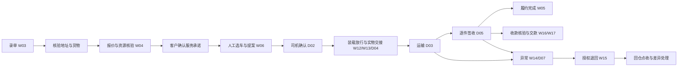

# DR RouteFit 首期页面与 UI UX 规划

2026-10-25 入口更新：[Telegram Mini App＋Bot 下单、司机 iOS／Android App](telegram-and-driver-app-scope-v0.1.md)。受控客户下单 C1-ORDER 纳入首个客户闭环；本文历史页面编号保留，旧 Android 单平台和仅通知的范围由本增补替代。

## 客户入口与接口开发补充（v0.1）

当前客户产品分为[邀请制货主门户与收货人轻入口](customer-portal-scope-v0.1.md)。原“客户 APP”描述为跨端能力方向，不作为首期独立原生 App 交付前置。C0 只读跟踪；C1 查订单/凭证/账单及提交异常；收货人写操作另需验证；C2 仓储申请依赖可靠库存；C1-ORDER 受控下单纳入首个客户闭环；C3 完整自助扩展/API 按开关开放。保留既有页面编号与演示页面，新增阶段不代表立即启用。各页面调用对照[接口目录](../../contracts/endpoint-catalog.md)和[流程](../../contracts/flows-and-acceptance.md)。

| 项目 | 内容 |
| --- | --- |
| 版本 | v0.1 · 2026-10-24 |
| 状态 | 草案，页面与交互方案待评审；功能验收尚未执行 |
| 交付范围 | R1 人工配送、R1-M 合作车辆与人工快递委托、R1-V 中控只读展示 |
| 需求依据 | [V1.4 评审稿](PRD-V1.4-review.md) §3–11、15、17、21、附录 B；当前基线仍为 V1.3 |
| 配套标准 | [设计标准](design-standards.md)、[开发标准](development-standards.md)、[系统边界](system-boundaries.md)、[术语表](glossary.md) |
| 验收映射 | [首期页面与验收映射](phase1-acceptance-map.md) |

与 PRD 冲突时以 PRD 为准；V1.4 冻结后按冻结版本复核本文件。页面 ID 仅用于设计追踪，不替代或重编 RULE／AT。以下导航、页面拆分、布局和交互为首期设计建议，不能据此宣布契约、权限或生产参数已冻结。

首期先完成“录单与核验 → 报价和承诺 → 选择履约方式 → 确认与实物交接 → 送达或退回 → 独立核账 → 中控只读展示”。三类履约共用订单入口，车辆直送使用 Assignment，快递使用 CarrierBooking。正式算法推荐、合单、途中插单、商业返程仍按原阶段推进；开放司机市场、快递 API 自动下单或中控写操作未获启用。客户 APP 与自助下单已由后续用户需求纳入规划，见本文增补，不再作为永久排除项。

## 1 各端与使用者

| 端／入口 | 使用者 | 首期职责 | 形态 |
| --- | --- | --- | --- |
| 运营 Web | 调度、运营、仓库、财务、授权管理员 | 订单、人工派单、交接、异常、账务、配置 | 一个后台，按角色分工作台和权限；不是四套系统 |
| 司机 iOS／Android App | 自营司机、白名单合作司机 | 接单、取货、运输、签收、收款申报、退回、离线补传 | 同一端；合作司机仅见自己的授权任务 |
| 客户入口 | 获授权发货人、商户及收货人 | 受控下单、报价付款、订单与账单、异常申请；收货人单订单授权 | Telegram Mini App＋Bot；另保留收货人轻量链接 |
| 智序工场中控 | 内部运营观察者、访客大屏观众 | 授权摘要、异常提示、跳转 RouteFit | 复用二维／三维现有入口，同一快照；访客只看批准汇总 |

不新增合作方独立门户、快递司机端或 GeoCore 管理平台。客户查询入口是否公开启用、可见字段和通知渠道按 D08／D11 及授权策略确认；未获批准可先使用人工通知留痕完成该段流程。

## 2 导航与页面清单

以下 38 个 ID 是设计覆盖单元，含独立页、详情标签、抽屉和步骤，不代表 38 个独立路由。路径为建议，R0-B 按技术栈与权限契约确定。首期不在导航中放不可用的“智能推荐”“拼单”“返程市场”。

### 2.1 通用入口

| ID | 页面／建议路径 | 关键内容与动作 | 出口／边界 |
| --- | --- | --- | --- |
| G01 | 登录与会话恢复 `/sign-in` | 已配置的身份方式、失效提示、返回目标 | 重验企业／对象权限后返回原任务；不做公开企业注册 |
| G02 | 无权限／功能未启用／对象不可用 | 原因、返回工作台、联系负责人 | 不泄露对象存在性或敏感字段；不是空白错误页 |

### 2.2 运营 Web

左侧一级导航：调度工作台、订单、运力与合作方、仓库交接、异常与退回、财务、基础资料与设置。仓库／财务登录后默认进入自己的待办，不要求先经过调度地图。

| ID | 页面或子视图／建议路径 | 必备信息与主操作 | 角色／阶段 |
| --- | --- | --- | --- |
| W01 | 调度工作台 `/dispatch` | 待派、待司机确认、待揽收、在途风险；S1／最晚安全派发优先；人工选择履约方式 | 调度；R1/M |
| W02 | 订单列表 `/orders` | 方式、服务等级、原承诺、履约状态、财务摘要、负责人；查找、筛选、新建 | 调度；仓库／财务仅授权字段 |
| W03 | 录单与核验 `/orders/new` | 联系人与确认地址、入口、逐件尺寸重量来源、包装、货类、期望窗口；存草稿／提交核验 | 调度；R1 |
| W04 | 报价与服务承诺，订单步骤 | 客户报价版本、方式候选、资源／时间依据、客户确认凭证；分别确认报价与承诺 | 调度；R1/M |
| W05 | 订单详情 `/orders/:id` | 原承诺／当前预计／客户期望，履约实例、件级去向、事件、证据、财务分栏；进入下一合法动作 | 授权角色；R1/M |
| W06 | 人工派单／改派，详情抽屉 | 自营／合作候选、窗口、装载放行、费用、已有任务、不可用原因；发提案／撤回／取货前改派 | 调度；R1/M |
| W07 | 车辆与司机 `/capacity` | 实测车型／门洞／载重、资格、班次、位置时效、占用；维护授权资料 | 调度／管理员；R1 |
| W08 | 合作方列表与详情 `/partners/:id` | 协议、资格、有效期、责任联系人、报价、结算周期、可用窗口；核验／暂停／退出 | 授权运营；R1-M |
| W09 | 快递委托详情 `/bookings/:id` | 服务能力、报价、联系渠道、外部单号、确认和取消状态、揽收窗口；登记人工委托／跟进 | 调度；R1-M |
| W10 | 快递事件与交付核验，委托标签 | 原始状态、发生／接收时间、证据、核验结论、过期提示；录事件／核验送达 | 授权核验角色；R1-M |
| W11 | 仓库交接队列 `/warehouse` | 待复核、待取货、待快递揽收、待退回点收；按任务定位交接单 | 仓库；R1/M |
| W12 | 装载复核，交接步骤 | 车型版本、每件证据、组合／卸货顺序、拒绝原因；复核并留证放行 | 授权装载复核人；R1 |
| W13 | 实物交接 `/custody/:id` | 交出／接收方、逐件标识、件数、包装／封签、地点时间、双方签认；确认／报差异 | 仓库及获授权交接人员；R1/M |
| W14 | 异常队列与详情 `/exceptions/:id` | 阻断动作、当前保管人、受影响件、负责人、期限、证据、下一动作；指派处理／授权处置 | 调度／授权运营；R1/M |
| W15 | 退回与回仓 `/returns/:id` | 授权目的地、原承诺影响、容量、取回交接、实收差异、检验；授权／指派／点收／结案 | 调度、司机、仓库各自权限；R1/M |
| W16 | 运费与 COD 核验 `/finance/collections` | 按币种及受益方分账，due／reported／verified／mismatch；核验／登记差额／审批冲正 | 财务；R1 条件启用 |
| W17 | 司机交款 `/finance/remittances` | 司机、班次、币种、应交实交、凭证、差额；核对／结清 | 财务；R1 条件启用 |
| W18 | 合作方应付 `/finance/payables` | 服务实例、协议报价版本、核对／争议／部分付款／已付清、凭证；核对／登记付款 | 财务；R1-M；不自动代付 |
| W19 | 地址／货物模板 `/master-data` | 来源、有效期、实测与模板版本、确认状态；维护／提交纠错候选 | 授权角色；R1；不修改公共地点真值 |
| W20 | 权限、试点与审计 `/settings` | 角色作用域、启用清单、批准记录、降级／暂停、审计、场景映射／摘要接入状态 | 对应授权人；R1/M/V；不能凭设置页自行放行 Gate |

### 2.3 司机 Android

底部三个入口：任务、订单列表、我的。订单列表分已超时、配送中、已完成、已取消；超时为派生风险，完成卡片区分正常签收和异常结案。同步与消息保留为任务页提醒及独立二级入口 D08。未接受提案与已接受任务分区。合作司机不显示全车队列表、其他合作方报价或财务核验按钮。

| ID | 页面或步骤 | 关键内容与主操作 | 结果与边界 |
| --- | --- | --- | --- |
| D01 | 当班与任务列表 | 授权班次、定位／网络状态、当前任务、待确认提案 | 仅缓存已授权任务，显示同步时间 |
| D02 | 提案确认 | 取送点、货物、窗口、约定报酬、有效期；安全停车后接受／拒绝 | 服务器成功才算接单；离线、过期或版本冲突禁止接受 |
| D03 | 当前任务详情 | 下一站、当前保管件、原承诺、预计时间、联系／导航、下一步 | 导航返回不改变状态；定位仅在授权范围采集 |
| D04 | 到仓与取货交接 | 逐件核对、装载放行、差异、照片；确认取货／出发 | 仓库与司机围绕同一交接记录协作；不重复造单 |
| D05 | 送达与签收 | 逐件实收、收货凭证、收款放货条件；完成交付／记录部分收货 | 部分收货不标整单 delivered，剩余继续占载荷 |
| D06 | 收款申报与交款记录 | 方式、FREIGHT／COD、币种、受益方、凭证；申报／查看交款差额 | 无 verified 权限；现金、转账、月结分别提示 |
| D07 | 异常与退回任务 | 拒收／不在／货损／故障，持货与证据；上报／执行已授权退回 | 不提供一键 failed 或删除持货任务 |
| D08 | 同步、消息与设备状态 | 待上传／上传中／失败／冲突、原事件时间、定位限制；重试／查看处理要求 | 相同事件重试沿用幂等键；不生成新签收 |
| D09 | 我的、语言与权限说明 | 身份、所属合作方、语言、授权说明、定位停止、退出 | 停止定位产生明确受限提示，不能扩大追踪范围 |

### 2.4 客户通知与查询

| ID | 触点 | 内容／动作 | 限制 |
| --- | --- | --- | --- |
| C01 | 通知模板 | 承诺确认、派发／交接、风险、签收／退回、联系渠道 | 期望／承诺／预计分开；渠道与模板待批准；送达通知不等于客户同意新承诺 |
| C02 | 订单查询 `/tracking/:ref` | 授权订单状态、原承诺、当前预计、最后更新、联系方式 | 引用短期、可撤销；无其他客户信息、全车队轨迹、财务明细；失效转 G02 |

### 2.5 中控只读模块

| ID | 模块 | 内容与交互 | 无数据／无权限时 |
| --- | --- | --- | --- |
| V01 | 配送总览 | 三类履约数量、原承诺准时率、统计窗口和分母；订单与委托单分计 | 未接入显示不可用；没有样本不显示 100% |
| V02 | 地图与位置摘要 | 授权位置、观测时间、精度、真实仓库映射 | stale 标旧点；快递无实时车位不画移动车辆 |
| V03 | 异常摘要与详情跳转 | 期限、负责角色、状态；在 RouteFit 中打开 | 跳转重验权限；访客不显示敏感详情或无权入口 |
| V04 | 财务汇总与未启用模块 | 批准受众可见运费／COD／应付分币种汇总；顺路、返程、库存、设备明确未启用／未接入 | 不用演示值填空；demo 如另开必须醒目标识且隔离 |
| V05 | 二维／三维共用数据状态条 | 快照版本、来源、模式、质量、最后观测／刷新时间；刷新／恢复提示 | 过期按批准期限隐藏内容；断源不回落到 demo |

## 3 核心流程与失败出口

### 3.1 自营车辆 R1



1. W03 未知尺寸、包装不明或未确认地址保留待核验，不能通过默认值变成已验证。
2. W04 报价确认不等于服务承诺；承诺需要有效资源／装载与时间依据、客户同意。S1 未校准时只能显示批准的人工依据，不出现“算法保证”。
3. W06 发提案后 W05 显示待司机确认，订单仍 awaiting_dispatch。D02 接受成功才进入 executing／pickup_pending；拒绝或超时释放提案软预留，既有承诺继续受保护并回到调度待办。
4. W12 已知超载／门洞不适配不能人工覆盖。换车、改货、尺寸或卸货顺序变化使旧放行失效，重新复核。
5. W13／D04 交接件数或包装不符时保留原保管方，创建阻断异常；交接成功后才推进持货状态。
6. D05 全部交付且证据与放货条件满足才完成履约。费用核验和司机交款独立，不随签收自动结清。

### 3.2 合作车辆 R1-M

W08 核验合作方与协议 → W07／W08 确认车辆、司机和具体可用窗口 → W04 核对客户报价与合作费用 → W06 选择合作车 → D02 获授权司机确认 → 复用取货、运输、签收／退回 → W18 应付核对与付款记录。

- 每次接受任务复核实际可用窗口及持货情况，本系统预留不证明其他平台无冲突。
- 资格／协议过期、资料未知、无窗口则阻止新任务；拒绝、临时无车或超时回调度人工备用，不自动罚款或扣 COD。
- 暂停／退出关闭新派单与无权读取；在途保管、退回和结案按继续处置所需的明确授权办理，不能丢任务或默认保留所有权限。
- 合作司机只见任务所需信息，不见客户全部订单、其他司机轨迹或其他合作方报价。

### 3.3 人工快递委托 R1-M

W03 核验逐件货物 → W08 核对承运商货类／范围／COD 能力 → W04 核价与有效服务确认、客户承诺 → W09 人工联系并登记 → 对方确认 → W13 实物交接 → W10 事件跟进 → 承运商报告送达 → 授权人按凭证策略核验 → W05 业务交付 → W16／W18 独立核账。

委托状态按 PRD §21.3.1 展示：draft → pending_confirmation → confirmed → awaiting_handover → handed_over → in_transit → delivery_reported → delivery_verified。这是候选机器契约，最终枚举在 R0-B 冻结；前端不自行写状态。

| 分支 | UI 与恢复动作 | 禁止 |
| --- | --- | --- |
| 已打电话但结果未知 | W09 待确认，显示联系人、时间、证据和下次跟进责任人 | 重复委托、把未知当失败重建 |
| 仅有面单／单号 | 保持未交接，W11 显示待揽收 | 自动标揽收、创建伪司机任务 |
| 报告送达但证据缺失 | W10 显示“承运商报告送达，待核验” | 整单送达或财务结清 |
| 取消未确认 | cancel_requested，跟进承运确认及实物去向 | 直接改派车辆／更换承运商 |
| 已交接后取消／货损／丢失 | W14 保留当前保管责任，走拦截、退回或授权转交 | 直接释放责任、把货物从账面移除 |
| 状态过期／乱序／未知 | W10 留原始事件，标最后可信状态与时间，人工核实 | 旧事件覆盖可信新状态、推定丢失 |

### 3.4 取货后异常与退回

D07 上报具体件与当前保管人 → W14 调度分派负责人并评估时限 → W15 授权目的地与退回任务 → 复验容量、时间和其他承诺 → 司机执行 → 仓库逐件点收／检验 → 去向全部闭合后授权结案。

部分收货分别记录已收与待退件，不开放计划拆单；故障换车先复核新车、接受新指派并完成实物交接。整单退回、部分交付异常结案与财务差额各自独立。ReturnTask 不是商业返程订单。

### 3.5 财务闭环

| 方式／账目 | 申报或依据 | 核验与最终出口 |
| --- | --- | --- |
| 现金／COD | D06 点收金额、币种、受益方、现场凭证，reported | 按批准现金策略放货；W16 财务核验，W17 应交／实交核对；差额继续开放 |
| KHQR 转账 | 截图只作 reported | W16 核对到账与唯一交易，防多单重复核销；不能以截图自行放货 |
| 月结 | 已批准客户协议／额度下的应收 | 签收不等于付款；账期内未付仍显示应收 |
| 合作应付 | 已确认服务、协议／报价版本、批准附加费用 | W18 核对、争议、部分付款、已付清，付款留证；不自动代付 |
| 更正 | 原记录 + 原因 + 授权 | 追加冲正，保留历史；不删除、不自动退款 |

USD 与 KHR 分列，运费／COD／合作应付三账分离。未启用收款方式不显示为可选，直接请求也须被服务端拒绝。客户联系和已授权的异常放货在 W14 留证，不能用通用“强制通过”按钮代替权限与额度规则。

### 3.6 客户通知与查询

业务状态确认 → 按批准模板和语言生成 C01 → 记录发送结果 → 失败进入人工跟进 → C02 读取当前授权摘要。通知记录保留内容版本、渠道、发送时间和失败原因；“已发送”不等于“已读”或“客户已确认”。

承诺变化走授权协商与确认留痕，保留原承诺；预计延迟不会自动修改承诺。查询引用过期／撤销时隐藏业务内容并提供获批准的联系入口，不在 URL 携带电话、地址或姓名。

### 3.7 中控只读 R1-V

RouteFit 权威业务状态 → 生成授权 RouteFitOpsSnapshot → 一个只读适配供二维／三维使用 → V01–V05 展示 → V03 跳转 RouteFit → G01／G02 重新校验 → W05／W14 执行业务操作。

- 两端使用相同快照、统计窗口、指标版本与分母；订单数与委托单数不相加。
- 模块逐个标 live／demo／shadow／unavailable 和质量。首期顺路／返程未启用，不能展示伪收益。
- 断源保留最后快照与原观测时间并标 stale，超过批准期限隐藏；从未接入显示不可用而不是 0。
- 初期以权威快照刷新为主，不要求引入消息中间件；重连重新取快照，重复／漏段不靠动画补累计。
- 中控关闭、三维动画结束、AI 工单完成均不改变订单。R1-V 故障不阻塞已获批准的 R1/M 履约。

## 4 关键页面 UI 结构

视觉沿用设计标准：海军蓝主操作、白色表面、浅灰工作背景；青绿与橙色保留品牌用途，风险使用语义深橙。Inter 用于拉丁文字和数字，Noto Sans Khmer／SC 覆盖高棉文与中文；金额、时间使用等宽数字。设计标准是唯一视觉数值来源，不另建相互竞争的色板。

辨识重点是“承诺与实物保管事实”：每个订单顶部固定显示三类时间、当前履约方式及当前保管方。未知写未知，人工估计明确标来源。时间倒计时不是可点击按钮，超时后保留原时间与风险，不归零掩盖迟到。

### 4.1 调度台 W01

```text
┌ 导航 ── 待派／待确认／待揽收／异常（真实计数与更新时间） ┐
│ 订单池 28%    │ 地图或地址证据 42% │ 人工方案／详情 30%  │
│ 筛选与优先级  │ 位置来源、时间精度 │ 方式、候选、拒绝原因 │
│ 原承诺与风险  │ 地图失效可切列表   │ 装载、窗口、报价     │
│ 当前保管方    │ 不虚构快递小车     │ 查看影响 → 发提案    │
├──────────── 最近业务事件与待跟进事项 ────────────────┤
└ 降级／暂停状态保留固定展示区域，不遮住主要操作 ─────────┘
```

比例为 1440–1920px 下的布局建议；1280px 将地图与地址证据切为标签，保留订单池和操作区。小于 1280px 的应急查看切为列表→详情，不依赖横向挤压完成派单；正式桌面操作目标仍按设计标准。地图不是必经操作，键盘可完成选单、核验、提案、撤回。

R1 右栏标题为“人工履约方案”，显示核验与拒绝原因，不显示算法评分、最优路线或自动采纳。每次只提交一个订单的合法方案，不用批量按钮绕过逐单承诺和资源核验。

### 4.2 订单详情 W05

顶部：订单号／方式／服务等级／履约总状态；第二行：客户期望｜原承诺与变更记录｜当前预计与来源；第三行：当前保管方、负责人、下一动作。

标签：履约、货物与交接、异常与退回、收款与应付、事件与证据。财务标签仅授权角色可见。右侧固定“下一合法动作”，已有风险显示具体阻断原因。详情抽屉可快速查看，复杂核验进入独立页；返回恢复原列表筛选和滚动位置。

### 4.3 仓库 W11–W13

队列按待复核／待交接／待回仓分区；扫描或手输标识定位同一对象。逐件清单保留型号、包装版本、重量尺寸与来源，照片与字段相邻。差异项必须可定位到件，底部显示“已核对 X / Y 件”，不能用一张照片替代尺寸证据。

手输是扫码失败的等价路径。误扫其他任务提示不匹配，不自动加入当前交接。放行、交接与出发三个动作分开；复核人与实物接收人不被默认视作同一人。

### 4.4 司机 D03–D05

```text
┌ 网络：离线 · 待上传 2 项  定位：受限 ┐
│ 当前任务／当前保管件数             │
│ 下一站与地标（可展开地址）         │
│ 原承诺窗口 · 预计（人工估计）      │
│ 逐件核对／照片／差异              │
│ 联系调度       查看异常           │
│ [确认取货／记录签收：一个主操作]   │
└ 任务          订单列表        我的 ┘
```

正文不小于设计标准 16px，主要操作高度 56dp，触控目标至少 48dp；高棉文行高不低于 1.6。手机窄屏、虚拟键盘和 200% 字体不得遮住主操作。驾驶中不要求输入；提案提醒明确“请安全停车后处理”，不得用倒计时诱导驾驶中点击。

离线采集显示“已保存在本机，待服务器确认”，不能用绿色送达成功替代。允许补传的动作以 R0-B 契约为准；新接单、未知放行／权限以及银行到账核验不得离线放行。持货任务离线不能因缓存缺失被误判已取消。

### 4.5 财务与中控

财务以待核验／差额队列为首页，不以收入图表为首屏。核验页左侧原始申报和凭证，右侧核对结果与差异；分别显示履约状态、收款状态、交款状态、合作应付状态。

中控保留现有二维／三维布局，用同一摘要模块接入。访客视图不显示个人信息；运营视图按授权展示更多摘要。来源、质量、时间始终可见；展示动画不暗示未经确认的真实运输动作。深色模式为可选方案，首期不以夜间主题完成作为功能验收依赖。

## 5 共用交互行为约定

本章作为首期跨页面 UX 约定；技术栈选定后再映射到共享组件，不为同一动作各写一套交互。

| 场景 | 一致行为 |
| --- | --- |
| 新建／编辑 | 录单草稿保存后进入 W05 继续核验；基础资料保存回所属列表。取消返回原入口；有未保存输入才提示离开损失 |
| 表单错误 | 保留输入，字段旁说明原因和改法，提交定位首个错误；后台错误返回稳定编码，界面提供本地化文案 |
| 提交中 | 按钮尺寸固定、显示处理中、防重复点击；派单、核验、交接不乐观显示成功 |
| 响应丢失 | 显示结果待确认，按原请求 ID／幂等键查询或重试；不得换键新建业务 |
| 版本冲突 | 展示已变化字段与当前版本，保留尚未提交的输入供比对；刷新并重新确认，不覆盖他人结果 |
| 高影响动作 | 撤回、取消、改派、放行、核验、冲正、暂停等显示对象与影响的确认面板；普通存草稿不重复弹确认 |
| 搜索与分页 | 管理列表服务器分页；筛选变更回第一页；搜索防抖、输入法组合安全、过期响应不覆盖新结果；提供清空 |
| 列表状态恢复 | URL 仅保存非敏感筛选／排序／分页；电话、姓名、地址搜索词不得写 URL、日志或埋点，采用受控临时状态 |
| 通知反馈 | 成功可用短提示；风险、阻断和结果未知保留在页面，不能只用几秒消失的 toast |
| 上传凭证 | 明示待传／上传中／失败／已确认；失败保留授权范围内本地证据并可重试，服务端校验类型／大小／对象权限 |
| 会话失效 | 停止受保护操作、重新登录并核验；敏感表单不自动落入普通浏览器存储，恢复方案按 D11 冻结 |
| 权限与禁用 | 无角色权限不展示不必要入口；已授权但前置条件缺失时按钮禁用并说明原因；后端仍执行拒绝 |
| 取消／删除 | 业务记录不提供物理删除；取货前取消与取货后退回分别走领域动作；更正保留审计 |

### 5.1 每个数据组件的状态

| 状态 | UI 表现 | 可采取的动作 |
| --- | --- | --- |
| 正常 | 当前数据、来源与时间 | 授权动作 |
| 加载中 | 保留表头和区域尺寸，局部加载标识 | 不重复提交 |
| 空 | 确认读取成功后的“暂无任务” | 有权限可新建；不伪造示例任务 |
| 筛选无结果 | 当前筛选与清空入口 | 清除筛选 |
| 错误 | 失败原因／请求引用，保留输入 | 安全重试或人工跟进 |
| 不可用 | 未接入／未知，数值为“—” | 查看原因；不以 0 填补 |
| 过期 | 原观测时间 + stale 标签 | 刷新；依赖新鲜数据的操作受限 |
| 部分数据 | 明确缺失范围与分母 | 只使用已授权完整部分，不能推算总量 |
| 降级 | 常驻原因、范围、开始时间 | 仅批准人工路径；每次操作留 DEGRADED |
| 无权限 | 隐藏敏感内容，明确拒绝 | 返回授权入口 |

模式 live／demo／shadow 与质量 fresh／stale／partial／unavailable 分开。数据可信状态、领域状态与 UI 加载状态不能合成一个枚举。

### 5.2 无障碍与本地化

沿用设计标准的对比度门槛和语义色；颜色之外有文字／图标。表格用语义表头，按钮可键盘操作且焦点可见；弹窗管理初始焦点、焦点范围和关闭后焦点恢复。主要动作不依赖悬停或拖动；减少动态效果设置生效。

原型使用合成数据，中文可作为评审语言；生产支持语言按 D15，不把中文原型当作已完成高棉文本地化。高棉文、英文与中文最长文案验证按钮、表格、地址和金额布局。时间使用 Asia/Phnom_Penh，USD／KHR 不换算或合计。

## 6 设计与实现顺序

| 工作包 | 覆盖 | 可评审产物／退出条件 |
| --- | --- | --- |
| P0 契约与设计基线 | 状态、权限、数据可信字段、D02/D05/D06/D08/D11/D15/D19–D24 | 页面字段与 R0-B 契约对应；未知项留待定，合成原型可继续 |
| P1 自营闭环 | W01–W07、W11–W17、W19–W20、G01–G02、D01–D09、C01–C02 | 录单至交接／签收／核账；拒单、超时、改派、离线、拒收／退回都有出口 |
| P2 合作车闭环 | W08、W18，扩展 W04/W06/D02 | 白名单、窗口、协议、授权任务和应付；过期、停用、越权场景可演示 |
| P3 快递闭环 | W09–W10，复用 W13/W14/W16/W18 | 人工委托、未知结果、交接、报告／核验、取消／退回，不伪接 API |
| P4 中控闭环 | V01–V05 + 安全跳转 | 同一真实授权摘要到二维／三维、断源／过期／无权限、跳转重验有证据 |

以上是依赖顺序，不是承诺工期。所有模块以角色与权限复用为先，避免先搭全套空页面再补业务。P1 可先用少量代表页面完成有状态原型，再扩展 P2–P4；原型 mock、契约测试、服务端联调、真机与真实源接入的证据分开记录。

## 7 首轮原型验收脚本

| 脚本 | 必须演示的路径 | 通过标准 |
| --- | --- | --- |
| U01 自营正常单 | W03→W04→W06→D02→W13/D04→D05→W16/W17 | 原承诺不丢，交接可追踪，履约与财务状态分离 |
| U02 接单异常 | 提案过期／拒绝／响应丢失／两人抢同车 | 不双派，重试不重复，旧提案不复活，回调度可继续处理 |
| U03 实物异常 | 尺寸未知、换车、部分收货、拒收退回 | 硬约束阻断，放行失效重验，每件去向闭合后才结案 |
| U04 合作车 | 有效窗口接单 + 过期／停用／越权负例 | 仅授权任务可见，新任务阻断不丢在途责任，应付独立 |
| U05 人工快递 | 电话结果未知→确认→面单→实物交接→报告送达→核验 | 不重复委托，面单不等于交接，报告不等于完成 |
| U06 快递取消 | 取消待确认同时尝试改派，随后迟到揽收消息 | 拒绝双派，进入保管与冲突处理，不直接取消 |
| U07 收款 | 现金现场申报、转账截图、重复交易、COD 双币种、冲正 | 未核验不冒充到账，三账分离，历史保留，差额不消失 |
| U08 弱网与撤权 | 证据上传中断、延迟位置、会话失效、司机撤权 | 待上传明确，旧点不当实时，恢复后重新鉴权与按序校验 |
| U09 中控 | 同快照二维／三维、断源、部分未接、访客、跳转越权 | 同口径，不补零不回 demo，无写入口，核心履约不受影响 |

脚本是 UX 走查，不替代 PRD 验收。完整映射见配套文件；所有实际执行结果初始 NOT_RUN。原型演示“核验成功”不能证明银行、服务端权限、并发或真机定位已通过。

## 8 待冻结事项与不阻塞的设计工作

| 待定项 | 影响 | 未决定时的规划处理 |
| --- | --- | --- |
| D02／试点批准 | 谁批准、谁能恢复能力 | 设计授权与拒绝状态，生产不开启 |
| D05／D15 | 司机机型与语言 | 先做窄屏和长文案布局，真机及译文未验收 |
| D06 | 收款方式、现金放货、月结与额度 | 分支全设计，未批准方式关闭，不填默认额度 |
| D08／D11 | 通知渠道、查询字段、保留与撤销 | 模板／失败／过期视图先设计，真实渠道与保留时长不编造 |
| D19–D21／D23 | 合作车、快递能力、返程边界、责任与结算 | 首期仅已批准合作方式；返程保持关闭；待定签收证据不默认放行 |
| D22 | 中控受众、部署认证、刷新与过期门槛 | 模块状态及权限变体先设计，不硬编码刷新／隐藏秒数 |
| D24 | 技术栈与组件 | 固定业务交互与字段语义，路由、组件库和实现方式后定 |

## 9 交付检查

- [ ] 每个设计单元有角色、前置条件、主操作、成功去向、失败恢复、空／加载／无权限状态。
- [ ] 页面动作映射到原 RULE／AT，且没有借 UI 增加首期自动化。
- [ ] 三种履约各有正常与负向流程；财务、保管与订单状态互不替代。
- [ ] 高棉文／窄屏／字体放大、键盘、焦点、对比度、触控目标有实际检查记录。
- [ ] 离线、并发、撤权、取消未知结果和真实摘要接入由对应测试验证，不以页面演示代替。
- [ ] R1、R1-M、R1-V 分别记录验收，全部必要证据完成后才声明首期功能闭环通过。

## 后续闭环页面增补

依据 [F01–F09 执行规划](future-closure-plan-v0.1.md)，保持现有 W/D/C/V 编号；新页面暂用名称追踪，编号待页面契约冻结，不挤占现有编号。

| 工作端 | 页面或 TAB | 必须显示和可执行动作 |
|---|---|---|
| 运营/客服 | 售后案件、客户变更申请 | 关联订单、件级事实、报价/承诺版本、责任人；核实、提交裁定；不得自行核销资金 |
| 调度 | W14 异常、W15 退回、事故接驳子任务 | 当前保管、剩余容量、原承诺、恢复/返仓/接驳复核，按件选择；不能直接减少持货 |
| 仓库 | W13 点收差异、退货检验、库存处置 | 应收/实收/差异分列；待检、合格、隔离/报损分别处理；保留来源单与外部 WMS 状态 |
| 司机 APP | D05 部分交付、D07 退回/事故、收入/提现二级页 | 实收与剩余件、下一步后果、收款条件；付款结果未知时禁用重复申请；银行卡脱敏 |
| 财务 | W16/17 收交款、费用调整、退款、收入冻结、提现核对 | 原应收/调整/已核收/退款中/已退/净收分列，保费独立；审核与实际支付核验分开 |
| 用户 APP | 下单校对、报价确认、订单详情、售后/退款进度 | 只见本人订单；变更申请不直接覆写任务；拒绝理由和复核渠道；不显示其他订单或司机完整账户 |
| 中控 | V01/V03/V04 扩展投影 | 正常/部分/退回与资金差异分别计数，质量/时效标识，授权跳转；没有业务写按钮 |

所有页面用列表→详情→动作确认，详情保持原 TAB、筛选和滚动位置；长内容拆为履约/货物保管/费用/证据/事件 TAB。手机主动作展示当前角色、金额/件数和不可逆后果；输入差异保留供纠正，不能只弹成功 Toast。退款未知、库存差异和提现冻结需要常驻状态与处理入口。批量动作先检查每个对象授权和版本，结果逐项返回。

## 路线调度专项入口

[路线规划与调度界面设计](route-planning-design-v0.1.md)细化W01地图调度：左侧待派订单、中部地图、右侧所选方案，方案内分推荐/站点时间表/逐段装载/成本对比/排除原因TAB。拖动站点仅编辑草稿，重算并确认才产生提案；司机只执行已确认路线。真实推荐按R2/R3分阶段，不将固定合成矩阵视为上线证据。

## 地图成本相关交互

依据[地图成本专项](map-cost-optimization-v0.1.md)：调度切TAB复用地图实例，车辆更新只更新图层；拖拽路线先编辑草稿，确认后重算；暂停非必要后台刷新并保留数据时效提示。司机“开始导航”打开当前站外部地图，返回仍保留原任务状态。客户默认时间线，地图按需打开。

地图未加载、定位过期、调用受限和无可行路线分别显示原因；调用受限不得显示“无司机”。不得因为降本隐去安全告警或将旧ETA显示为实时。地图来源署名保持可见。

## 按主体结算与财务到期提醒

实现状态更新：财务导航 `#settlements` 已提供待办／规则／账单／发送记录页签、详情返回、搜索分页、日期预览、共用确认弹窗及消息中心到账单的入口。已完成本地浏览器验证，见[记录](../../prototype/records/2026-10-24-settlement/README.md)；下文完整规划中的资金日历、真实发送、客户资料页嵌入和后台调度仍为后续范围。

依据[结算专项 §3](partner-settlement-and-funds-v0.1.md)：客户、合作单位和个人详情增加“结算设置”TAB，展示应收／应付方向、独立账期、截账／出账／到期／提醒时间、责任人及版本；保存前预览三个周期和受影响账项。模板可选，不强制按个人周结或单位月结；客户信用资格单独展示。

财务“结算与资金”分菜单展示规则、待办、客户应收、合作方应付、个人申请、付款批次和资金日历。待办分待出账／待收款／待催收／待付款／异常 TAB；显示金额、币种、到期日、责任人和下一动作。列表进入详情后返回保留筛选。内部通知进入具体待办，已读不消除未处理事项，不只用瞬时 Toast。

账单与催收草稿经财务确认后发送；确认界面展示接收人、账单版本及最新可催余额，发送前再次校验。争议、付款待核验、部分已付和已结清明确显示；催收客户欠款与提醒支付合作方分开。发送失败提供重试及记录，自动提醒不等于自动付款。本节已实现的 Demo 子集及浏览器结果见上方实现更新；生产能力仍待接入。


## 财务页面整合目标（待实现）

[财务闭环设计 §7](financial-closure-design-v0.1.md)统一为客户应收、收款与核销、司机交款、应付与结算、差异与更正、规则与报表六组菜单；上一节已实现的账期提醒并入规则待办，保留历史入口跳转。不是另建平行账本。详情返回保留筛选、分页和选中对象；COD 未启用前不提供返款入口。

确认界面展示币种、主体、脱敏账户、资金来源、所选账项、本次分配和余款；支持一款多单与一单多款。付款登记、到账核验和核销按钮分开，权限与版本提交时重验。首页按币种展示客户欠款、对外应付、司机持款、商户待返及差异，待确认／待分配与已核销分开；保费不计配送分成。


## 跨端财务同步更新（2026-10-24）

新增财务 finance.html 六组菜单及司机、用户、商户、合作方、仓库、管理者授权投影，手机卡片布局；原工作台提供同会话入口。细化页面、动作、明细／账龄、CSV及设计图见专项。原有任务地图与司机执行动作保留。

以[跨端需求与报表 v0.1](cross-end-finance-and-reports-v0.1.md)为最新增补，保持本文草案状态；此前未实现／待确认描述为历史阶段记录，本次实现边界和证据以新专项为准。
