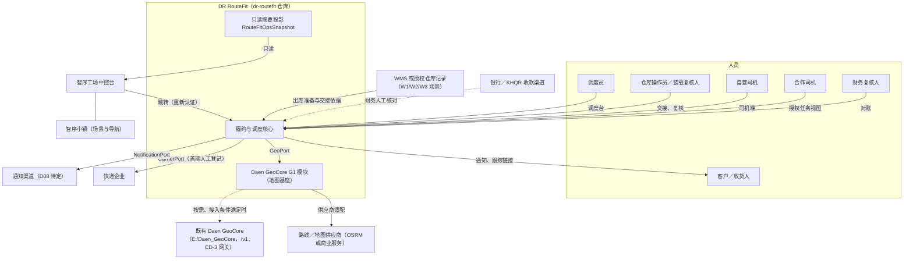

# DR RouteFit · 系统边界

2026-10-25 已确认[渠道边界](telegram-and-driver-app-scope-v0.1.md)：Telegram Mini App／Bot 是受限客户入口，司机 iOS／Android 共用履约服务。Telegram 身份不等于企业成员权限；Bot 不拥有后台派单或付款审批权。

## 客户门户和开发契约补充（维持 v0.1）

客户入口采用[门户分期](customer-portal-scope-v0.1.md)，不要求独立原生 App 或三维场景前置。运营企业隔离之外，还须检查货主账户、成员权限、订单/凭证归属；公开跟踪与验证收货人不可取得内部财务权。客户确认不替代内部审核；仓库预报不等于实收。实现参照[开发接口包](../../contracts/README.md)，本节不声称生产边界已实现。

| 项目 | 内容 |
| --- | --- |
| 状态 | 草案，待产品负责人与人类集成负责人评审 |
| 版本 | v0.1 · 2026-10-24 |
| 需求依据 | [PRD V1.4 评审稿](PRD-V1.4-review.md) 1、5、9、15、17、19、21；当前基线 [V1.3](PRD-V1.3-final.md) |
| 相关文档 | [设计标准](design-standards.md) · [开发标准](development-standards.md) · [术语表](glossary.md) |

本文回答四个问题：**谁负责什么、数据归谁、谁能写、哪些不做。**内容整理自 PRD，与 PRD 冲突时以 PRD 为准；V1.4 冻结后按冻结版本复核。

---

## 1. 一句话定位

**DR RouteFit 是智序小镇体系内可独立运行的配送履约与调度业务系统：统一管理自营车辆、受控合作车辆和快递委托，在履约与安全约束内提高顺路及返程运力利用率。Daen GeoCore 提供地图基座，智序工场提供展示与业务入口。**（PRD 21.1）

RouteFit 不依赖中控台、三维场景或任何展示层在线才能运行（PRD 17.2）。

---

## 2. 系统上下文

实线为首期存在的交互；虚线为人工或按条件启用的交互。

---

## 3. 系统清单与职责

| 系统 | 负责 | 明确不负责 | 首期形态 |
| --- | --- | --- | --- |
| **DR RouteFit 核心** | 客户需求、报价与承诺、履约方式、车辆指派、快递委托、交接、异常、退回、收款与应付记录、审计 | 路网引擎、库存真值、承运商内部调度、资金划转 | R1 + R1-M |
| **Daen GeoCore G1 模块** | 地址与入口位置事实、道路行驶时间矩阵与路线、车辆位置观测与来源 | 订单承诺、整趟履约 P90、合单、司机报酬、快递运单状态 | dr-routefit 仓库内独立模块，按需建设 |
| **既有 Daen GeoCore**（`E:/Daen_GeoCore`） | 自身的地点身份治理、`/v1` 接口、CD-3 地理编码网关 | 被 RouteFit 改写契约；为 RouteFit 全部上线 | 逐项评估后按需消费，不复制、不共用数据库 |
| **路线／地图供应商** | 道路路线与时间、地理编码 | 实时路况可靠性（需校准证明）、配送优化 | 经 G1 模块的供应商适配器接入，R2 按需验证 |
| **智序工场中控台** | 读取授权摘要、聚合展示、带业务引用跳转 | 指派车辆、收款核验、设备控制；AI 工单完成不等于货物送达 | R1-V：复用既有中控入口，只读 |
| **智序小镇** | 场景导航、园区标识、可视化入口 | 真实坐标、库存、运单状态真值 | 消费中控展示；不直接对接 RouteFit 写接口 |
| **WMS 或授权仓库记录** | 库存、包装核实、备货、实物出入库 | 由 RouteFit 删除库存；用场景动画替代实物扫描 | 首期按授权人工交接；完整 WMS 接入属 R5 |
| **快递企业** | 接单、揽收、网络内运输、外部凭证 | 获取企业订单、司机、客户或地图私有数据 | 首期人工委托与登记，API 关闭 |
| **合作车辆方** | 按协议提供车辆与司机、执行被指派任务 | 查看非指派任务；不受协议约束地接单 | 白名单准入，R1-M |
| **银行／KHQR** | 实际到账 | 由截图或二维码展示证明到账 | 财务人工核对，无银行接口 |
| **通知渠道** | 送达客户通知 | 承诺变更的授权 | 渠道待 D08 确定 |

---

## 4. 数据权威

"权威"指该数据的唯一真值来源。其他系统只能读取、引用或保存经授权的快照，不能改写。

| 数据 | 权威 | 可写入者 | 其他系统的使用方式 |
| --- | --- | --- | --- |
| 订单、服务承诺、报价 | RouteFit | 授权调度员（客户确认后） | 中控读摘要 |
| 指派、路线计划、容量预留 | RouteFit | 调度员、被指派司机（接受／拒绝） | 中控读摘要 |
| 快递委托（CarrierBooking） | RouteFit | 调度员（人工登记）；后续经 CarrierPort | 快递企业只见委托所需字段 |
| 承运商外部状态 | 快递企业 | 快递企业 | RouteFit 保存原始状态与映射，核验后才影响业务状态 |
| 实物交接（CustodyTransfer） | RouteFit | 交出方与接收方共同签认 | — |
| 收款记录（运费、COD） | RouteFit | 司机申报（reported）、财务核验（verified） | 中控只读汇总，按受众授权 |
| 转账到账 | 银行 | — | 财务据银行流水核验；付款截图仅形成 reported |
| 现金实收／交款 | 授权现金点收与交款凭证；RouteFit 保存核验记录 | 司机现场点收并申报（reported）、财务核验现金与交款 | 按已批准的现金／COD 放货策略交付；不要求银行流水，不虚构银行交易（PRD 9.2.1、9.3） |
| 合作方应付（PartnerPayable） | RouteFit | 财务 | 与应收、COD 分账 |
| 地址库、入口位置 | GeoCore G1（按企业作用域） | 经授权的确认流程 | 订单保存确认快照，地址后续修正不改历史订单 |
| 车辆位置观测 | GeoCore G1 | 授权班次内的司机端 | RouteFit 判断是否过期及业务含义 |
| 道路行驶时间与路线 | GeoCore G1（经供应商） | — | RouteFit 计算整趟履约 P90 与承诺 |
| 公共地点身份（GeoID 等） | 既有 Daen GeoCore | 其自身治理流程 | RouteFit 只可引用，`placeRef` 可为空 |
| 库存、备货、出入库 | WMS 或授权仓库记录 | 仓库 | RouteFit 只读取交接依据 |
| 场景映射（SceneBinding） | RouteFit | 授权管理员 | 中控用于把真实仓库映射到 W1/W2/W3 场景 |
| 只读摘要（RouteFitOpsSnapshot） | RouteFit | 只由 RouteFit 生成 | 中控只读，不回写 |

**数据规则：**

- 不共享数据库；跨系统只经接口。
- 游戏或场景坐标不转换成未经核实的经纬度；园区面积、月台数等示意数值不进入生产报表（PRD 21.2）。
- 第三方地图内容的缓存与留存按供应商授权；缓存默认关闭，CD-3 临时地理编码结果默认不缓存（PRD 5.3）。

---

## 5. 接口边界

| 接口 | 方向 | 首期形态 | 认证与授权 | 失败时 | 阶段 |
| --- | --- | --- | --- | --- | --- |
| **GeoPort** | RouteFit → G1 | 进程内或内部 HTTP；契约测试 | 服务端企业作用域 | 返回结构化原因（`UNAVAILABLE`、`TIMEOUT`、`OUT_OF_COVERAGE`、`LOW_CONFIDENCE`），转人工降级 | R0-B 合成验证，R1 起使用 |
| **G1 供应商适配** | G1 → 地图供应商 | 适配器隔离供应商 SDK | 供应商凭据只在服务端 | 不伪造路线或 ETA | R2 按需 |
| **既有 GeoCore 适配** | G1 → `E:/Daen_GeoCore` | 按其已批准契约 | 按其认证方式 | 不阻塞有依据的人工位置确认 | 可选，接入条件满足后 |
| **CarrierPort** | RouteFit → 快递企业 | 首期人工登记；API 后续 | 承运商授权与签名（启用 API 时） | 结果未知进入跟进队列，不重复委托 | R1-M 人工；API 另行评审 |
| **仓库交接** | WMS／仓库 → RouteFit | 授权人工记录 | 仓库角色 | 件数或尺寸不符阻断交接 | R1 |
| **NotificationPort** | RouteFit → 通知渠道 | 渠道待定 | 服务端 | 记录失败并升级，不以"已发送"代替授权 | R1 |
| **收款核验** | 银行 → 财务 → RouteFit | 人工核对银行流水 | 财务复核人 | 未核验保持 reported | R1 |
| **RouteFitOpsSnapshot** | RouteFit → 中控台 | 一个权威只读快照接口；二维和三维共用 | 服务端受限适配或批准的只读会话；前端无业务密钥 | 保留最后快照标 stale；从未接入标 unavailable；不回落到 demo | R1-V |
| **中控跳转** | 中控台 → RouteFit | 带非敏感 ID 或服务器签发的短期引用 | RouteFit 重新认证并校验对象权限 | 无权限则拒绝 | R1-V |

---

## 6. 写权限边界

以下规则不因任何降级、演示或紧急情况放宽：

1. **只有 RouteFit 能改变配送业务状态。**中控台、三维场景、动画结束、AI 工作任务结束都不能改变货物或订单状态（PRD 21.6）。
2. **中控台没有写操作。**调度写操作只在 RouteFit 中执行。
3. **GeoCore 不改订单。**地理数据变化不直接修改订单或运单状态；执行中订单须评估、确认后版本化重规划（PRD 5.3）。
4. **外部状态不直接生效。**承运商报告的 delivered 先登记为报告，按批准的凭证策略核验后才确认交付（PRD 21.3.1）。
5. **截图不是到账。**转账截图只能形成 reported，银行流水核验后才是 verified（PRD 9.2）。
6. **影子推荐不写业务。**影子模式只写推荐日志（PRD 11.2）。
7. **客户端不决定作用域。**`companyId` 从认证主体推导，客户端传入的值不作授权依据。
8. **RouteFit 不删除库存。**库存由 WMS 或授权仓库记录维护。

---

## 7. 信任区

| 区域 | 包含 | 规则 |
| --- | --- | --- |
| 内部操作区 | 调度台、仓库、财务界面 | 员工认证；按角色和对象授权 |
| 现场设备区 | 自营司机端 | 设备可能离线、丢失；本地只缓存授权任务；凭据可远程撤销 |
| 合作方区 | 合作司机的任务视图 | 只见被指派任务；协议到期或退出即撤销访问（PRD 21.3） |
| 外部公众区 | 客户跟踪链接、通知 | 短期签名引用；不含电话、地址、姓名；可撤销 |
| 集成区 | 中控台只读适配、快递企业、地图供应商 | 服务端对服务端；最小字段；无共享数据库；凭据只在服务端 |
| 展示区 | 访客大屏 | 只显示批准的汇总；不显示个人信息、签收照片、原始轨迹 |

跨区传递数据时，只传对方完成任务所需的最少字段。

---

## 8. 范围边界（按阶段）

### 8.1 能力与 Gate

| 能力 | 首期（R1 / R1-M / R1-V） | 后续 Gate | 备注 |
| --- | --- | --- | --- |
| 仓库发货到客户 | ✅ R1 | — | 首个试点唯一业务链 |
| 自营车辆人工派单 | ✅ R1 | — | |
| 白名单合作车辆 | ✅ R1-M | — | 不开放司机市场 |
| 人工快递委托 | ✅ R1-M | API：另行评审 | 首期不调用快递 API |
| 中控只读展示与跳转 | ✅ R1-V | 扩展数据域：R5 | R1-V 未通过不阻塞 R1/R1-M 履约 |
| 收款登记与对账 | ✅ R1（按启用方式） | — | 未启用方式被拒绝 |
| 影子推荐 | — | R2-A | 不写业务 |
| 人确认的推荐 | — | R2-B | |
| 有限自动派发（简单 S2/S3） | — | R2-B 后独立批准 | S1 自动承诺仍禁用 |
| 发车前同仓合单 | — | R3-A | |
| 途中插单 | — | R3-B | |
| 返程配货 | — | R3-C | 返程订单独立于退回任务 |
| 复杂三维装箱 | — | R4（可选） | |
| WMS／设备／更多场景真实数据 | — | R5（可选） | |

### 8.2 首期明确关闭

原 V1.4 首期关闭清单包含外部自助下单及一般多车拆单。后续用户已明确纳入客户 APP/接入下单，并允许事故应急逐件分散转运，见[闭环需求增补](closed-loop-requirements-v0.1.md)；两项不再作为永久排除项。开放司机市场、快递 API 自动下单、计划接力转运、普通计划拆单仍未获启用；商业返程、合单、途中插单与自动派发按原阶段及独立批准推进。事故例外不扩展为普通订单任意多车并行。

### 8.3 V1 不包含

全国开放式社会司机市场、全自动运价竞价、司机金融贷款、自动资金划转、自动退款或自动保险理赔、真实设备自主控制、多国跨境与清关、未经验证的 AI 自主运营、全面替代地图基础设施、客运或人货混载仍不包含。用户后续已确认司机收入、提现申请与财务人工审核；人工售后退款纳入后续闭环规划，不能继续用早期“钱包排除”否定这些需求，也不据此开启真实自动付款。

### 8.4 地图基座边界

- G1 只建当前配送需要的能力，不另开平台主线，不要求第二个使用方。
- G2（Daen 内部共享）、G3（对外开放）归档为未来选项，不进入任何当前 Gate、预算或验收（PRD 5.4）。
- 智序工场读取 RouteFit 的授权配送摘要，不等于 GeoCore 已平台化。

---

## 9. 组织与责任边界

| 角色 | 负责 | 不负责 |
| --- | --- | --- |
| 产品／运营负责人 | 范围、SLA、货类、试点参数、风险与上线批准 | 技术候选的依赖批准 |
| 人类集成负责人（待指定，D02） | 基线、契约版本、依赖、候选构建、回滚批准；与运营负责人共同批准试点恢复 | 业务参数 |
| 当班调度员 | 录单、派单、异常处理、降级操作、暂停对应能力 | 全局停单、恢复 |
| 财务复核人 | 到账核验、交款对账、应付核对 | 以司机申报代替银行确认 |
| AI 执行者（ChatGPT、Trae、Codex、harness） | 按任务卡实现、测试、提交 | 自行宣布生产启用；审查自己的实现 |
| 独立技术审查 | 固定 SHA 的源码、契约、运行证据审查 | 实现 |

**法律责任不由系统认定：**对客履约责任方、实际承运方、货损赔偿、合作方拒单与超时的责任，按合同确认（PRD 21.5、D23）。系统只记录事实、证据和负责人。

---

## 10. 地域与试点范围

- 优先服务区域：金边及周边；具体服务区边界由 `serviceAreaRef` 定义，在试点范围表中批准（PRD 1.4）。
- 首期：一个运营主体、一个发货仓。CI 中使用第二个合成公司做隔离测试，但不建设多企业注册、开户或品牌后台。
- 当地法律、运输资质、保险、代收责任和位置隐私由具备能力的人员核实，本文不作合规保证（PRD 17）。

---

## 11. 品牌边界

| 名称 | 归属 | 写法 |
| --- | --- | --- |
| DR RouteFit | 配送调度业务产品 | DR 大写不加点；不写 Dr.／RouterFit |
| Daen GeoCore | 地图基座 | 不写 DR GeoCore |
| 智序工场、智序小镇 | 展示与入口所在的另一产品体系 | 使用原名，不加 DR 前缀 |

视觉规则见[设计标准](design-standards.md)第 2 章。

---

## 12. 待定事项

| 编号 | 事项 | 影响本文的部分 |
| --- | --- | --- |
| D02 | 人类集成负责人 | 第 9 章 |
| D08 | 通知渠道与失败升级 | 第 3、5 章 |
| D10 | GeoPort 实际能力、数据来源许可与可保存字段 | 第 4、5 章 |
| D11 | 数据保留、删除与权限 | 第 4、7 章 |
| D19 | 合作车辆名单、窗口、合同 | 第 3、7 章 |
| D20 | 快递企业、揽收点、货类与凭证 | 第 3、5 章 |
| D22 | 中控台身份映射、可见字段、部署、刷新与过期门槛 | 第 5、7 章 |
| D23 | 对客责任与应付规则 | 第 9 章 |
| D24 | 开源选型 | 第 3 章（供应商与组件） |

## 13. 后续闭环的数据与责任边界

按 [执行规划](future-closure-plan-v0.1.md) F01–F09 增补，后续用户确认优先于早期范围排除；原 R 阶段和正式验收保留。

- RouteFit 对订单、承诺、调度、授权交接及业务费用裁定负责；仓库对实物点收/检验事实负责，不能由财务将差异货物改为已收。
- 每个仓库明确自建轻量库存或外部 WMS 为库存权威。早期“完整 WMS 接入 R5”不排除已确认的仓库订单接入和轻量作业，完整 WMS 替代仍需独立范围评审。
- 支付渠道/银行提供支付结果证据，RouteFit 财务负责核对账项；不能用渠道超时推定失败，也不能用付款登记推定到账。
- 保险方/有效保单约定投保、退保、理赔事实；平台保费报价和减免不产生真实保单或赔付结论。
- 客服核实事实和沟通；财务按批准策略审核费用、退款、应付与提现；客户或司机不能自行批准自己的付款。具体审批职责分离随组织配置，禁止配置成绕过服务端授权。
- 中控仅消费授权投影；客户 APP、司机和 WMS 分别受主体/企业/对象范围控制。GitHub 静态 Demo 无服务端鉴权，不作为这些边界已实现的证据。

## 地图与导航降本边界

[地图成本专项](map-cost-optimization-v0.1.md)将底图、地址解析、路线矩阵、车辆定位、任务排序和司机导航分开：RouteFit负责订单、站点顺序、安全约束与确认，GeoPort封装有来源的地图计算，外部导航负责到当前站的道路指引。

外部导航不成为签收或定位真值，普通驾车导航不证明货车限高/限重适配。第三方路线与底图组合、缓存和离线使用遵循各自授权；不得把OSM社区公共服务器当无限免费生产基础设施。供应商切换只替换适配能力，不改变订单与保管事实。优先控制无效调用，再根据实际账单和维护成本评估自建，不预先冻结D24。

## 财务闭环责任补充

依据[财务闭环设计](financial-closure-design-v0.1.md)，银行／渠道资金证据、RouteFit 核销分配、司机保管交接及外部会计记账分别负责。RouteFit 不凭付款凭证登记推定到账，不把收款、交款和收入重复累计。业务确认与资金确认独立，财务更正不改履约事实。

> 历史阶段结论（已由跨端财务 v0.1 及本轮 KESS 复核取代，不表示当前仍待确认）：保留司机已赚收入的申请提现，未开展充值转账类钱包。COD 设计保留、首期启用待确认；托管候选不等于银行已承接或平台可动用本金。会计导出不替代完整总账／税务系统。正式审批人与执行、核验职责需服务端校验；前端席位切换不是权限证明。

## 跨端财务同步更新（2026-10-24）

> 历史阶段结论（已由跨端财务 v0.1 及本轮 KESS 复核取代，不表示当前仍待确认）：COD 纳入首期需求和合成Demo，未启用真实代收。仓库仅申报本仓服务费用，用户仅本人收款退款，商户仅自身COD返款，司机仅本人收入提现，承运商仅本主体应付。三个审核人按自然人区分；生产服务端鉴权和银行权限仍待实现。

以[跨端需求与报表 v0.1](cross-end-finance-and-reports-v0.1.md)为最新增补，保持本文草案状态；此前未实现／待确认描述为历史阶段记录，本次实现边界和证据以新专项为准。

## KESS 接入与再次复核（2026-10-24）

KESS 指定为客户收款渠道；服务端负责密钥与查单，静态页面仅模拟。没有因此开放提现、自动退款或托管资金使用。COD已纳入新版财务需求；真实渠道结算到银行另核。详见 [KESS 接入](kess-payment-integration-v0.1.md)。
