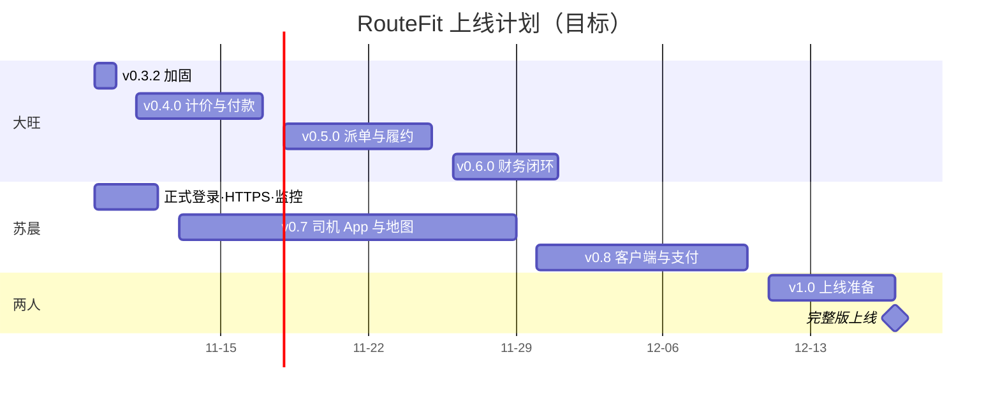

# DR RouteFit 上线路线图

更新：2026-11-07（UTC+7）· 苏晨

这一版替代 2026-10-31 的草案。草案只排顺序、不排日期；这次我把目标日期定下来了，后面每周对照实际进度复核一次。

## 结论

v0.3.1 今天上午部署完成，没有回滚。从现在到完整版上线还有七个版本，分三个阶段走。

我定的目标是 **12 月中旬（12-17 前后）完整版上线**，保底 **2027 年 2 月中**。12 月初（12-03 前后）先让公司内部把整条业务链用起来。

开发分两条线同时推进：大旺带一个 Codex 做业务主线（计价、付款、派单、财务）；我带一个 Codex 做正式登录、司机 App 和客户端。两条线最后汇合，一起做上线准备。

上面的日期不包含外部手续的等待时间，比如 KESS 商户开通、地图账户、应用商店审核。这些要从现在开始并行去办。

## 三个阶段

| 阶段 | 用户 | 要达到的状态 | 时间 |
| --- | --- | --- | --- |
| A 受控试运营 | 员工 | 员工经 SSH 隧道登录，只做录单和固定费报价，其余环节按人工手册配合 | 进行中 |
| B 内部正式使用 | 员工、司机 | 一笔订单从录单到收款、派单、司机履约、财务结算，全部在系统里完成；正式登录、域名和 HTTPS 上线 | 12-03 前后 |
| C 客户自助（完整版） | 客户 | 司机用原生 App，客户用 Telegram 下单和查询，付款走 KESS 真实渠道 | 12-17 前后 |

## 现在有什么、缺什么

大部分模块在本地已经有后端代码和网页原型，README 里登记的 235 个接口都是"本地已实现、未部署"。真正上过服务器、经过验收的只有录单和报价这一块。

| 模块 | 后端代码 | 网页原型 | 试运营已启用 | 主要缺口 |
| --- | --- | --- | --- | --- |
| 录单、报价、策略审核（P01） | 有 | 有 | 是 | 只能算固定费，超距费没做（RF-PM-032）；正式策略还没发布 |
| 付款与月结派单守卫（P02） | 有 | 有 | 否 | 财务规则、月结批准记录、收款渠道要定 |
| 调度派单与车辆成本（P03） | 有 | 有（示意地图） | 否 | 缺真实车型、车辆、仓库资料；地图供应商没定 |
| 司机履约与仓库交接（P04） | 有 | 有（网页版） | 否 | 没有 iOS/Android App |
| 财务与司机应付（P05） | 有 | 有 | 否 | P05 财务模型还有差距要补 |
| Telegram 客户端 | 无 | 演示入口 | 否 | 登录交换、Bot webhook、草稿续填都还没写进接口 |
| 支付（KESS） | 模拟 | 有 | 否 | 商户没开通 |
| 登录与访问 | 只有开发会话 | — | SSH 隧道 | 正式登录（S1）、域名、HTTPS 都没做 |
| 运维 | 试运营工具链 | — | 单机 VPS | 备份定时器 11-08 装；没有监控告警 |

## 版本计划

| 开发线 | 版本 | 范围 | 卡片 / PR 批次（估） | 目标时间 | 退出条件 |
| --- | --- | --- | --- | --- | --- |
| 大旺 | v0.3.2 | RF-PM-052 与 054 合并为一个批次；RF-PM-053 单独成批（高风险，先设计） | 3 / 2 | 11-09 至 11-10 | 开工检查脚本入库并在服务器上跑通；遗留授权按批准的设计收口 |
| 大旺 | v0.4.0 | RF-PM-032 距离计价；P02 付款与月结派单守卫 | 8 / 3 | 11-11 至 11-17 | 固定验算场景的超距费 $5 由服务端算出；未付、少付、币种不符、资格无效、报价过期都派不了单；重复核验不重复到账 |
| 大旺 | v0.5.0 | P03 合格车辆与路线成本比较；P04 司机逐站执行 | 10 / 4 | 11-18 至 11-25 | 每个排除原因都能看懂；成本未知不按 0 排序；导航返回不自动签收；刷新、断网不丢状态 |
| 大旺 | v0.6.0 | P05 财务与司机应付收口；P06 端到端验证 | 6 / 2 | 11-26 至 12-01 | 一笔预付、一笔月结订单从录单到最终状态逐条可追溯；每笔已核收的款只核销一次 |
| 苏晨 | 正式登录·HTTPS·监控 | 替换开发会话；域名、证书；监控告警 | 6 / 2 | 11-09 至 11-12 | 员工不经 SSH 隧道也能安全登录；服务异常能收到告警 |
| 苏晨 | v0.7 | 司机 iOS/Android App；真实地图与道路时间 | 15 / 5 | 11-13 至 11-29 | 两个平台的真机都过了前后台、锁屏、断网、定位撤权测试；签名分发完成 |
| 苏晨 | v0.8 | Telegram Bot + Mini App；KESS 真实支付 | 10 / 4 | 11-30 至 12-10 | 伪造或过期的 initData、重复 webhook 都被拒；同一订单两端报价一致；KESS 真实渠道对账通过 |
| 两人 | v1.0 | 生产环境、恢复演练、上线审批 | 5 / 2 | 12-11 至 12-17 | 生产环境、监控、自动备份和恢复演练都就绪；我批准上线 |

阶段之间有两道门：

- **进入阶段 B 之前：** 试运营稳定，正式报价策略已经发布，v0.4.0 要用的财务规则和收款渠道已经定了。
- **进入阶段 C 之前：** 预付、月结各一笔订单端到端可追溯；正式登录和 HTTPS 已经上线。

业务版本只能一个接一个做：付款准入要拿完整报价去核，派单要先过付款准入，财务收口要等派单和履约。所以大旺那条线没法再拆。我这条线和他的线基本独立，司机 App 先按现有的司机接口开发，等 v0.5.0 合并后再联调。

## 进度是怎么估的

Codex 写一张卡只要 15 到 30 分钟，真正花时间的是写完之后的环节：CI 大约 20 分钟，审查加一轮返工 1 到 2 小时，再加上作者以外的人批准合并。这些开销是按 PR 算的，不按代码量算。

所以我把卡片按批次合并：同一模块、同一风险等级、同一套验收步骤的几张卡放进一个 issue、一个 PR。剩下约 63 张卡（按 PRD 范围粗估，还没逐张拆）合成约 24 个 PR，每个版本 2 到 5 个。PR 少了，CI、批准、合并的轮次少了近 40 轮，比逐张提交大约省 4 天。

省不掉的有三块：部署次数（本来就按版本部署，一个版本一次）、审查本身（改动量没变），以及部署验收、真机测试、Telegram 和 KESS 联调。合起来大约 5 周半。

有个数据我一直记着：项目 10-24 开工，第一周就合并了 81 个 PR，可 P01 从第一个页面合并（10-27）到部署验收完（11-07）用了 11 天，中间返工 4 轮。速度上的差距几乎全在返工和验收上，不在写代码。

## 节奏能不能守住，看五件事

1. 当天审、当天批。大旺和我互审对方的 PR，仓库要求作者以外的人批准。
2. 按批次合并，但不要合过头。一个 PR 只覆盖一个验收场景，代码改动控制在约 500 行以内；身份认证、资金与 KESS、数据库迁移、删除数据的卡单独成批，出了问题能单独回滚。
3. 合并以后马上部署，不再等固定的维护窗口。
4. 每个 PR 最多返工一轮。超过一轮的，先停下来查是卡写得不清楚还是实现有问题。批次越大，一次返工的代价越高。
5. 司机 App 不等 v0.5.0，先按现有司机接口开发。

这五件事里有一件持续做不到，进度就会往 2 月中的保底日期滑。我每周用实际合并的 PR 和卡片数对照上面的表复核一次，落后超过一周就重新排。

## 上线前必须补齐的基础能力

这些不属于哪个业务版本，但缺一项都不能对外上线。服务代码现在只允许在本机开发模式下启动，正式登录是第一道硬门槛。

| 能力 | 为什么必须 | 外部前置 | 放在哪里 |
| --- | --- | --- | --- |
| 正式登录与权限（S1） | 司机和客户不可能走 SSH 隧道；开发会话不能用于生产 | 身份方案 | 我这条线，第一件事 |
| 域名、HTTPS、公网安全收口 | 对外服务的前提；云防火墙、SSH 来源、服务器上另一个业务服务的归属都还没收口 | 域名、证书 | 与 S1 一起 |
| 监控、告警、日志 | 现在出了故障只能靠人发现 | 告警通道 | 与 S1 一起 |
| 自动备份与定期恢复演练 | 单机 VPS 是单点；备份目前靠人工 | 无 | 11-08 装定时器，之后每月演练一次 |
| 真实支付（KESS） | 先付款再派单的前提，不能拿模拟顶替 | 商户开通、联调资料 | v0.8 |
| 真实地图与道路时间 | 距离计价和派单成本比较都靠它 | 供应商、付费账户、配额 | v0.4.0 开工前定方案 |
| 司机 iOS/Android App | PRD 要求原生 App，网页和 PWA 不算交付 | 开发者账号、签名、真机 | v0.7 |
| Telegram Bot + Mini App | 客户的主入口 | 申请 Bot、服务端 webhook | v0.8 |
| 数据与合规 | 正式客户资料的使用和留存 | RF-DEC-07 正式签字；隐私和留存规则 | 阶段 B 之前 |

## 风险

| 风险 | 影响 | 我的处理 |
| --- | --- | --- |
| 审查和验收排队 | 卡片堆在 PR 里，进度看着快、实际没合并 | 当天互审；每周看合并数，不看提交数 |
| 连续高强度工作导致返工增加 | 返工轮数一多，日期就往保底滑 | 卡片写清用户入口和验收标准；返工超过一轮就停下来查原因 |
| KESS 商户没开通 | v0.8 只能对模拟渠道验收 | 这周就去办商户申请 |
| 地图供应商没定 | 距离计价、派单成本没有可信的数据来源 | v0.4.0 开工前做技术验证 |
| 单机 VPS | 单点故障，对外上线后不能接受 | v1.0 之前定生产环境方案 |
| 审查没过就合并（#40、#41、#43、#44 出现过） | 缺陷带进生产 | 坚持"要求修改未处理不得合并" |

## 还没定的事

1. v0.4.0 的财务规则、收款渠道、月结批准记录由谁提供。
2. 生产环境是否和试运营服务器分开。
3. 后续闭环 F01–F09（部分签收、退款、提现、合作应付、仓储、推荐拼单等）哪些必须在 v1.0 之前做。

## 这周要做的

- [ ] 11-10 23:59 之前发布正式报价策略；来不及的话，明确到期后暂停报价并通知员工
- [ ] 11-08 安装每日备份定时器，手动触发一次验证
- [ ] 启动 KESS 商户申请；确定地图供应商候选，安排技术验证
- [ ] 整理 v0.4.0 要用的财务规则和月结批准记录，然后给大旺派 RF-PM-032
- [ ] 大旺完成 v0.3.2：052 与 054 合并后的批次，以及 053 的设计（#121）
- [ ] 我开始正式登录（S1）的设计

依据：[基础配送闭环实施任务 P01–P06](../../PRD/docs/core-delivery-implementation-plan-v0.1.md)、[后续闭环规划 F01–F09](../../PRD/docs/future-closure-plan-v0.1.md)、[平台执行基线](../../PRD/docs/platform-first-execution-baseline.md)、[Telegram 与司机 App 范围](../../PRD/docs/telegram-and-driver-app-scope-v0.1.md)、[v0.3.1 发布说明](releases/v0.3.1.md)。
