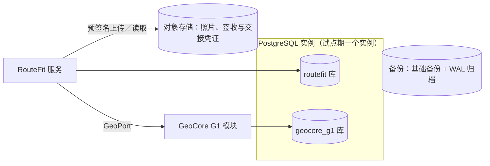
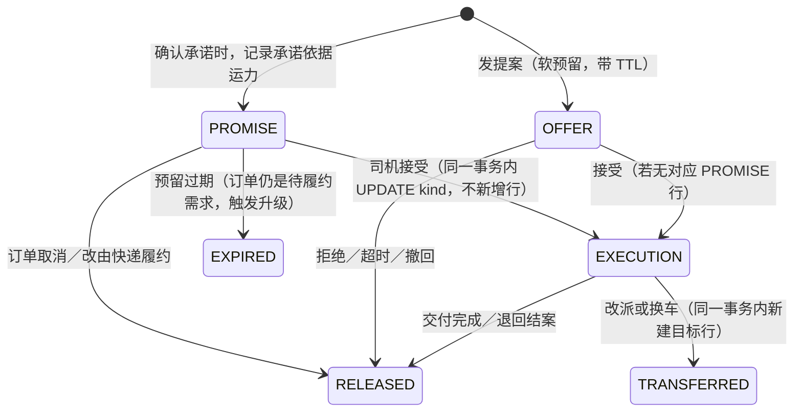
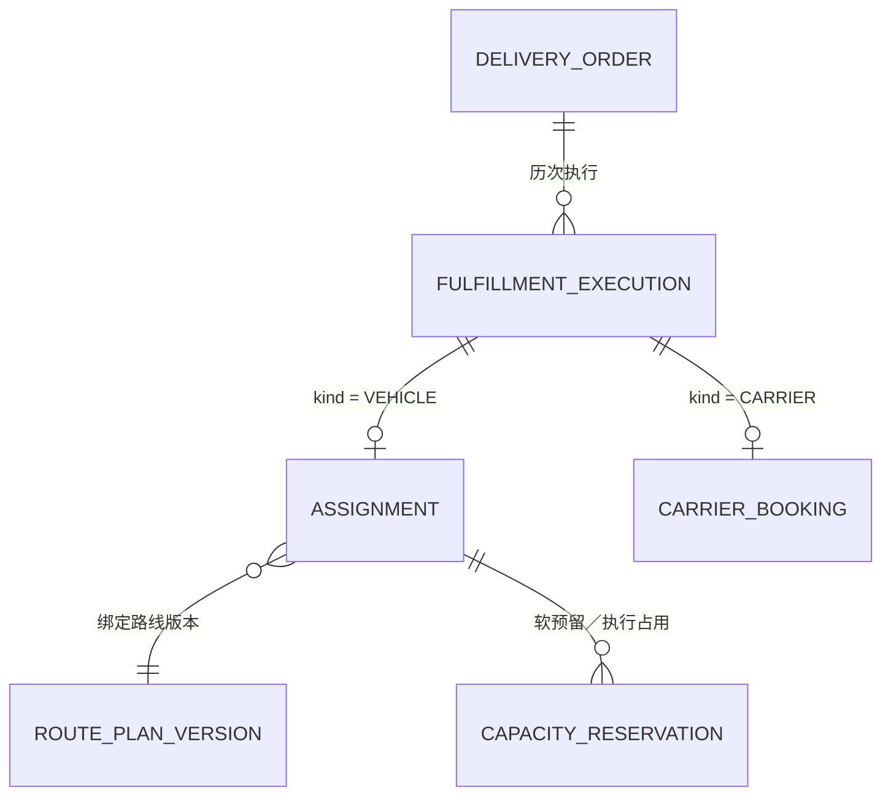

# DR RouteFit · 数据库架构设计

| 项目 | 内容 |
| --- | --- |
| 状态 | 草案，待人类集成负责人评审；数据库选型须经 ADR 确认（PRD D24） |
| 版本 | v0.1 · 2026-10-24 |
| 需求依据 | [PRD V1.4 评审稿](PRD-V1.4-review.md) 3.8、4、5、6、9、13、17、21；当前基线 [V1.3](PRD-V1.3-final.md) |
| 建表草案 | [`database/routefit-schema-draft.sql`](database/routefit-schema-draft.sql)、[`database/geocore-g1-schema-draft.sql`](database/geocore-g1-schema-draft.sql)（**尚未在数据库中执行验证**） |
| 相关文档 | [接口设计](api-design.md) · [开发标准](development-standards.md) · [系统边界](system-boundaries.md) · [术语表](glossary.md) · [首期页面](phase1-pages-and-ux.md) |

本文规定 RouteFit 与 Daen GeoCore G1 的数据如何存放、如何隔离、哪些规则由数据库约束兜底。实体职责以 PRD 13、21.7 为准；字段的最终形态以 R0-B 冻结的机器契约为准，本文的表结构随契约调整。与 PRD 冲突时以 PRD 为准。

---

## 1. 设计目标

1. **业务规则有数据库兜底。**并发下最容易出错的规则（重复派单、同车时段冲突、重复核销、重复事件），除了应用校验，还由约束保证（第 6 章）。
2. **未知不补零。**缺失值用 `NULL` 加原因，不用 0 或默认值冒充（PRD 17）。
3. **历史不可改写。**承诺、路线版本、外部事件、财务记录、审计都只追加；更正用新记录（PRD 3.6、9.3）。
4. **企业作用域强制隔离。**跨企业引用在数据库层面不可能发生（第 5 章）。
5. **边界清晰。**RouteFit 与 GeoCore G1 分库，不共享表，不跨库查询（[系统边界](system-boundaries.md) 第 4 章）。
6. **首期简单。**试点规模小（3–5 辆车），不引入分库分表、消息中间件或多副本写入。

---

## 2. 选型建议

**建议：PostgreSQL 16 及以上 + PostGIS 3.4 及以上。**正式选定须写入 ADR（PRD D24、[开发标准](development-standards.md) 第 11 章）。

| 需要 | PostgreSQL 的对应能力 | 关联规则 |
| --- | --- | --- |
| 同一车辆时段不被重复占用 | 排他约束（`EXCLUDE USING gist`，配合 `btree_gist`） | PRD 3.8、AT-72 |
| 同一订单只有一个有效执行 | 部分唯一索引 | RULE-041、AT-10、AT-68 |
| 短事务复验与容量原子性 | 行级锁、可串行化隔离 | PRD 7.1、RULE-012 |
| 原始外部事件、快照、策略 | `jsonb` | PRD 21.3.2、21.6 |
| 服务区、坐标、距离 | PostGIS `geography` | PRD 5、1.4 |
| 企业隔离的第二道防线 | 行级安全（RLS） | PRD 17、AT-14 |
| 定位与审计的大表 | 声明式分区，按分区删除到期数据 | PRD D11 |

**许可证：**PostgreSQL 使用 PostgreSQL License，PostGIS 使用 GPL-2.0 及以上（作为独立数据库扩展运行，不随 RouteFit 代码分发）。采用前在 ADR 中由人类集成负责人确认。

**替代方案：**

| 方案 | 不作首选的原因 |
| --- | --- |
| MySQL | 无排他约束，同车时段冲突只能靠应用锁；部分唯一索引需变通 |
| 文档数据库 | 难以表达跨对象的强一致约束（预留、执行、核销） |
| 沿用候选框架自带数据库 | 若 POC 后采用 Fleetbase 等框架（PRD 附录 G），其数据库与本设计的关系须另写 ADR；不得把同一业务真值拆在两个数据库里各改各的 |

---

## 3. 总体拓扑

| 存储 | 内容 | 访问者 |
| --- | --- | --- |
| `routefit` 库 | 订单、承诺、运力、调度、快递委托、交接、异常、退回、财务、审计、集成 | 只有 RouteFit 服务 |
| `geocore_g1` 库 | 地址库、入口、位置观测、路线调用记录、经授权的缓存 | 只有 GeoCore G1 模块 |
| 对象存储 | 照片、签收、交接、付款凭证文件 | 服务端签发短期链接；数据库只存对象键和哈希 |

- 两个库使用不同的数据库账号，**不建立跨库外键、不用 dblink／FDW 跨库查询**。RouteFit 只通过 GeoPort 取地理数据，并把订单用到的位置存为快照（PRD 5.3）。
- 智序工场中控台、既有 `E:/Daen_GeoCore`、VirtualAiOffice 都**不直连**这两个库（PRD 21.6）。
- 文件不存进数据库；数据库保存 `object_key`、`sha256`、`content_type`、`size_bytes`、上传人和时间。

### 3.1 环境

| 环境 | 数据 | 规则 |
| --- | --- | --- |
| 开发、CI | 只有合成数据，含两个合成公司 | CI 每次新建临时库，跑完即删 |
| 预发 | 合成数据 | 与生产同版本迁移 |
| 演示（demo） | 合成数据 | **独立环境**；中控台的 demo 模块从这里取数（PRD 21.6） |
| 生产 | 真实数据 | 不放 demo 数据；不复制到其他环境（PRD 17） |

演示数据放在独立环境，比在生产库加 `mode` 字段过滤更可靠：生产汇总不可能误算演示数据（AT-15）。影子推荐使用真实输入，所以 `recommendation_log` 在生产库，但与业务表隔离（第 4 章 `reco` 域）。

---

## 4. 分域（schema）

`routefit` 库按业务域划分 schema；一个域的表只由该域的应用模块写入。

| Schema | 主要表 | 首期阶段 |
| --- | --- | --- |
| `org` | `company`、`principal`、`role_grant` | R1 |
| `party` | `customer`、`customer_contact`、`carrier_partner`、`partner_agreement` | R1／R1-M |
| `fleet` | `vehicle`、`vehicle_spec_version`、`driver`、`driver_qualification`、`shift`、`capacity_availability` | R1／R1-M |
| `cargo` | `cargo_template`、`cargo_template_version`、`load_pattern`、`load_pattern_vehicle` | R1 |
| `orders` | `delivery_order`、`order_item`、`order_location`、`quote`、`service_promise`、`eta_estimate`、`service_area` | R1 |
| `dispatch` | `fulfillment_execution`、`route_plan`、`route_plan_version`、`route_stop`、`stop_event`、`assignment`、`capacity_reservation`、`load_review`、`return_task`、`route_opportunity` | R1（`route_opportunity` 属 R3-C） |
| `carrier` | `carrier_booking`、`booking_contact_log`、`carrier_tracking_event` | R1-M |
| `custody` | `custody_transfer`、`custody_transfer_item`、`delivery_proof`、`evidence_file` | R1 |
| `finance` | `collection_record`、`collection_verification`、`remittance`、`partner_payable`、`payable_payment` | R1（条件启用）／R1-M |
| `ops` | `dispatch_exception`、`degradation_record`、`pause_record`、`pause_approval`、`pilot_policy_version`、`feature_flag`、`notification_message`、`tracking_link` | R1 |
| `reco` | `recommendation_log`、`trip_economics` | R2（`trip_economics` R1 起记录） |
| `integration` | `idempotency_record`、`outbox_event`、`inbox_event`、`ops_snapshot`、`scene_binding` | R1／R1-V |
| `audit` | `audit_event`（按月分区） | R1 |

`geocore_g1` 库：

| Schema | 主要表 |
| --- | --- |
| `geo` | `address_record`、`access_point`、`address_correction_candidate` |
| `loc` | `collection_window`、`location_observation`（按日分区） |
| `route` | `provider_call_log`、`travel_time_cache`（默认关闭） |

### 4.1 PRD 实体对照

| PRD 实体（13.1、21.7） | 表 | 说明 |
| --- | --- | --- |
| CompanyScope | `org.company` | |
| Customer | `party.customer` + `party.customer_contact` | 联系方式单独成表，便于限权与脱敏 |
| Vehicle／Driver | `fleet.vehicle`、`fleet.vehicle_spec_version`、`fleet.driver` | 车厢实测尺寸按版本保存，装载复核引用版本 |
| CargoTemplate／LoadPattern／CargoItem | `cargo.*`、`orders.order_item` | |
| AddressRecord | `geocore_g1.geo.address_record` | 订单只存 `orders.order_location` 快照 |
| DeliveryOrder | `orders.delivery_order` | 订单总览 |
| ServicePromise／ETAEstimate | `orders.service_promise`、`orders.eta_estimate` | 承诺按版本只追加 |
| RoutePlan／RouteStop | `dispatch.route_plan`、`route_plan_version`、`route_stop` | 每次改动生成新版本 |
| DispatchOffer／（指派） | `dispatch.assignment` | 提案就是指派的 `offered` 阶段，不单独建表，避免两套状态 |
| CapacityReservation | `dispatch.capacity_reservation` | |
| DeliveryProof | `custody.delivery_proof` + `custody.evidence_file` | |
| ReturnTask | `dispatch.return_task` | 与返程订单分开 |
| CollectionRecord／RemittanceRecord | `finance.collection_record`、`finance.remittance` | |
| AuditEvent | `audit.audit_event` | |
| VehicleLoad／LoadReview | `dispatch.load_review`（含车辆规格版本、货物清单版本） | |
| DispatchException | `ops.dispatch_exception` | |
| RecommendationLog／TripEconomics | `reco.*` | |
| DispatchPolicy | `ops.pilot_policy_version`、`ops.feature_flag` | |
| LocationObservation | `geocore_g1.loc.location_observation` | |
| CarrierPartner／PartnerAgreement | `party.carrier_partner`、`party.partner_agreement` | |
| CapacityAvailability | `fleet.capacity_availability` | |
| CarrierBooking／CarrierTrackingEvent | `carrier.carrier_booking`、`carrier.carrier_tracking_event` | |
| CustodyTransfer | `custody.custody_transfer` + `custody_transfer_item` | 件级 |
| PartnerPayable | `finance.partner_payable` + `payable_payment` | |
| RouteOpportunity | `dispatch.route_opportunity` | R3-C |
| IntegrationProjection／SceneBinding | `integration.ops_snapshot`、`integration.scene_binding` | R1-V |

---

## 5. 全局约定

### 5.1 主键与编号

- 主键 `id uuid`，由应用生成 UUIDv7（按时间有序，索引友好，不可推测业务含义）。
- 面向人的编号单独存：`order_no`（如 `RF-20261024-0042`），按企业与日期生成，**唯一但不作外键**。
- 外部编号（快递单号、银行交易号）存原值，并按来源建唯一约束。

### 5.2 企业作用域

- `routefit` 库的业务表都有 `company_id uuid NOT NULL`。
- 每张业务表建 `UNIQUE (company_id, id)`；引用其他业务表时使用**复合外键** `(company_id, x_id) → (company_id, id)`。这样数据库层面无法把 A 公司的订单指派给 B 公司的车辆（AT-14）。
- 启用行级安全作为第二道防线：应用在每个事务开始时执行 `SET LOCAL app.company_id = '<uuid>'`，策略只返回该企业的行。应用账号不是表的所有者，因此受 RLS 约束。
- 运营主体 `operating_company_id` 即 `company_id`；合作方 `carrier_partner_id` 是独立字段，不合并（PRD 21.3）。

### 5.3 字段类型

| 类别 | 规则 |
| --- | --- |
| 时间 | `timestamptz`；数据库时区 UTC；按金边日期统计时显式存 `business_date date`（`Asia/Phnom_Penh`） |
| 时间窗 | `tstzrange`，下界包含、上界不包含（`[)`） |
| 设备上报 | 同时存 `observed_at`（设备）和 `received_at`（服务端） |
| 金额 | `amount_minor bigint` + `currency char(3)`，`CHECK (currency IN ('USD','KHR'))`；**禁止 `float`／`real`** |
| 重量、尺寸、体积 | `numeric`，列名带单位：`weight_kg numeric(10,3)`、`length_cm numeric(8,1)`、`volume_m3 numeric(10,4)` |
| 未知 | 值为 `NULL` 时，同时填写 `*_unknown_reason`；关键字段用 `CHECK` 保证二者至少有一个 |
| 来源 | `*_source text`，取值如 `WAREHOUSE_MEASURED`、`VERIFIED_TEMPLATE`、`CUSTOMER_ESTIMATE`（PRD 4.2） |
| 状态 | `text` + `CHECK` 列举合法值；不用 PostgreSQL `ENUM` 类型（增删值需要迁移锁表，且难以撤回） |
| 坐标 | `geography(Point, 4326)`；同时存精度 `accuracy_m` 和来源 |
| 原始外部数据 | `jsonb`，并记录 `schema_version` 或 `mapping_version` |

### 5.4 通用列

| 列 | 用途 |
| --- | --- |
| `version integer NOT NULL DEFAULT 1` | 可变聚合的乐观并发；每次更新 +1，更新语句带 `WHERE version = $expected` |
| `created_at`、`created_by` | 创建时间与主体 |
| `updated_at`、`updated_by` | 可变表才有 |

### 5.5 删除与更正

- 业务表和财务表**不物理删除**：应用账号没有 `DELETE` 权限；"取消""作废"是状态。
- 只追加的表（承诺版本、路线版本、外部事件、交接、财务核验、审计）由触发器拒绝 `UPDATE` 和 `DELETE`。
- 财务更正：新增一条带 `reverses_id` 的冲正记录，原记录保留（PRD 9.3）。
- 个人信息到期删除（PRD D11）通过专门的数据保留任务执行，由所有者账号运行并写审计，不走应用账号。

---

## 6. 由数据库保证的关键规则

| 规则 | 约束 | 关联 |
| --- | --- | --- |
| 一个订单同一时刻只有一个有效执行（车辆指派与快递委托互斥） | `dispatch.fulfillment_execution` 上 `UNIQUE (company_id, order_id) WHERE status = 'ACTIVE'` | RULE-041、AT-10、AT-68 |
| 一个订单最多一条 offered／accepted 指派 | `dispatch.assignment` 上部分唯一索引 | PRD 6.3 |
| 同一车辆的独占预留时段不重叠（不同订单之间） | `dispatch.capacity_reservation` 上 `EXCLUDE USING gist (vehicle_id WITH =, during WITH &&, order_id WITH <>) WHERE (status = 'ACTIVE' AND sharing = 'EXCLUSIVE')` | PRD 3.8、AT-72 |
| 同一笔银行交易只能核销一次 | `finance.collection_verification` 上 `UNIQUE (company_id, channel, external_txn_id)` | AT-38 |
| 同一司机、同一营业日、同一币种只有一张交款单 | `finance.remittance` 唯一约束 | PRD 9.3、AT-40 |
| 外部事件不重复入账 | `carrier.carrier_tracking_event` 上 `UNIQUE (company_id, carrier_partner_id, dedupe_key)` | PRD 21.3.2 |
| 写请求幂等 | `integration.idempotency_record` 主键 `(company_id, principal_id, idempotency_key)` + 请求摘要 | RULE-024、AT-71 |
| 承诺版本连续且只追加 | `orders.service_promise` 上 `UNIQUE (order_id, version)` + 只追加触发器 | PRD 3.6 |
| 金额不能被改写 | 财务表触发器拒绝修改金额列 | PRD 9.3 |
| 跨企业引用不可能 | 复合外键 + RLS | AT-14 |

### 6.1 容量预留的生命周期

- **承诺级预留转换为执行占用时更新同一行**，所以容量不会被重复扣减（PRD 3.8）。
- 同一订单的承诺预留与提案预留不互相冲突（排他约束带 `order_id WITH <>`）。
- **R3 合单共享车辆**时，预留标记为 `sharing = 'SHARED'`，不受排他约束；逐段重量、体积与时间窗由应用在 `SELECT … FROM fleet.vehicle WHERE id = $1 FOR UPDATE` 锁住车辆行后联合校验。独占与共享混用的冲突同样在这把锁下检查。
- 预留过期由定时任务把 `status` 改为 `EXPIRED`，同时为订单生成升级事件；订单本身不变（PRD 3.8）。

### 6.2 执行与互斥

- 发出提案或快递委托离开 `draft` 时，先插入一行 `fulfillment_execution`（`status = 'ACTIVE'`）；部分唯一索引保证同一订单不会同时有两个有效执行。
- 指派被拒绝、过期、撤回、被替代或完成，委托被确认取消或核验送达时，执行行变为 `ENDED`。
- 改派、换车或换承运商：在同一事务中结束旧执行、创建新执行；已交接的货物还须先有交接记录（PRD 21.3.1）。

---

## 7. 主要表结构

完整定义见建表草案；这里列出各表的关键列与约束。`company_id`、`version`、时间戳等通用列从略。

### 7.1 订单域 `orders`

**`delivery_order`**

| 列 | 说明 |
| --- | --- |
| `order_no` | 面向人的编号，企业内唯一 |
| `customer_id` | 复合外键 |
| `service_level` | `S1`…`S4` |
| `status` | `draft`／`validating`／`quoted`／`awaiting_dispatch`／`executing`／`delivered`／`cancelled`／`return_open`／`returned`／`closed_exception`（PRD 6.1） |
| `fulfillment_stage` | `pickup_pending`／`picked_up`／`in_transit`／`delivery_recorded`；只在 `executing` 时有值 |
| `fulfillment_mode` | `OWN_FLEET`／`PARTNER_VEHICLE`／`PARCEL_CARRIER`；历史数据未知时为 `NULL` 并进入人工核验，不默认自营（PRD 21.7） |
| `requested_window` | 客户期望时间（`tstzrange`） |
| `current_promise_id` | 指向当前有效承诺版本 |
| `collection_policy` | 收款策略（现金、COD、月结等，按启用情况） |
| `s4_fallback` | S4 未拼成预案（启用 S4 时必填） |

**`order_item`**：逐件货物。`template_version_id`、`length_cm`／`width_cm`／`height_cm`／`weight_kg` 及各自的 `*_source`、`*_unknown_reason`、`measured_at`、`measured_by`、`stackable`、`orientation_rule`。件级标识 `item_label` 用于交接与部分收货（PRD 6.4）。

**`order_location`**：订单确认的取送位置快照。`role`（`PICKUP`／`DROPOFF`／`RETURN_DEST`）、原始地址文字、地标、入口说明、`location geography`、`location_source`、`confirmed_by`、`confirmed_at`、`geocore_address_ref`（可空）、`geocore_address_version`（可空）、`provider_terms_ref`（该坐标的留存依据）。地址库后续更正**不改这里**（AT-47、AT-63）。

**`quote`**：报价版本，含明细 `jsonb`、合计金额（按币种）、有效期、客户确认凭证。报价不等于承诺（RULE-037）。

**`service_promise`**：只追加。`version`、`pickup_window`、`delivery_latest_at`、`promise_accepted_at`（S1 时钟起点，不可重置）、`basis`（`CALIBRATED_P90`／`MANUAL_POLICY`）、`buffer_minutes`、`customer_consent_ref`、`supersedes_id`、`resource_basis`（承诺依据运力）。

**`eta_estimate`**：只追加。`checkpoint`（取件／交付）、`estimate_type`（`P90`／`POINT`／`MANUAL`／`UNCALIBRATED`）、`eta_at`、`computed_at`、`source`、`data_version`、`quality`。

**`service_area`**：批准的服务区多边形（`geography(MultiPolygon, 4326)`）与版本；由 RouteFit 策略校验（PRD 5.2 `checkZones`）。

### 7.2 运力域 `fleet` 与合作方 `party`

| 表 | 关键列 |
| --- | --- |
| `vehicle` | `ownership`（`OWN_FLEET`／`PARTNER_VEHICLE`）、`carrier_partner_id`（合作车必填）、车牌、`status`、`current_spec_version_id` |
| `vehicle_spec_version` | 只追加；车厢内长宽高、门洞宽高、有效载重、轮拱与固定空间、测量人与时间 |
| `driver` | `carrier_partner_id`（合作司机）、`principal_id`、允许车型、`status` |
| `driver_qualification` | 资格类型、有效期、核验状态与核验人；证件文件放受控存储，不进公开仓库 |
| `shift` | 司机班次 `tstzrange`，定位采集授权以此为准 |
| `capacity_availability` | 合作车辆／司机已确认的可用窗口、来源、到期时间、`external_commitment_unknown boolean`（PRD 21.3） |
| `carrier_partner` | `partner_type`（`VEHICLE_OPERATOR`／`PARCEL_CARRIER`）、`status`（申请／待核验／可用／暂停／到期／退出）、服务能力 `jsonb` |
| `partner_agreement` | 协议版本、有效期、费率、结算周期、责任与异常联系人、数据授权范围 |

只有 `status = 可用` 且协议在有效期内的合作方才能进入候选；该判断在应用层实现，并在创建提案的事务中复验。

### 7.3 调度域 `dispatch`

| 表 | 关键列与约束 |
| --- | --- |
| `fulfillment_execution` | `order_id`、`kind`（`VEHICLE`／`CARRIER`）、`status`（`ACTIVE`／`ENDED`）、`end_reason`；有效执行唯一 |
| `route_plan` | `vehicle_id`、`driver_id`、`status`（PRD 6.1）、`current_version` |
| `route_plan_version` | 只追加；`plan_id`、`version`、计算依据、`created_by` |
| `route_stop` | 只追加；`plan_version_id`、`stop_key`（跨版本稳定）、`seq`、`stop_type`、`order_id`、`order_location_id`、`time_window`、`planned_at`、`load_after_kg`、`load_after_m3`。新版本必须原样保留已完成站点（应用校验 + 测试，RULE-038） |
| `stop_event` | 只追加；到达、完成、跳过，含 `observed_at`／`received_at` 与是否降级记录 |
| `assignment` | `execution_id`、`driver_id`、`vehicle_id`、`plan_version_id`、`policy_version`、`expires_at`（提案 TTL）、`status`（`offered`／`accepted`／`completed`／`expired`／`rejected`／`revoked`／`superseded`）、`accepted_at`。PRD 的 DispatchOffer 即 `offered` 阶段 |
| `capacity_reservation` | `vehicle_id`、`order_id`、`assignment_id`、`kind`（`PROMISE`／`OFFER`／`EXECUTION`）、`sharing`（`EXCLUSIVE`／`SHARED`）、`during tstzrange`、`weight_kg`、`volume_m3`、`status`、`release_reason`；排他约束见第 6 章 |
| `load_review` | `vehicle_spec_version_id`、`items_digest`（货物清单版本摘要）、`plan_version_id`、`result`（`VERIFIED_PATTERN_PASS`／`MANUAL_LOAD_REVIEW`／`MANUAL_RELEASED`／`REJECTED`）、`reviewer_id`、证据、`invalidated_at`、`invalidated_reason`（PRD 4.7） |
| `return_task` | `order_id`、`reason_code`、`destination`、`status`（PRD 6.1）、费用承担、保管责任 |
| `route_opportunity` | R3-C：起点、预定终点、最早接货、最晚回场、走廊、剩余容量、`valid_until`、来源 |

`REJECTED` 的装载复核没有覆盖入口：数据库层面，`assignment` 进入取货阶段的应用检查要求存在未失效的 `VERIFIED_PATTERN_PASS` 或 `MANUAL_RELEASED`。

### 7.4 快递域 `carrier`（R1-M）

| 表 | 关键列 |
| --- | --- |
| `carrier_booking` | `execution_id`、`carrier_partner_id`、`service_product`、`external_booking_no`、`request_idempotency_key`、报价、`status`（`draft`→…→`delivery_verified`，取消为 `cancel_requested`→`cancellation_confirmed`，PRD 21.3.1）、揽收窗口 |
| `booking_contact_log` | 人工委托的每次联系：渠道、联系人、时间、结果（含"未知"）、下次跟进责任人、证据 |
| `carrier_tracking_event` | 只追加；`provider_event_id`、`dedupe_key`、`occurred_at`、`received_at`、`raw_status`、`raw_payload jsonb`（最小必要、已脱敏）、`mapped_status`、`mapping_version`、`entered_by`（人工录入时） |

`external_booking_no` 在同一承运商内唯一（非空时）。

### 7.5 交接域 `custody`

| 表 | 关键列 |
| --- | --- |
| `custody_transfer` | 只追加；`order_id`、`from_party`、`to_party`（仓库、司机、承运商、收货人）、地点、时间、`status`（`proposed`／`confirmed`／`discrepancy`） |
| `custody_transfer_item` | 每件货的标识、数量、包装／封签状态、差异说明 |
| `delivery_proof` | 交付凭证类型、引用的文件、件级实收 |
| `evidence_file` | `object_key`、`sha256`、`content_type`、`size_bytes`、`captured_at`、`uploaded_by`；不存文件内容 |

货物当前保管方由最近一次已确认的交接推导，并在订单读模型中缓存。

### 7.6 财务域 `finance`

| 表 | 关键列与约束 |
| --- | --- |
| `collection_record` | `order_id`、`charge_type`（`FREIGHT`／`COD`）、`beneficiary`、`method`（`CASH`／`KHQR`／`MONTHLY_ACCOUNT`）、`currency`、`due_minor`、`reported_minor`、`status`（`due`／`reported`／`verified`／`mismatch`／`voided_by_correction`）、`reverses_id` |
| `collection_verification` | 只追加；`collection_id`、`channel`、`external_txn_id`、核验金额与币种、核验人、依据文件；交易号唯一（AT-38） |
| `remittance` | `driver_id`、`business_date`、`currency`、应交、实交、`status`（`open`／`submitted`／`verified`／`discrepancy`／`reconciled`）；唯一 `(company_id, driver_id, business_date, currency)` |
| `partner_payable` | `execution_id`、`carrier_partner_id`、`agreement_version`、`currency`、应付、已核、已付、`status`（待核对／已核对／争议／部分付款／已付清）、`reverses_id` |
| `payable_payment` | 只追加；付款金额、日期、凭证 |

- 运费、COD、合作方应付三账分表，不能互相抵扣（PRD 9.4、21.5）。
- USD 与 KHR 金额永不相加；汇总按币种分组。
- 未启用的收款方式由应用依据 `ops.feature_flag` 拒绝，数据库不另设默认值。

### 7.7 运营域 `ops`

| 表 | 关键列 |
| --- | --- |
| `dispatch_exception` | `order_id`、`type`、`stage`、`blocking`、`blocked_actions`、`owner_id`、`due_at`、`custodian`、`status`、处置结果、证据 |
| `degradation_record` | 降级类型（PRD 6.5 四种）、开始、结束、原因、操作人；期间记录带 `degraded = true` |
| `pause_record` | 暂停的能力、触发问题、操作人、开始时间、`scope`（能力／全局） |
| `pause_approval` | 恢复批准；同一暂停须有运营负责人与人类集成负责人两条不同主体的批准才能恢复（PRD 15.1） |
| `pilot_policy_version` | PILOT-0 参数（`jsonb`）、版本、批准人、批准时间、状态 |
| `feature_flag` | 能力编码、开关、关联政策版本、修改人；读取失败按关闭处理 |
| `notification_message` | 模板编码与版本、语言、渠道、收件引用、发送结果、失败原因；"已发送"不等于"已确认"（首期页面 3.6） |
| `tracking_link` | 不透明随机引用的哈希值（不存明文）、订单、到期时间、撤销时间 |

### 7.8 推荐域 `reco` 与集成域 `integration`

| 表 | 关键列 |
| --- | --- |
| `reco.recommendation_log` | 决策前输入快照、建议版本、调度员决定、未采纳原因（采样）、实际结果；影子模式唯一写入的表（AT-43） |
| `reco.trip_economics` | 每趟运输收入与各项直接成本、`is_estimated` |
| `integration.idempotency_record` | `principal_id`、`idempotency_key`、`request_hash`、`response_status`、`response_body jsonb`、`expires_at` |
| `integration.outbox_event` | 领域事件信封（见[接口设计](api-design.md)第 9 章）、`published_at`、`attempts` |
| `integration.inbox_event` | 外部回调或导入的去重记录 |
| `integration.ops_snapshot` | `snapshot_id`、`sequence`、`generated_at`、`data_as_of`、`quality`、`metric_definitions_version`、`payload jsonb`；中控只读接口的数据来源 |
| `integration.scene_binding` | 真实仓库 ID 与场景分区（W1／W2／W3）的显式映射、版本、批准人 |

### 7.9 审计 `audit.audit_event`

按月分区。列：`occurred_at`、`company_id`、`principal_id`、`action`、`object_type`、`object_id`、`before_version`、`after_version`、`idempotency_key`、`request_id`、`degraded`、`detail jsonb`（不含凭据与个人信息原文）。应用账号只有 `INSERT` 权限，触发器拒绝修改和删除。

### 7.10 `geocore_g1` 库

| 表 | 关键列 |
| --- | --- |
| `geo.address_record` | `company_id`、原文、地标、`location geography`、来源、有效期、可通行车型、楼层与装卸条件、`version` |
| `geo.access_point` | 入口位置、入口照片引用、确认人与时间 |
| `geo.address_correction_candidate` | 司机回写或人工纠错的候选；偏移超过批准范围或精度不足时须人工确认（PRD 5） |
| `loc.collection_window` | RouteFit 下达的授权采集窗口（司机、班次、起止）；窗口外的点拒收 |
| `loc.location_observation` | 按日分区；`vehicle_ref`、`driver_ref`、`observed_at`、`received_at`、`location`、`accuracy_m`、`source`、设备与权限状态；`(driver_ref, client_point_id, observed_at)` 唯一（幂等） |
| `loc.latest_location` | 每个司机一行的最新位置，按观测时间只前进；补传的旧点不覆盖（AT-12） |
| `route.provider_call_log` | 供应商、请求摘要、耗时、结果、适配器版本 |
| `route.travel_time_cache` | **默认关闭**；只有获准的数据类别按来源、有效期、策略版本缓存；私有数据不跨企业命中（PRD 5.3） |

GeoCore G1 不保存订单、承诺或运单状态（[系统边界](system-boundaries.md) 第 3 章）。

---

## 8. 账号与权限

| 账号 | 所在库 | 权限 |
| --- | --- | --- |
| `routefit_owner` | routefit | 拥有全部对象；只用于迁移与数据保留任务 |
| `routefit_app` | routefit | 业务表 `SELECT`／`INSERT`／`UPDATE`；只追加表仅 `INSERT`；**无 `DELETE`、无 DDL**；受 RLS 约束 |
| `routefit_report` | routefit 只读副本（启用后） | 只能读不含个人信息的报表视图 |
| `geocore_owner`／`geocore_app` | geocore_g1 | 同上模式 |
| 备份账号 | 实例 | 复制与备份所需最小权限 |

- 应用不使用超级用户或表所有者账号连接。
- 连接凭据只在部署环境或密钥管理服务中（[开发标准](development-standards.md) 6.2）。
- 联系方式（`party.customer_contact`）、司机资格材料只在需要的接口中读取；报表视图不含这些列。

---

## 9. 索引

| 查询场景 | 索引 |
| --- | --- |
| 调度工作台按最晚安全派发时刻排序 | `orders.delivery_order (company_id, status, latest_safe_dispatch_at)` |
| 订单详情时间线 | 各事件表 `(company_id, order_id, occurred_at)` |
| 车辆时段冲突 | `capacity_reservation` 的 GiST 排他约束（自带索引） |
| 待揽收、超期未更新的委托 | `carrier.carrier_booking (company_id, status, last_event_at)` |
| 财务待核验 | `finance.collection_record (company_id, status, currency)` |
| 外部单号查找 | 各外部编号的唯一索引 |
| 服务区判断 | `orders.service_area` 的 GiST 空间索引 |
| 位置查询（G1） | `location_observation` 按日分区 + `(driver_ref, observed_at DESC)` 索引；最新位置另存小表 |

索引随实际查询计划调整；新增索引走迁移评审。

---

## 10. 数据量与分区

| 数据 | 试点估算（5 辆车、每天 12 小时） | 处理 |
| --- | --- | --- |
| 位置观测 | 每 15 秒一点，约 1.5 万行／天，约 550 万行／年 | 按日分区；到期按分区整体删除（D11） |
| 审计事件 | 每单数十条 | 按月分区 |
| 订单及相关表 | 每天数十到数百单 | 不分区 |
| 快递事件 | 每单十条以内 | 首期不分区 |

以上是规划假设（PRD 16），用于判断首期不需要分库分表；实际数据量在 R1 试点中测量后再评估。

---

## 11. 迁移规范

- 迁移工具随技术栈确定（[开发标准](development-standards.md) 第 13 章）；迁移文件纳入版本控制，由 `routefit_owner` 执行。
- 只向前迁移；已执行的迁移文件不修改。
- 破坏性变更用"扩展—迁移—收缩"三步：先加新列或新表并双写，再迁移数据，最后在下一个版本删除旧结构。
- 大表加索引使用 `CREATE INDEX CONCURRENTLY`；加 `NOT NULL` 先加 `CHECK … NOT VALID` 再验证。
- 状态取值变化（`CHECK` 列表）与契约版本同步修改。
- 种子数据只有合成数据。
- 每次迁移在 CI 的临时库中从零执行一遍，并跑契约与验收测试。

---

## 12. 备份、恢复与保留

- 生产启用持续 WAL 归档 + 每日基础备份，支持按时间点恢复。
- 对象存储开启版本保留，防止凭证文件被覆盖。
- 恢复点目标（RPO）与恢复时间目标（RTO）在 R1 生产前确定（PRD 17.1、D11）；R1 实车试点前至少完成一次完整恢复演练并记录。
- 保留期限：位置观测、照片、联系方式、审计分别设定（D11）；到期由数据保留任务处理并留审计，不做无限期默认保留。

---

## 13. 与需求的追踪

| 规则／案例 | 数据库机制 | 位置 |
| --- | --- | --- |
| AT-10、AT-68、RULE-041 | 有效执行唯一 | 6、7.3 |
| AT-72、PRD 3.8 | 排他约束 + 车辆行锁 | 6.1 |
| AT-14、AT-66 | 复合外键 + RLS | 5.2 |
| AT-38 | 银行交易号唯一 | 7.6 |
| AT-40 | 交款单唯一 + 幂等 | 7.6 |
| AT-71 | 幂等记录 | 7.8 |
| AT-47、AT-63 | 订单位置快照独立于地址库 | 7.1 |
| AT-12 | `observed_at`／`received_at` 分开 | 7.10 |
| AT-15 | 演示数据独立环境 | 3.1 |
| AT-43 | 影子只写 `recommendation_log` | 7.8 |
| PRD 9.3 | 冲正记录、金额不可改 | 5.5、7.6 |
| PRD 15.1 | 恢复双人批准 | 7.7 |

---

## 14. 待定事项

| 事项 | 关联 |
| --- | --- |
| 数据库选型 ADR（本文建议 PostgreSQL + PostGIS） | D24 |
| 迁移工具与 ORM | 开发标准第 13 章 |
| 数据保留期限、RPO／RTO | D11 |
| KHR 金额的最小单位 | 开发标准 4.3 |
| 地图供应商数据可留存的字段 | D10 |
| 建表草案在 PostgreSQL 中的执行验证 | 本机暂无可用数据库环境 |
